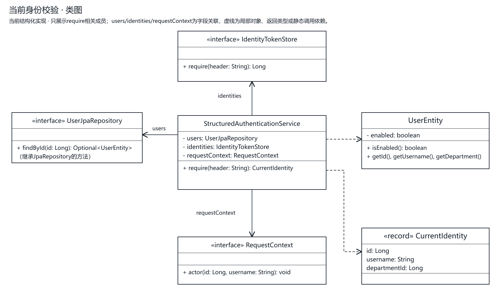
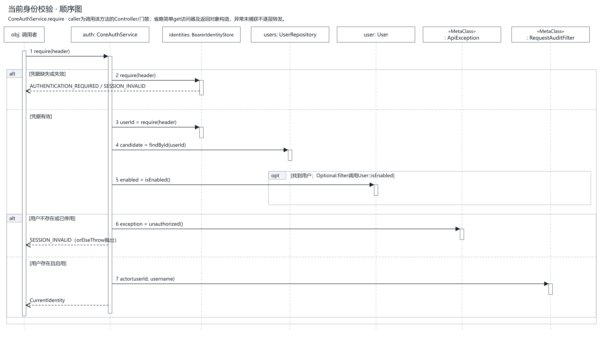

# 后端概要设计与双实现方案

版本1.2；依据[需求](requirements.md)、[领域](domain-model.md)、[数据库](database-design.md)及[API](api-contract.md)。章节职责参照老师[backend-design](https://gitee.com/mingqcn/course-project-mgt/blob/fde08d5dd417abc543145aff33ca8378deb9ca36/docs/backend-design.md)，内容使用本RBAC业务。本文设计目标不作为实现完成声明。

## 1. 设计目标与约束

单仓库、单后端应用，提供structured/ddd两种业务实现，共用HTTP/数据库契约、前端与初始化来源。两种实现应在身份、授权、范围、错误、持久化状态、回滚和并发下保持一致。Java21、Boot3.5.6、JPA、MySQL8.4、AOP及老师真实CloneFactory沿当前技术基线，不因参考老师新版本而升级框架。

本RBAC自己保存口令并认证，不照搬课程项目的外部统一身份。课程系统接入、Redis、语音、存储和其他示例集成不纳入当前设计实施。

## 2. 当前基线与总体架构

文档PR #29、结构化归类PR #30及原型PR #31已合入；阶段4正式前后端在PR #32待审。后端位于backend，业务实现归service.structured，部门及总览增量已包含在本分支。共享Controller只调用service.port，持久化、认证、请求、日志及Excel归入infrastructure，config/bootstrap负责装配和启动。DDD目录及策略选择尚未实现。

| 实际模块 | 当前责任 |
| --- | --- |
| api.auth/user/department/role/resource/audit及shared | 共享HTTP、DTO/VO、输入校验、CloneFactory映射及响应/错误适配 |
| service.port | 独立用例接口、Command/Query/Result与支撑抽象，无Entity/MVC/Spring依赖 |
| service.structured | 事务脚本、范围/有效授权/可授予/根锁/K及初始化；直接使用JPA仓储 |
| infrastructure.persistence.entity/repository | Entity/JpaRepository，保留表结构、关系与查询，不作为DDD聚合 |
| infrastructure.security/web/logging/excel | BCrypt与身份索引、MVC预检/过滤器、最小日志、游标与来源读取 |
| config / bootstrap | 扫描/数据源守卫/秘密装配，以及RbacApplication、ImportCommand、BootstrapAuthorizationCommand |

原com.municipal.rbac骨架已分别归入API、用例支撑与基础设施，不保留第二份旧业务链路。当前结构化代码与测试的详细命名及映射见[代码归类](code-organization.md)。

请求主链：身份及requestId过滤→操作预检→DTO校验/Controller→实际AOP门禁→结构化用例事务→JPA/MySQL。请求追踪通过RequestContext端口传递；认证/密码通过IdentityTokenStore和PasswordHashing隔离技术。预检不替代实际门禁及写锁后重验。

## 3. 当前分层与后续DDD位置

```text
com.municipal.rbaccore
├── api                       Controller、dto、vo、HTTP异常适配
├── service
│   ├── port                  公共用例接口、Command/Query/Result、共享错误
│   ├── common（后续按需要提取，当前无此包）
│   ├── structured            结构化事务脚本与辅助规则
│   └── ddd（后续设计，当前不存在）
│       ├── application       用例编排与事务
│       └── domain
│           ├── model         聚合/实体/有业务规则的值对象
│           ├── policy        授权、范围、可授予、完整K
│           └── repository    领域仓储端口
├── infrastructure            JPA Entity/Repository/Adapter、认证、日志、Excel
└── config                    装配、基础设施配置（策略选择待DDD阶段）
```

API只依赖service.port；DDD application只依赖领域模型、领域仓储和用例抽象，不引用JpaRepository、JPA Entity或EntityManager。领域不依赖MVC/JPA/基础设施。Infrastructure实现端口并映射持久化模型；Repository不返回可由Controller序列化的JPA图。当前结构化实现直接使用Infrastructure中的JPA仓储完成事务脚本，不转调DDD；DDD也不包装旧Service冒充第二套实现。

## 4. 双实现选择

拟用app.backend-strategy=structured|ddd，默认structured，错误配置启动失败。Spring条件装配同一用例接口的一个Bean；Controller不写策略if/else，不登记两组路由。此开关尚未编码，不能用于当前运行命令。

两种策略共用用例输入输出及HTTP错误语义，核心业务各自表达；认证索引、日志、文件读取和JPA基础设施可复用。共享service.common当前不存在，不提前创建隐藏业务边界的大Service。公共端口只表达协议及支撑抽象；部门类型枚举不执行层级策略，技术适配器不导入结构化服务或DDD应用服务。分别以隔离数据库运行同一契约测试，不能让两套测试并发修改同一数据集。

## 5. 公共用例与端口

以下按用例组说明职责；已抽取的实际接口名见代码归类。Command/Query/Result是内部用例模型，与HTTP DTO/VO分开。

| 用例端口组 | 输入/输出 | 关键约束 |
| --- | --- | --- |
| 认证与本人 | account/password或可信身份→身份及有效权限 | 双入口唯一、有效管理API准入、退出幂等 |
| 组织人员查询 | 可选部门/q/状态/page/size→可见树/分页 | 范围先于筛选与计数，不返回范围外父节点 |
| 人员管理 | userId及roleIds/停用/目标部门→最新结果 | 子集、本人/管理员限制、调动双范围、根锁/K |
| 角色与选权 | 角色查询/空权限新建/部分更新/整体选权 | 共同根与实际API、编码唯一、显式权限 |
| 资源与映射 | 目录读取/允许字段更新/完整apiIds | 同系统、树规则、映射OR、根锁/K |
| 最小日志 | 筛选/UTC范围/cursor/limit→快照分页 | 日志API+共同根、每批重验、脱敏 |
| 初始化 | 原件、秘密、来源、预检清单→来源/回执 | 新项目、只读预览、重复不重置 |

日志存储、身份索引、Excel读取等由小型端口隔离；有真实外部HTTP需求才引入@HttpExchange客户端，业务层不得拼HTTP请求。当前不预建未确认外部系统客户端。

## 6. 结构化实现方案

按人员、角色、资源、认证、日志、初始化划分用例服务，Service负责业务判断和事务，Repository负责明确查询/持久化。候选Permission子集、范围过滤、total和分页在数据库完成，不先全量加载再截页。纯规则可提取有明确输入的辅助对象，不把角色名硬编码成权限判断。

当前分支已拆分用例输入输出、迁移JPA/认证/日志等技术支撑，并按需求归类测试；阶段2修复copyNotNull、API输入清洗/ID和日志判定职责；阶段4新增部门/总览接口与初始SQL字段，当前29操作及12表字典以OpenAPI/正式SQL为准。实际验证随阶段记录更新。所有类和关键方法写中文Javadoc，明确类型，不用var，不写压缩单行类或字面量换行。

## 7. DDD实现方案

User、Role、Permission、ApiResource采用[领域模型](domain-model.md)提出的聚合边界，以标识引用其他聚合。领域行为封装状态改变和自身规则；跨对象授权、树和完整维护者规则由领域策略接收一致事实判断。Department拟作为独立聚合实现类型约束、合法下级新增、改名和删除空节点；ApplicationSystem目前只读，不增加通用CRUD。

应用服务编排锁、仓储、领域行为和事务，不直接set持久化实体。JPA适配器负责领域对象装配/持久化和约束错误翻译；领域常量归口对应领域对象，application/domain不依赖结构化或service.common状态字符串。无需事件总线或最终一致性来替代根锁下的本地事务。

## 8. 纵向切片设计

首个DDD切片宜选人员角色分配，覆盖API、用例、领域与仓储真实闭环：

1. API校验目标id和唯一roleIds，转Command；操作者只来自可信身份。
2. 应用服务开启事务、取得可信根锁，重读操作者有效API、归属及目标。
3. 范围策略检查目标、自身/完整管理员限制；角色候选规则检查全部有效Permission ID子集。
4. User行为整体替换roleIds，通过仓储保存，维护者策略验证同一根用户完整K仍存在。
5. 成功提交并转Result/VO；未知关联、越界、最后管理员或数据库故障均回滚。

查询候选与保存分别重验，前端旧草稿不构成授权证据。其余切片依次覆盖人员状态/调动、角色选权、资源与映射，再以同契约验证全量行为；以上为DDD目标职责；结构化对应切片已在阶段4实现，DDD尚未启动。

## 9. 事务与并发

| 场景 | 事务与保护 |
| --- | --- |
| 普通查询 | Service只读事务，数据库范围/筛选/计数/分页 |
| 相关管理写 | 同一Service事务、同一可信根悲观锁、锁后身份/API/范围重验、写后K |
| 多表整体替换 | 关联删除与新增及状态共同提交；拒绝/故障恢复全部原值 |
| 初始化 | 资料导入与首次授权各自整批事务；预览只读；回执与授权同时提交 |
| 最小日志记录 | 独立事务，失败不改变原允许/拒绝结论；日志查询失败安全报错 |

可信根来自来源映射和真实组织覆盖，不按名称或任意null父节点选锁。并发时不能两事务各把对方当保底维护者；锁后重验还须防止等待期间撤权/调离。普通保存不额外flush；仅必须在当前写边界捕获约束时用saveAndFlush，异常翻译后保持回滚。

## 10. API、安全与错误

OpenAPI定义29个操作（含部门及总览5个新增操作）；[业务约束](api-contract.md)解释实际API OR、同系统、范围、可授予子集和17项K。API门禁按服务端方法/模板，不依据固定权限code、角色名或客户端admin标识。本人查询与退出沿独立兼容契约。

账号唯一性和口令校验后还需管理端准入。Bearer索引保留在进程内，重启失效；每次管理请求重读最新状态/授权/部门，不把token内旧权限当真。用户停用后已有身份不能管理。统一{code,message,data,requestId}，401/403/404/409各按规范，500不泄露栈、SQL或输入。

最小鉴权日志记录允许/拒绝，技术日志统一AOP只记方法、耗时和异常类型。不得输出口令、token、Authorization、原始手机号登录输入、DTO/VO或完整响应。存储失败只记安全运维事件，禁止把原异常和敏感参数带出。

## 11. 测试方案

遵循行为RED→最小实现→回归；两策略共用用例/HTTP契约，分别真实MySQL验证状态、范围、事务回滚、根锁并发与数据库约束。领域单元测试覆盖自身规则，不能用mock数据库代替集成证据。

重点覆盖双入口/歧义、无管理准入、权限OR、外系统、子集陷阱、树循环、候选跨页、撤权/停用即时生效、共同根、K不能拼人及交叉写入口并发。DTO类型/未知字段/缺失id及每个稳定业务错误均需契约测试。当前T13仅为历史结构化基线，本次文档验证与未来双实现验收见[测试说明](testing-acceptance.md)。

## 12. 实施顺序

按[开发计划](development-plan.md)：文档审核→结构化归类和编码规范修复→新原型/API审核→正式前端→DDD→双实现总验收。各阶段独立分支与验证；本次不合并或推进下一阶段，T14/T15等老师要求。

## 13. 待评审的设计决策

已确认的业务口径不重复作为未决需求。用户本轮重点审核：目标包及端口划分、DDD聚合边界、根锁事实读取、完整前端交互、OpenAPI与现有契约一致性。当前类/接口名已在代码归类中列明；未来DDD实施前再细化领域仓储、策略装配及切片顺序。代码分支仍交用户审核，新原型未开始。

## 14. CloneFactory映射方案

采用老师spring-fundamentals的真实CloneFactory，版本0.0.1-SNAPSHOT并锁定源码提交237f49c52bdc72da30383571bb2f985ac54a514a。可复现安装唯一维护在[部署说明](../deploy/README.md#本机依赖安装)，不以ObjectMapper/BeanUtils替代。

DTO→Command、Result→VO、同名同类型toResult优先CloneFactory.copy；PATCH共同非空字段优先copyNotNull。当前Entity→Result由Entity端@CopyTo声明，使纯用例模型不反向依赖持久化类型；角色和API状态PATCH用Entity端@CopyNotNullFrom。派生字段、多来源、集合元素变化、时间类型转换及id/系统归属/授权等受保护字段必须排除并显式处理。

不能用copyNotNull表达parentId“缺省保留/显式null清父”的三态，应保留字段存在标记并显式调用业务行为；不能把Command整包复制进聚合绕过校验。修改注解后clean重编译并验证生成映射行为，不提交生成源码。

## 15. HTTP DTO与VO规范

api.<业务>.dto下的类以DTO结尾，api.<业务>.vo下的类以VO结尾；请求@Valid，长度、范围、枚举、唯一数组、时间先后和JSON类型在API边界。Service负责授权、范围、状态、树及跨对象一致性，不承担请求格式清洗。

缺省与null、整数安全范围、page/size和日志cursor/limit沿OpenAPI，不照搬老师pageSize。VO只包含契约允许字段，不返回Entity、口令哈希、手机号或导入原文。Controller负责映射，不承担查询/持久化；持久化约束错误在Adapter/Service写边界转稳定业务错误，Advice只统一HTTP响应。

## 16. 运行与部署设计

产品RbacApplication、离线ImportCommand和首次BootstrapAuthorizationCommand相互分离。显式rbac_core、ddl-auto=validate、sql.init.mode=never、旧初始化关闭；错库/测试profile组合失败关闭，不在启动时恢复旧表或重授角色。口令/数据库秘密通过环境或configtree提供。

当前本地构建/测试/初始化命令见[后端说明](../backend/README.md)。用户明确部署先不处理，后续增加服务器再确定方案；原Dockerfile/Stack及容器测试脚本保留旧配置，未适配backend目录，不作为当前发布入口。本地MySQL/JAR结果不代表云部署成功。结构变更涉及数据备份与迁移，不能仅回滚镜像；未来策略切换不创建第二套业务表。

## 17. 当前实现UML与边界

阶段4增加StructuredPersonnelAuthority和StructuredDepartmentService/StructuredOverviewService：固定角色级别、完整RBAC有效Permission子集、所有人员写的严格级别保护、部门增删改名与范围聚合共用事务/根锁。目录查询先限制范围，按部门聚合人数；人员角色摘要只批量加载当前页。部门type与deleted、有效同级名称唯一约束直接进入首次SQL，删除保留来源墓碑；重复导入按稳定编码和原父ID核对，不复原后续维护。新总览及部门操作不扩大原17项K，完整维护者另需有效基础级别5。正式系统不初始化18业务演示目录，课程系统暂不接入。

以下两图表达当前StructuredAuthenticationService.require的实际协作，已随本轮代码归类重新生成，不是DDD目标类图。省略无关访问器和构造，安全判断顺序不省略。



[类图SVG](design/current-auth-class.svg)



[顺序图SVG](design/current-auth-sequence.svg)。caller为调用方，未捕获异常直接回复caller，HTTP转换在图外；BusinessException.unauthorized的静态调用以MetaClass表示；RequestContext是普通端口对象，HttpRequestContext适配内部过滤器采集。脚本及UML skill适用边界见[图件说明](design/README.md)。本次保留图件，不生成虚构DDD实现图。
