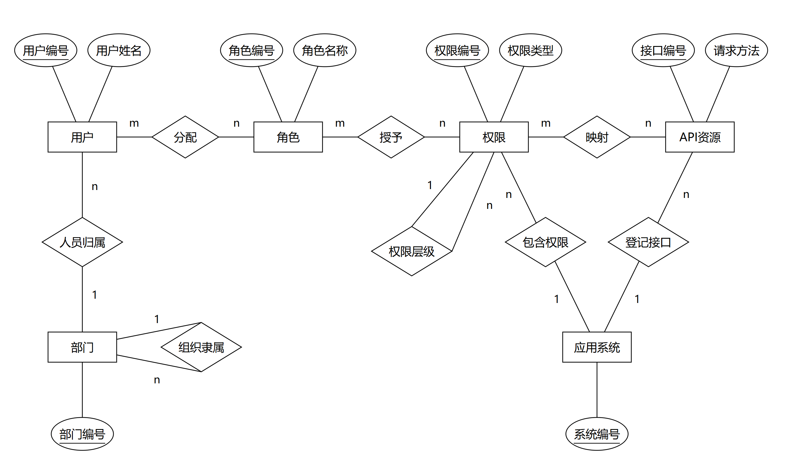

# 数据库概念与关系设计

版本：1.1评审稿。业务依据为[需求](requirements.md)和[领域模型](domain-model.md)。本次保留已评审核心ER关系，首次建库结构增加角色级别、组织类型和删除墓碑，不因DDD规划新增重复模型。

## 1. Chen ER概念模型

[可编辑SVG](database/chen-er-overview.svg)；[三段关系源码及既有评审](database/chen-er-source.md)。原图与源码保持不变。图中仅六个核心实体，账号认证支撑、日志、导入来源及回执不进入核心ER；全局管理员使用独立初始化User，具备有效基础级别5、可信根范围与实际维护权限，不单列实体。

| 联系 | 基数及参与约束 |
| --- | --- |
| User—Role | M:N，允许无角色用户、无用户角色 |
| Role—Permission | M:N，角色可暂时无权限 |
| Permission—ApiResource | M:N，多个权限可映射同一API；必须同系统 |
| Department—User | 1:N，每人一个非空部门 |
| Department—Department | 一个可空上级、多个下级；真实组织为单根无环连通树 |
| ApplicationSystem—Permission/ApiResource | 各1:N，每项只属一个系统 |
| Permission—Permission | 一个可空父节点；同系统、无环，BUTTON不得有子节点 |

## 2. 关系映射

六实体表为users、roles、permissions、departments、systems、api_resources；三组M:N分别落user_roles、role_permissions、permission_apis，共九张核心表。实体表使用BIGINT代理主键，关联表使用双外键联合主键。角色全局共享，不按部门复制角色定义。

工号username、可空phone、password_hash及岗位position作为users的现有属性保存，不增加employee_no、login_identifiers、独立公司、会话、管理员资格或直接用户权限表。

## 3. 存储约束与业务约束分工

数据库兜底主键、外键、编码唯一、双字段分别唯一与关联去重；树循环、跨用户工号/手机号碰撞、跨系统映射、完整K及人员范围由实际业务入口验证。不能宣称自引用外键已防环，也不能宣称工号/手机号两个独立唯一索引已防跨列歧义。登录匹配仍须对不同用户歧义失败关闭。

同一业务事务中的关联整体替换、状态变更及维护者检查共同提交；发生故障或冲突不留下部分更新。并发写共用导入来源核实的根部门行锁，取锁后重新鉴权，不以“先查后写”替代锁保护。

## 4. 双实现共用存储

目标structured与ddd共用同一逻辑表结构、初始化来源及迁移规则。DDD领域对象与JPA Entity分开，通过适配器装配；不复制ddd_users等第二套业务表。两种策略分别测试时使用隔离的相同结构数据库，不并行修改同一套测试数据。

部署选择显式rbac_core，应用ddl-auto=validate、sql.init.mode=never、旧初始化关闭；建表由部署步骤显式执行，不从应用启动恢复旧模型。既有SQL不承担自动升级未知旧库的职责，结构冲突先停止并核对备份/迁移。

完整字段、索引、运行支撑与初始化顺序见[物理模型](database/physical-model.md)及[部署说明](../deploy/README.md)。

## 5. 设计取舍与扩展限制

菜单/按钮树表达导航和显式选权，API独立表达方法/路径；多对多映射允许一个动作由多个有效权限覆盖。部门树只表达范围，不绑定角色定义。五角色是首次清单，不在数据库设计中固化为管理员类型。

启停仅改变有效性，不物理删除用户、角色及历史关联。本轮没有实体删除接口，外键不设置级联删除，避免共享授权及日志来源被误清理。完整K、真实根和子集校验由业务事务实现，不能伪称SQL单行约束已覆盖跨对象规则。

后续双实现沿同一概念/关系模型，领域聚合不与每张表一一对应。真正新增需求须先更新模型及评审，再新增版本化迁移；不修改已执行迁移，不借DDL自动更新旧业务库。
