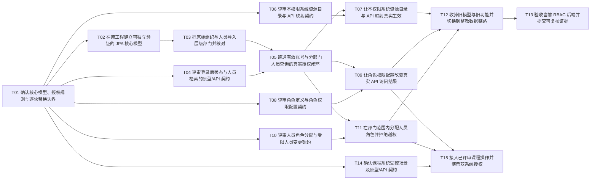

# RBAC 整改任务清单

15 张任务已发布：当前范围 13 张，课程后续 2 张；共 22 条原生 Blocked by。任务拆分已确认，模型与原型/API 契约仍按对应票评审，83 条验收标准保持未完成。

## 1. 依据与交付边界

执行依据是[原版执行计划](RBAC整改计划与Chen-ER图.md)，需求依据和技术纪要摘录见[检查记录复核说明](RBAC检查记录复核说明.md)。GitHub 负责认领、讨论和验收状态；本文是唯一完整任务清单，不再维护逐票 Markdown 镜像。

| 依据类别 | 本清单如何使用 |
| --- | --- |
| 检查纪要明确要求 | 用户—角色—权限及两组多对多；层级部门；管理权限由角色决定；菜单/按钮与 API 关联；先原型后 API 契约；分页/搜索；JPA、AOP 和清晰分层；下一阶段双系统 |
| 用户补充 | 有效账号通过既有身份校验可登录；无管理权限提示；管理请求按具体权限和部门范围限制；不增加管理员属性、独立登录资格或认证新功能 |
| 方案建议 | 九张表、全局共享角色、单部门归属、根部门全局维护、API 多对多、整体替换及分页默认值；须评审，不能当作老师原话 |
| 暂缓范围 | 正式前端开发；课程受控场景另行确认启动。原型仍须完成，不据此宣称界面验收 |

旧资料已归入 docs/legacy/，业务源码仍为旧实现；已有工程骨架、数据读取、分页/搜索和适用测试可复用，错误模型及直接 JDBC 实现须逐块替换。本轮未运行后端或数据库。

## 2. 拆分与协作规则

1. 以可演示或独立验证的闭环拆分。模型准备、数据导入和原型/API 评审是明确允许的前置例外，不把每层代码各拆成一张票。
2. Blocked by 只列直接且必要的前置票：前置完成后本票才可开始；传递依赖不重复列出。排期暂缓、共享代码冲突另列，不伪装成技术阻塞。
3. 正式接口票 T05/T07/T09/T11/T15 分别受 T04/T06/T08/T10/T14 的对应原型及契约评审约束。没有评审结论，不生成最终接口或扩大成整套 CRUD。
4. 后端切片覆盖请求、业务规则、JPA、验证及本切片说明；前端部分只引用已评审原型，正式页面开发暂缓。后端通过与界面验收分开记录。
5. 在原仓库逐块替换。先增加可验证的新模型，再迁移每个业务调用，最后由 T12 收掉旧实现；不新建替代工程，不先删除仍被其他切片使用的共享代码。
6. 每个写闭环自行交付其事务、越权和管理员保护验证，不能推到最终验收才补。共享规则与锁方式须协调一致。
7. 原库、Excel 和本地未跟踪的小组文档保留。跨票共享文件的改动由认领后的组员协调；本文件不指定任何人，也不打自动执行或可自动领取标签。
8. 新旧模型若无法在同一启动入口兼容，先在整改集成分支核对组合，不承诺每个中间状态整站可用；分票的独立验证仍须可复现，T13 才给当前后端集成结论。

## 3. 已发布任务与直接依赖

| 任务 | GitHub Issue | Blocked by |
| --- | --- | --- |
| T01 确认核心模型、授权规则与逐块替换边界 | [#2](https://github.com/minxuanbo/ooad-course-project/issues/2) | 无 |
| T02 在原工程建立可独立验证的 JPA 核心模型 | [#3](https://github.com/minxuanbo/ooad-course-project/issues/3) | [T01/#2](https://github.com/minxuanbo/ooad-course-project/issues/2) |
| T03 把原始组织与人员导入层级部门并核对 | [#4](https://github.com/minxuanbo/ooad-course-project/issues/4) | [T02/#3](https://github.com/minxuanbo/ooad-course-project/issues/3) |
| T04 评审登录后状态与人员检索的原型/API 契约 | [#5](https://github.com/minxuanbo/ooad-course-project/issues/5) | [T01/#2](https://github.com/minxuanbo/ooad-course-project/issues/2) |
| T05 跑通有效账号与分部门人员查询的真实授权闭环 | [#6](https://github.com/minxuanbo/ooad-course-project/issues/6) | [T03/#4](https://github.com/minxuanbo/ooad-course-project/issues/4)、[T04/#5](https://github.com/minxuanbo/ooad-course-project/issues/5) |
| T06 评审本权限系统资源目录与 API 映射契约 | [#7](https://github.com/minxuanbo/ooad-course-project/issues/7) | [T01/#2](https://github.com/minxuanbo/ooad-course-project/issues/2) |
| T07 让本权限系统资源目录与 API 映射真实生效 | [#8](https://github.com/minxuanbo/ooad-course-project/issues/8) | [T05/#6](https://github.com/minxuanbo/ooad-course-project/issues/6)、[T06/#7](https://github.com/minxuanbo/ooad-course-project/issues/7) |
| T08 评审角色定义与角色权限配置契约 | [#9](https://github.com/minxuanbo/ooad-course-project/issues/9) | [T01/#2](https://github.com/minxuanbo/ooad-course-project/issues/2) |
| T09 让角色权限配置改变真实 API 访问结果 | [#10](https://github.com/minxuanbo/ooad-course-project/issues/10) | [T05/#6](https://github.com/minxuanbo/ooad-course-project/issues/6)、[T08/#9](https://github.com/minxuanbo/ooad-course-project/issues/9) |
| T10 评审人员角色分配与受限人员变更契约 | [#11](https://github.com/minxuanbo/ooad-course-project/issues/11) | [T01/#2](https://github.com/minxuanbo/ooad-course-project/issues/2) |
| T11 在部门范围内分配人员角色并拒绝越权 | [#12](https://github.com/minxuanbo/ooad-course-project/issues/12) | [T05/#6](https://github.com/minxuanbo/ooad-course-project/issues/6)、[T10/#11](https://github.com/minxuanbo/ooad-course-project/issues/11) |
| T12 收掉旧模型与旧功能并切换到整改数据链路 | [#13](https://github.com/minxuanbo/ooad-course-project/issues/13) | [T07/#8](https://github.com/minxuanbo/ooad-course-project/issues/8)、[T09/#10](https://github.com/minxuanbo/ooad-course-project/issues/10)、[T11/#12](https://github.com/minxuanbo/ooad-course-project/issues/12) |
| T13 验收当前 RBAC 后端并提交可复核证据 | [#14](https://github.com/minxuanbo/ooad-course-project/issues/14) | [T12/#13](https://github.com/minxuanbo/ooad-course-project/issues/13) |
| T14 确认课程系统受控场景及原型/API 契约 | [#15](https://github.com/minxuanbo/ooad-course-project/issues/15) | [T01/#2](https://github.com/minxuanbo/ooad-course-project/issues/2) |
| T15 接入已评审课程操作并演示双系统授权 | [#16](https://github.com/minxuanbo/ooad-course-project/issues/16) | [T09/#10](https://github.com/minxuanbo/ooad-course-project/issues/10)、[T11/#12](https://github.com/minxuanbo/ooad-course-project/issues/12)、[T14/#15](https://github.com/minxuanbo/ooad-course-project/issues/15) |

## 4. 依赖图

箭头表示前置票阻塞后续票；后续范围的人工启动条件见 T14/T15，不由图自动触发。

## 5. 各票验收与共享模块

### T01 确认核心模型、授权规则与逐块替换边界

**类型：**评审前置。**状态：**拆分已确认，已发布，未认领。

**Blocked by:** 无（技术上可立即开始）。先明确需要保留和替换的规则，避免把旧模型继续带入新实现。

**交付行为：**小组获得一份已确认的核心模型、需求归属和迁移对照，能据此分别认领实现；本票以评审记录验收，不写正式接口。

**验收标准：**

- [ ] 逐项对照检查记录及原版执行计划，核对六个核心实体、三组多对多、部门与权限树；九张表、全局共享角色、单部门归属等明确标为方案建议。
- [ ] 确认有效账号可登录、无管理权限提示、管理请求同时校验具体权限和部门范围；不增加管理员属性、独立登录资格或认证新功能。
- [ ] 明确有效全局管理员的权限判定、根部门的范围作用，以及哪些变更会影响其有效性；禁止以角色名替代判定。
- [ ] 形成“复用、替换、删除”的业务对照：保留工程骨架、响应与异常处理、可用的数据读取和测试方法；替换错误组织/授权模型及直接 JDBC 业务实现。
- [ ] 列明旧会话与统一标识依赖的最小衔接方案、保留的基础登录字段，以及旧功能的调用方、初始化、测试、配置、文档清理范围；不在本票设计令牌格式或生命周期。
- [ ] 记录评审人、结论和未决项；涉及原版建议变更时先回写原版，相关下游票保持阻塞。

**共享模块及冲突：**模型与术语、初始化边界、当前身份、授权规则。与所有下游票共享；后续改变这些约定须先同步评审。

### T02 在原工程建立可独立验证的 JPA 核心模型

**类型：**必要模型准备。**状态：**拆分已确认，已发布，未认领。

**Blocked by:** T01。需要已确认的实体、关联和新旧数据边界；尚不需要正式接口契约。

**交付行为：**在原仓库的独立整改数据库中，用一组小样例通过 JPA 保存并读回“部门—人员—角色—权限—API”完整数据链，为业务切片提供共同基础。

**验收标准：**

- [ ] 复用现有 Java、Spring Boot、MySQL 与构建骨架，加入所需 JPA 支持；不新建替代项目，不一次性重写全部 Service。
- [ ] 按已确认模型建立实体及三组关联关系；联合唯一性、必要外键、系统归属和树约束有持久化或领域规则验证，不能只画图。
- [ ] 用小样例验证多角色、无角色、同 API 被多个权限引用、部门父子及权限父子；这些是测试数据，不是未经评审的正式 API 清单。
- [ ] 整改库与原库隔离，启动或测试不会让旧初始化器向新模型写入旧目录，也不会修改原库；保留 MySQL 驱动和必要工程依赖。
- [ ] 记录与原实现共存/集成的边界；旧调用尚未迁移时不提前删除其共享实现。没有新增正式 Controller 或产品页面。

**共享模块及冲突：**构建依赖、实体与关联、建库和启动初始化、测试数据入口。与 T03/T05/T07/T09/T11 的数据改动可能冲突，先稳定共同映射再各自迁移。

### T03 把原始组织与人员导入层级部门并核对

**类型：**数据闭环。**状态：**拆分已确认，已发布，未认领。

**Blocked by:** T02。导入必须写入已经验证的新部门与人员模型。

**交付行为：**在整改库中恢复公司、分公司、部门的层级，并让原始人员逐一对应正确部门，组员能独立复核数量、归属与异常。

**验收标准：**

- [ ] 公司并入层级部门；根无上级、每个部门最多一个上级，不接受循环、缺失父节点或不明确的人员归属。
- [ ] 按原始数据的实际数量核对约一万人及员工资料，保留已有工号等来源标识；不能凭空假定全部有效或丢弃无法对应的人员。
- [ ] 以明确规则转换账号有效状态并保留必要基础登录字段；不导入统一登录标识、数据库会话或新的凭证模型。
- [ ] 可追溯原组织/人员到新记录的对应；异常单独列出，禁止默默扩权或把旧业务目录一并导入。
- [ ] 重复执行不会重复建人、重复授予默认权限或覆盖已调整授权；失败可回滚或安全重试，原 Excel 与原库保持不变。
- [ ] 提供 MySQL/JPA 导入核对结果及小样本归属验证；尚未完成界面或人员接口验收。

**共享模块及冲突：**组织/人员实体、Excel 读取、数据初始化、状态映射和测试夹具。与 T02/T05/T11 的同类数据入口冲突；只迁移组织和人员，不接管角色资源导入。

### T04 评审登录后状态与人员检索的原型/API 契约

**类型：**原型与契约前置。**状态：**拆分已确认，已发布，未认领。

**Blocked by:** T01。需要稳定的身份、管理范围和用户模型；不必等待数据库导入完成。

**交付行为：**用可讨论的原型走通有效账号进入系统、无管理权限提示、按部门找人和分页搜索，并把每个场景转为已审核的接口契约。

**验收标准：**

- [ ] 原型展示有效账号可登录；无管理权限时显示提示，能查询本人身份/权限，不以管理权限决定登录资格。
- [ ] 覆盖本部门/下级导航、同级越界、搜索与筛选组合、分页总数、空结果、错误和无权状态；不能一次呈现全部人员。
- [ ] 明确每个场景的请求方法、路径、字段、响应、错误、分页约定、权限条件及部门范围，决定旧重复列表接口如何收敛。
- [ ] 区分匿名登录入口、仅需有效登录的本人查询和需要具体管理权限的人员查询；不扩展注册、找回密码等认证功能。
- [ ] 留存原型产物与逐项契约评审结论。仅完成设计评审，不代表正式前端已开发或界面已验收。

**共享模块及冲突：**人员导航、本人信息、分页与错误契约。与 T08/T10 的角色选择和授权入口需要交叉核对，但这些评审可以并行，不因此增加硬依赖。

### T05 跑通有效账号与分部门人员查询的真实授权闭环

**类型：**首个后端业务闭环。**状态：**拆分已确认，已发布，未认领。

**Blocked by:** T03、T04。同时需要可核对的组织人员数据和已批准的对应原型/API 契约；T02 由 T03 传递包含。

**交付行为：**有效账号通过既有身份校验后，能取得本人身份与权限；有人员查询权限的账号通过真实 HTTP 按部门分页找人，无权限或范围外请求被拒绝。

**验收标准：**

- [ ] 仅实现 T04 已审核的接口与 DTO；必要身份衔接读取新用户模型，保留有效性和口令校验，不再依赖将删除的统一标识/会话表；满足既定令牌运行前提但不新增认证功能或令牌选型。
- [ ] 本人查询不依赖管理权限；无管理权限的提示在已评审原型中可见，后端提供约定状态。本票不开发正式提示页面。
- [ ] 沿有效用户、角色、权限、API 的关联，由 AOP 检查实际方法与服务端路径模板；至少一条真实人员查询接口的放行/拒绝可以复现，不能用模拟鉴权接口代替。
- [ ] 部门范围在服务端约束；先限制可管理人员，再搜索、筛选、计数和分页。部门导航不暴露范围外组织，不能先全量读取再在前端裁剪。
- [ ] 验证无角色、父菜单单独授权、未登记受控接口、无管理权限、越界部门及无效账号等边界；父菜单和导航补出的祖先不产生子 API 授权。
- [ ] 通过小范围初始化为已核对人员配置必要角色/资源作为运行基线，不整包导入旧五类角色范围；提供真实 HTTP 与 JPA/MySQL 验证证据，并迁移本切片的旧 JDBC 调用、测试和文档。

**共享模块及冲突：**当前身份、统一接口入口、响应 DTO、AOP 授权、部门范围、分页与最小初始化。T07/T09/T11 将复用；首个闭环合入前协调这些共享接口，后续不要各自复制鉴权逻辑。

### T06 评审本权限系统资源目录与 API 映射契约

**类型：**原型与契约前置。**状态：**拆分已确认，已发布，未认领。

**Blocked by:** T01。需要核心资源模型与全局维护规则，不依赖人员查询接口完成。

**交付行为：**通过原型确认组员如何核对菜单/按钮树、系统归属和真实 API 映射，只为确有使用场景的操作制定契约。

**验收标准：**

- [ ] 原型能说明一个菜单/按钮对应哪些 API，以及同 API 被多个权限复用的含义；明确系统、方法和路径模板的展示。
- [ ] 逐项确认本轮实际需要的查询、映射保存和必要维护/停用操作；没有场景支持的实体全套 CRUD 不进入契约。
- [ ] 覆盖树循环、按钮有子节点、跨系统关联、重复关系、未授权修改和关键管理资源变更的拒绝反馈。
- [ ] 审核根部门成员还须拥有对应操作权限的条件，以及会影响最后有效管理员时的处理；不新增管理员字段。
- [ ] 仅选择本权限系统实际需要的目录；课程侧接口仍待后续场景确认。形成逐项评审记录，正式前端继续暂缓。

**共享模块及冲突：**资源术语、权限树、映射 DTO、全局维护与停用语义。与 T08 角色选权原型共享权限树表现，需协调但不强制串行。

### T07 让本权限系统资源目录与 API 映射真实生效

**类型：**后端业务闭环。**状态：**拆分已确认，已发布，未认领。

**Blocked by:** T05、T06。复用首个真实鉴权链路，并严格依赖资源配置对应契约评审。

**交付行为：**有对应管理权限的根部门账号能按已批准场景核对和维护资源映射，保存结果能被真实接口鉴权使用；非法关联和无权修改被拒绝。

**验收标准：**

- [ ] 仅实现 T06 确认的资源操作，通过 JPA 持久化，并可由真实 HTTP 读取保存结果；不自动补齐全套 CRUD。
- [ ] 权限及 API 各属单一系统，映射同系统；权限树禁止循环、按钮不能有子节点，唯一性与失败回滚有验证。
- [ ] 管理请求同时满足根部门和实际对应权限；普通根部门成员、无权限用户均不能修改。
- [ ] 同一 API 关联多个权限时任一有效授权可放行；停用或解除关联后的后续请求使用最新有效授权，不能依赖令牌过期。
- [ ] 对会使最后有效全局管理员失去必要维护能力的变更，事务内拒绝并验证并发路径；不能只防用户停用而漏掉本票的资源/映射变更。
- [ ] 资源来自已评审且实际存在的权限系统接口；清理本切片旧目录/模拟功能鉴权调用、初始化、测试、配置和说明，给出真实允许/拒绝证据。

**共享模块及冲突：**权限树、API 登记/映射、AOP 查询、初始化、事务与管理员保护。与 T09/T11 共享有效授权计算和保护检查，避免各自采用不同锁或判定。

### T08 评审角色定义与角色权限配置契约

**类型：**原型与契约前置。**状态：**拆分已确认，已发布，未认领。

**Blocked by:** T01。角色与权限模型是前置；不必等待资源维护页面或其接口完成。

**交付行为：**组员能在原型中理解角色所含权限、父菜单与子按钮的区别，确认必要角色维护和权限保存/撤销行为及对应接口。

**验收标准：**

- [ ] 覆盖角色查询、权限树已选状态、保存成功/失败、空选清空以及本轮需要的启用/停用；仅确认必要的角色定义维护，不扩展角色继承、版本或审批。
- [ ] 父菜单不自动授予子按钮；导航补祖先只影响展示，不改变所选权限。
- [ ] 明确全局共享角色、根部门且有对应权限才可修改等方案默认，并记录是否接受；不把这些写成老师逐项规定。
- [ ] 审核整体替换、错误回滚、停用后生效、最后有效管理员保护的契约；以实际权限判断管理员，不按角色名。
- [ ] 形成原型与逐项接口契约评审结论；没有正式前端开发或界面验收结论。

**共享模块及冲突：**角色/权限 DTO、权限树原型、停用与授权语义。与 T06 共享资源展示，与 T10 共享可分配角色的含义。

### T09 让角色权限配置改变真实 API 访问结果

**类型：**后端业务闭环。**状态：**拆分已确认，已发布，未认领。

**Blocked by:** T05、T08。需要通用的真实接口鉴权和相应契约；可使用已确认的初始化权限，不必等待 T07 的资源维护接口。

**交付行为：**具备权限的全局维护者给角色配置或撤销权限后，该角色用户在后续真实请求中立即得到相应允许/拒绝结果。

**验收标准：**

- [ ] 按 T08 契约用 JPA 处理必要角色定义、角色状态和角色权限配置；同一权限可用于多个角色，不另保留独立管理权限模型。
- [ ] 整体替换成功或回滚，空选为撤销；非法、不可用或跨越约定边界的数据被拒绝，原授权不变。
- [ ] 新增、撤销权限或停用角色后，已有登录身份的后续请求按最新授权判断；无角色及只授父菜单的结果正确。
- [ ] 修改要求实际对应权限与根部门条件，最后有效管理员保护覆盖角色权限/状态变更，事务和并发拒绝路径均有验证。
- [ ] 只迁移能明确对应的新角色及权限；旧角色名绑定范围规则不沿用，无法对应的旧授权不启用并列出差异。
- [ ] 迁移本切片的 JDBC、调用、初始化、测试、配置和说明；用已有受控 HTTP 场景证明授权变化，正式前端不在交付范围。

**共享模块及冲突：**角色、角色权限、有效授权查询、管理权限判定、事务与管理员保护。与 T07/T11 存在共享模块冲突；没有硬依赖不等于可以同时覆盖同一公共实现。

### T10 评审人员角色分配与受限人员变更契约

**类型：**原型与契约前置。**状态：**拆分已确认，已发布，未认领。

**Blocked by:** T01。需要人员归属、可授予角色及管理范围规则；原型可与人员检索和角色配置评审并行。

**交付行为：**在原型中走通选择范围内人员、查看当前角色与可分配角色、保存或清空，以及必要人员停用/归属变更的受限反馈。

**验收标准：**

- [ ] 覆盖本部门、下级、同级其他部门，以及无管理权限账号；界面提示不得替代后端权限约束。
- [ ] 审核可分配角色的范围、不能授予超出自身有效权限的角色、部门管理员不能改自己的授权/所属部门或全局管理员。
- [ ] 确认人员停用场景及接口；调部门仅在评审确认需要时纳入，并明确原部门和目标部门都在管理范围内。不默认新建人员/组织全套 CRUD。
- [ ] 明确角色整体替换、空选清空、失败回滚、最后有效管理员保护和错误反馈，形成逐项契约。
- [ ] 与 T04 的人员定位、T08 的角色含义交叉核对并记录结论；此项仅是原型/契约评审，正式前端仍暂缓。

**共享模块及冲突：**人员选择、部门范围、可分配角色、人员状态与授权 DTO。与 T04/T08 可并行评审，冲突在契约结论中解决，不以“同一页面”制造无关阻塞。

### T11 在部门范围内分配人员角色并拒绝越权

**类型：**后端业务闭环。**状态：**拆分已确认，已发布，未认领。

**Blocked by:** T05、T10。需要真实鉴权/人员范围和对应契约；可分配已确认的初始化角色，不必等待 T09 的角色编辑接口。

**交付行为：**有对应权限的部门管理者能为本部门及下级人员配置角色，保存后影响其真实 API 访问；超范围、自提权或非法人员变更被拒绝。

**验收标准：**

- [ ] 按 T10 契约用 JPA 查看当前角色、计算可分配角色并整体保存/撤销；写入全部成功或回滚。
- [ ] 逐请求校验具体操作权限及目标人员部门；同级其他部门拒绝，不信任前端提供的范围或角色候选列表。
- [ ] 不能授予超出自身有效权限的角色；部门管理员不能修改全局管理员，也不能改自己的授权或所属部门。已确认的调部门操作同时检查原、目标部门。
- [ ] 人员停用及角色分配/撤回影响后续真实请求；无管理权限仍不影响有效账号登录，不引入独立登录资格。
- [ ] 本票的撤权、人员状态/归属变更覆盖最后有效管理员保护；事务内检查与锁一致，并发不能造成管理员全部失效。
- [ ] 逐项迁移可明确对应的旧人员角色分配，旧独立范围不照搬；同步清理本切片 JDBC、调用、初始化、测试、配置和文档，提供真实 HTTP 防越权与授权变化证据。

**共享模块及冲突：**人员/角色关联、候选角色、部门范围、用户状态、授权失效与管理员保护。与 T03/T09 共享人员数据和权限计算，与 T07 共享保护路径，需要同步接口和锁约定。

### T12 收掉旧模型与旧功能并切换到整改数据链路

**类型：**逐块替换的最终收敛。**状态：**拆分已确认，已发布，未认领。

**Blocked by:** T07、T09、T11。这些现有业务路径完成迁移后，才能删除它们仍共享的旧授权、目录与数据实现；T05 和数据准备已传递包含。

**交付行为：**原工程以整改模型和 JPA 跑通保留的权限业务，旧功能不再暴露或在启动时复活，原库和原始资料仍可恢复。

**验收标准：**

- [ ] 按 T01 清单清除现存的公司独立模型、旧功能点目录、独立管理权限/范围、会话落库、统一登录标识、离职交接、角色版本及业务审计等超范围实现；不存在的项标明不适用。不删除必要基础身份校验或技术异常处理。
- [ ] 每项覆盖服务端调用、DTO、初始化、约束、测试夹具、配置、脚本和文档；不能只删表，不能让启动重新创建旧模型或重新授予旧权限。
- [ ] 处理旧前端中指向已删除功能的入口和请求；仅做删除/隔离与说明，不趁此开发新前端或宣称界面已验收。
- [ ] 保留可用工程骨架、统一响应、异常处理、数据读取工具和有意义测试；生产核心持久化改由 JPA，移除不再需要的直接 JDBC 实现和依赖，不误删 MySQL 驱动。
- [ ] 核对员工、组织、角色及保留授权的来源和未启用差异后切换整改库配置；原库/Excel 保留，不直接覆盖或清空旧库。
- [ ] 从干净整改库初始化及再次启动均可验证，保留的真实接口正常，已移除入口不能继续执行业务；测试和覆盖率配置反映新范围，不靠删除有效检查掩盖缺口。

**共享模块及冲突：**启动、建库、初始化、构建与覆盖率、所有旧调用、旧前端入口及文档。影响面最大，应在前三条写闭环迁移后集中收敛；与它们的收尾改动必须协调。

### T13 验收当前 RBAC 后端并提交可复核证据

**类型：**集成验收。**状态：**拆分已确认，已发布，未认领。

**Blocked by:** T12。要验证的是清理并切换后的当前后端，不能以旧功能尚在的中间状态替代完成。

**交付行为：**小组可复现“登录身份—部门人员—角色授权—真实 API 放行/拒绝”的当前后端结果，并明确哪些要求尚未完成。

**验收标准：**

- [ ] 在干净整改库及实际组织人员数据上重走约定链路，保留 Java/MySQL、真实 HTTP 和重要事务/并发结果；旧测试报告不作新结构证据。
- [ ] 验证约一万人下分页、总数、搜索及部门筛选，不泄漏范围外数据；没有约定性能指标时如实记录环境与结果，不虚报吞吐或响应时间。
- [ ] 跨资源/映射、角色权限、人员角色/状态三类写入口核对最新授权与最后有效管理员保护，包含交叉并发与回滚，不只测各票的成功样例。
- [ ] 对照原型/API 契约，核对输入输出、错误和权限范围；核对 JPA、AOP 和 Controller/Service/Repository 职责，确认旧 JDBC/错误模型未在保留路径继续使用。
- [ ] 同步验收说明、初始化说明、已知限制与 PR 变更范围，分别标注“当前后端已验证”“正式前端暂缓”“课程系统未完成”；不自行合并。
- [ ] 本票通过只代表当前 RBAC 后端阶段通过，不代表界面或双系统要求已经验收。

**共享模块及冲突：**全部保留接口、测试数据、集成/并发验证、配置和交付说明。不得用修报告代替修实现；发现缺陷回到相应业务票修正。

### T14 确认课程系统受控场景及原型/API 契约

**类型：**后续任务：设计评审。**状态：**拆分已确认，已发布，未认领。

**Blocked by:** T01。模型规则是直接前置；不必等待无关的人员功能收尾，但课程场景本身尚待落实。

**外部条件/排期：**后续范围启动、课程侧资料与对接边界由小组确认；当前排期仍暂缓，不能因技术阻塞少就自动启动。

**交付行为：**选定一个范围明确的真实课程受控操作，确认它如何归属课程系统、由何种角色权限控制，以及可评审的原型和接口契约。

**验收标准：**

- [ ] 由组员确认课程侧真实业务操作、现有实现/对接方式与资料来源；没有资料时保持待办，不编造接口或扩成完整课程管理系统。
- [ ] 先有课程场景原型，再审核 API 方法、路径、字段、错误、权限及可观察结果；明确与权限系统共用身份的边界，不新增 SSO 或认证功能。
- [ ] 确认课程权限与 API 的系统归属、与权限系统的隔离及双系统授权演示步骤。
- [ ] 记录评审对象、评审人及结论，明确 T15 的正式接口实现尚未开始；原型评审不等于课程界面或正式前端验收。

**共享模块及冲突：**应用系统归属、资源登记、身份边界及课程侧接口资料。与 T06/T08 的资源/角色术语需一致；不把“后续排期”写成虚假的 T13 技术依赖。

### T15 接入已评审课程操作并演示双系统授权

**类型：**后续任务：业务闭环。**状态：**拆分已确认，已发布，未认领。

**Blocked by:** T09、T11、T14。需要可实际修改的角色权限、人员角色及课程侧已批准契约；真实授权链路由 T09/T11 传递包含。

**外部条件/排期：**T14 的后续范围条件已满足且课程侧具备实际实现/对接条件后，由组员认领；不自动启动。

**交付行为：**同一授权模型对权限系统及选定课程操作都产生真实的允许/拒绝结果，角色配置和人员角色变化能在两个系统的后续请求中演示。

**验收标准：**

- [ ] 仅实现或对接 T14 审核通过的最小课程操作，登记实际课程 API；沿用既有工程/对接边界，不复制另一套 RBAC 或新造完整课程系统。
- [ ] 课程受控请求实际进入授权检查；有权成功、无权拒绝可复现，不能用两条系统记录、菜单可见或模拟鉴权响应替代。
- [ ] 通过已完成的角色配置和人员角色修改，演示权限系统与课程系统的访问结果前后变化，以及跨系统错误映射的拒绝；后续请求使用最新有效授权。
- [ ] 按 T14 已确认的范围验证课程业务条件，不擅自把人员部门范围扩成新的课程数据权限需求。
- [ ] 同步真实 HTTP/联调证据、必要初始化、测试和文档；正式前端仍按另行确认的范围处理，不能宣称课程界面已验收。
- [ ] 与 T13 的当前后端证据合并核对后，才能讨论双系统整体要求是否通过；任一项未完成都保留待办状态。

**共享模块及冲突：**多系统资源、真实 API 拦截、角色配置、人员角色及联调数据。与 T07/T09/T11 共享授权规则；如后续修改当前后端公共行为，须回归对应切片与 T13 场景。

## 6. 并行机会与冲突处理

| 阶段/模块 | 可以怎样开展 | 冲突或限制 |
| --- | --- | --- |
| T01 完成后 | T02 与 T04/T06/T08/T10 可并行；原型不必等数据库导入 | 任何评审改变模型或授权默认值，先回写原版并通知受影响票；T14 仍排在后续范围 |
| T02 完成后 | T03 导入与各原型评审并行 | 新表映射、初始化和测试夹具共同维护，不能各自创建相互矛盾的数据模型 |
| T05 及各自评审完成后 | T07/T09/T11 可分别形成业务 PR | 共享有效授权、AOP、人员/角色 DTO、初始化及管理员保护；同时覆盖公共实现前先协调。代码冲突不是增加无关 Blocked by 的理由 |
| T09/T11 为何不等 T07 | 可使用 T02/T05 的已确认最小数据与已登记真实接口，分别验证改角色权限和改人员角色 | T07 提供资源维护能力，不是这两种行为的必经前置；禁止自行编造一整套未评审资源作为替代 |
| 全部当前写闭环迁移后 | T12 集中清理、切库，T13 验证组合 | 不提前删共用旧实现；旧前端入口清理不等于新前端开发 |
| 课程后续 | T14 在小组确认启动后评审；T15 在其列明前置完成后实施 | 不把当前后端收尾当成虚假的设计阻塞；也不因 T14 技术上只依赖 T01 就自动启动。整体要求需要 T13 与 T15 的证据共同成立 |

## 7. 原版覆盖核对

| 原版关注点 | 对应任务 |
| --- | --- |
| 模型、方案取舍和工程复用 | T01、T02 |
| 公司并入部门、人员导入及来源核对 | T03、T05、T11 |
| 原型与 API 契约前置 | T04→T05、T06→T07、T08→T09、T10→T11、T14→T15 |
| 可信身份、真实 AOP 授权、部门范围与分页搜索 | T05；写范围在 T07/T09/T11 补齐 |
| 菜单/按钮树与 API 映射、角色权限、人员角色 | T07、T09、T11 |
| 授权变更生效、事务、防越权及最后有效管理员 | 各写票自己的验收；T13 做跨入口与并发集成核对 |
| 保留可用骨架、替换 JDBC、清理调用/初始化/测试/配置/文档 | 各迁移票处理本切片，T12 做最终收敛，T13 复核 |
| 当前后端的真实验证及未完成状态 | T13 |
| 课程系统真实受控操作与双系统演示 | T14、T15，均保留后续状态 |
| 正式前端开发 | 当前暂缓，未生成自动开工任务；原型评审和后端验收不得替代界面验收 |

## 8. 确认记录与发布边界

2026-11-02，用户确认了本清单的任务粒度与依赖：共 15 张票，13 张属于当前范围，T14/T15 属于课程系统后续范围。保留原拆分、验收标准、共享模块说明及 22 条直接依赖，不合并或拆出额外任务。

这次确认仅针对拆票方案。T01 的模型及规则评审、各原型/API 契约评审、后端验证和课程受控场景仍须按各票完成；不能把任务拆分确认当成设计或验收通过。所有验收复选框保持未勾选。

15 张平台 Issues 和执行资料已发布，22 条原生依赖已核对；所有任务均未认领，也未启动业务实现。其他对话须由用户指定单票后，按[协作步骤](../../CONTRIBUTING.md)核对阻塞并开始。原版执行计划仍为执行依据。

[整改入口](README.md)提供当前范围与 T01 开工指令，[协作步骤](../../CONTRIBUTING.md)规定基线、认领、工作树及草稿 PR 流程。调整任务时同时更新本清单和对应 Issues；不得将资料整理当作业务清理或验收完成。
