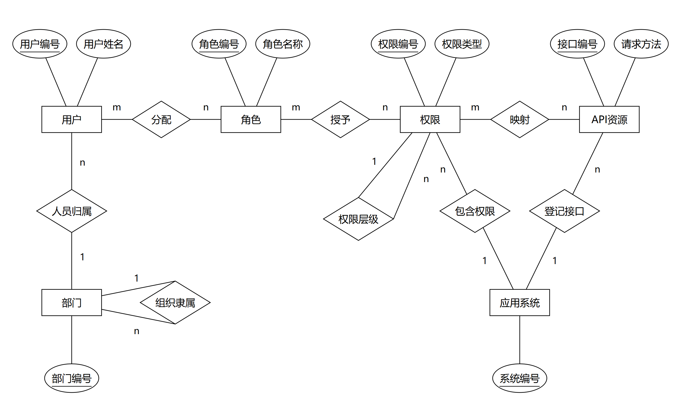
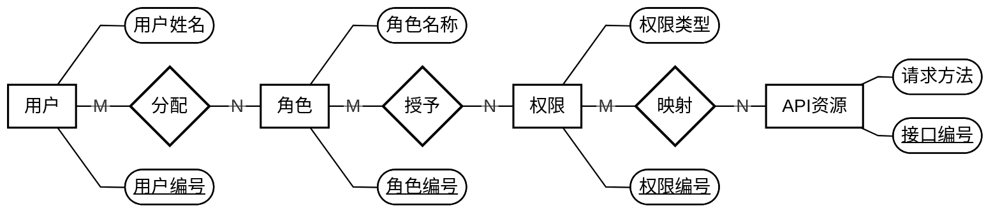
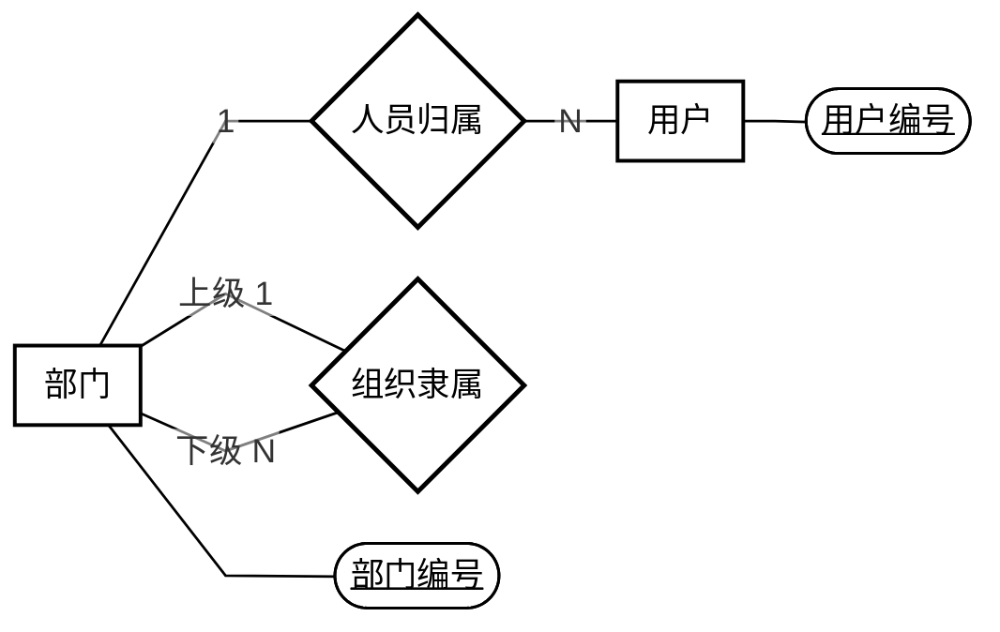
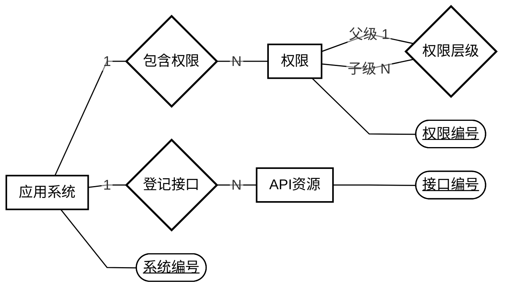

# RBAC 整改方案

> 组内阅读讨论稿，对应原版 v0.6｜2026-11-01。**执行以[原版计划](RBAC整改计划与Chen-ER图.md)为准；讨论结论先回写原版，再实施。**

## 1. 这次要改什么

以本次《2-9组检查记录》第一轮纪要及用户关于令牌范围的补充为依据，完成“用户—角色—权限—API”的实际授权，支持按部门管理约一万名用户。

| 处理 | 内容 |
|---|---|
| 保留并完善 | 用户、角色、菜单和按钮权限、部门管理、多系统归属、API 授权 |
| 简化 | 公司并入部门树；管理权限并入统一权限模型；基础认证只提供可信当前用户身份 |
| 删除 | 数据库会话、统一登录标识、离职交接、角色版本、复杂业务和业务审计模块 |
| 暂缓 | 按用户安排暂缓前端与课程系统开发；原型前置要求及下一阶段双系统演示仍待落实 |

现有代码已有分层类名、分页和搜索方法，但部门仍为扁平结构，持久化仍用 JDBC，不能视作已满足检查要求。整改重点是理清模块职责、使用 JPA、统一列表场景并实现真实接口授权。

## 2. 新结构怎么理解

静态图中矩形表示实体，椭圆表示属性，菱形表示关系，主键带下划线。上方主线解释用户通过角色获得权限并访问 API；折叠区的 Mermaid 保留编辑参考，其样式可能随阅读器变化。

| 核心实体 | 负责什么 | 对应表 |
|---|---|---|
| 用户 | 身份标识、员工资料、所属部门 | `users` |
| 角色 | 可分配给用户的权限集合，定义全局共享 | `roles` |
| 权限 | 菜单和按钮，组成权限树 | `permissions` |
| 部门 | 公司、分公司、部门组成的组织树 | `departments` |
| 应用系统 | 区分权限和 API 所属系统 | `systems` |
| API 资源 | 请求方法与接口路径模板 | `api_resources` |

用户与角色、角色与权限、权限与 API 都是多对多关系，分别使用 `user_roles`、`role_permissions`、`permission_apis` 三张关联表。合计六个核心实体、九张物理表；九张表是本方案的落库结果，不是老师另定的表数。

模型约束：

- 每个用户属于一个部门，可以暂时没有角色；角色也可以暂时没有用户。
- 部门最多一个上级，根部门无上级；部门树禁止循环。
- 权限和 API 各自只属于一个系统，只能在同系统内映射。权限最多一个父节点，父子必须同系统，按钮不能有子节点。
- 用户不直接获得权限，部门不直接授予角色或权限；部门树和权限树都不表示角色继承。
- 不增加管理员属性、角色父节点或独立管理范围表；不支持跨部门临时委托。角色全局共享、单部门归属、根部门全局维护等是本方案默认建议，不当作老师原话。

### Mermaid 关系源码

展开查看 Mermaid 关系源码

## 3. 权限怎么生效

**角色决定能做什么，所在部门决定能管理哪些人；两项同时满足才允许管理操作。**

**本次采用的账号规则（用户补充）**：有效账号在既有身份校验通过后允许登录，不以管理权限作为登录条件。无管理权限时显示“当前账号暂无管理权限”提示；后端仍按具体操作权限和部门范围校验每个管理请求，越权请求拒绝。不增加管理员属性、独立登录资格或新的认证功能。

| 规则 | 约定 |
|---|---|
| 实际接口鉴权 | 用户与所属系统启用时，沿角色、权限和 API 关联检查，匹配实际请求方法及 Spring 路径模板。不能只隐藏按钮或用模拟鉴权代替真实拦截。 |
| 菜单与按钮 | 拥有父菜单不自动获得子按钮权限；为导航补出的祖先菜单不增加接口授权。 |
| API 复用与默认拒绝 | 同一 API 对应多个权限时，命中任一有效授权即可。受控接口未登记、未映射或授权失效时拒绝访问。 |
| 部门管理员 | 按实际管理权限认定，角色名或根部门成员身份本身不授予管理权。只能管理本部门及下级人员，不能分配超出自身权限的角色。 |
| 全局维护 | 修改角色定义、角色权限、系统、权限或 API 映射，要求操作者属于根部门且拥有对应管理权限。 |
| 越权防护 | 部门管理员不能修改全局管理员，不能修改自己的授权或所属部门。人员调部门时，原部门和目标部门都要在允许范围内。 |
| 管理员保护 | 不能停用或撤权最后一名有效全局管理员；检查和修改在事务内完成，并通过锁处理并发。 |

登录仅提供可信当前用户身份。记录中的令牌登录、会话不写数据库是运行前提；令牌格式、有效期、刷新和退出机制不纳入 RBAC 核心设计或验收。授权修改后，后续请求按最新有效权限判断。基础认证入口及有效登录后查询本人信息不依赖管理权限。

## 4. 按什么顺序整改

| 顺序 | 主要工作 | 核对结果 |
|---|---|---|
| 1. 模型评审 | 核对实体、关系、管理范围及功能取舍 | 图、表、规则一致，老师要求与方案建议分开 |
| 2. JPA 与授权规则 | 导入组织人员，整理持久化及角色权限计算 | 数据可核对，核心使用 JPA，规则可独立验证 |
| 3. 原型与 API 评审 | 先审界面原型，再补齐需求/API 说明及契约 | 当前暂缓前端时保持待办，不能跳过 |
| 4. 实际接口与 AOP | 按已确认契约实现查询、授权修改及拦截 | 真实请求受角色权限和部门范围控制 |
| 5. 验收与交付 | 同步测试和文档，提交 PR | 分开记录后端结果与下一阶段双系统待办 |

实施时需要保留的约束：

- 技术栈保留 Java 21、Spring Boot、MySQL，使用 Spring Data JPA 和 AOP。Controller 处理 HTTP，Service 处理业务规则及事务，Repository 处理持久化；减少跨层通用 Map。
- 人员列表必须按部门显示、支持搜索和分页。方案暂定第 0 页起，每页默认 20 条、最多 100 条，具体格式随原型确认；部门筛选含下级，查询受管理范围限制。
- 三类授权关系修改采用整体替换，空列表表示全部撤销；写入须整体成功或回滚。角色、权限、系统和 API 通过停用控制，不提供物理删除。
- 保留原库、Excel 和小组文档，在独立整改库导入核对后切换。只整理本轮所需权限，不整包迁入旧应用及业务功能目录；旧授权不明确时先不启用，未知课程 API 不编造。
- 删除功能时一并处理调用方、DTO、初始化、测试、配置和文档。前端后续适配新契约；本轮不增加注册、找回密码等流程。
- 沿用 `refactor/rbac-core-backend` 分支；首次建立时以确认后的 main 为起点，分阶段提交 PR，不自行合并。具体字段、接口及执行要求查阅原版计划。

原型未评审前，可以先做模型、JPA 和授权规则，不能按旧清单批量生成最终接口。系统、权限和 API 的整套 CRUD 也不是默认必做功能。下一阶段仍须覆盖权限系统与课程系统的受控场景，只有多系统字段或目录记录不算完成。

## 5. 组内重点看什么

评审时先核对这些问题：

- [ ] 六个实体和八个关系是否清楚，三组多对多是否准确落到关联表？
- [ ] 能否沿图解释一个用户为什么有权或无权调用某个 API？
- [ ] 公司并入部门树后，原有组织和员工是否能准确对应？
- [ ] 部门管理员、根部门全局维护的权限和范围是否明确？
- [ ] 菜单展示是否与实际授权分开，旧功能的删除范围是否合适？
- [ ] 是否守住“原型 → 需求/API 说明 → 契约评审”的顺序，并明确课程系统待办？

实施后重点验证：

- 有效账号通过既有身份校验后可登录；无管理权限时显示提示，直接请求无权管理的 API 被拒绝；有管理权限但超出部门范围也拒绝。
- 无角色、无权限或只授予父菜单时，不能访问未授权 API。
- 分配或撤回角色后，后续请求按最新有效授权判断；用户、角色或所属系统停用后，不能继续使用失效授权。
- 本部门及下级人员按权限允许管理，其他同级部门人员拒绝管理；授予超出自身权限的角色时拒绝，原授权不变。
- 树循环、跨系统映射被拒绝；并发撤权仍保留至少一名有效全局管理员，失败事务回滚。
- 约一万名用户的分页、总数、搜索和部门筛选正确，无范围外人员；员工、组织和保留授权可追溯到来源。
- 下一阶段须验证权限系统和课程系统的授权结果；当前暂缓的课程侧场景不能提前标记通过。
