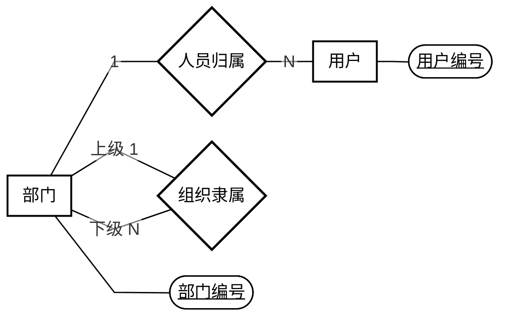
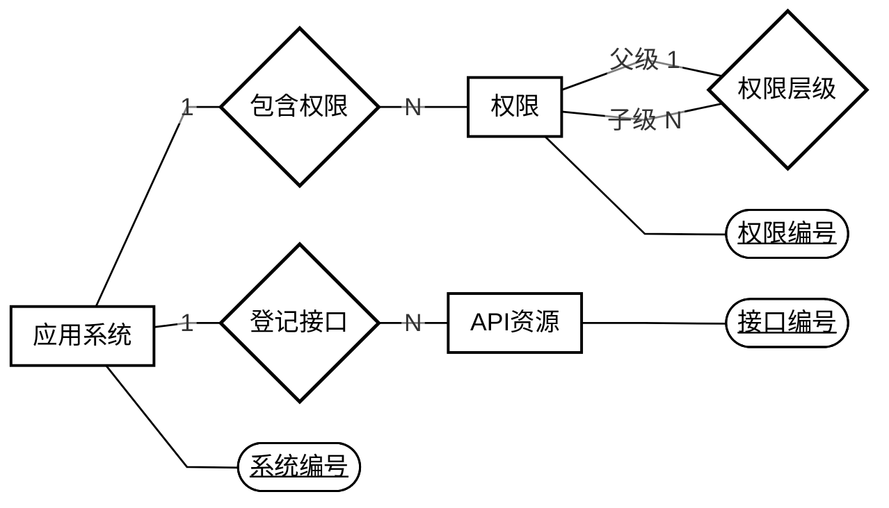

# RBAC 核心整改计划与 Chen 风格 ER 图

> 原版计划 v0.6（项目同步与账号规则补充稿）｜2026-11-01\
> 本版按参考图采用黑白 Chen 图、椭圆属性和单段直线；保留 Mermaid 关系源码供组内讨论。\
> 本文为后续执行依据；原型与 API 契约未确认的部分须先完成评审，不代表数据库或后端已经整改。\
> 本次仅同步整改文档与账号规则，未修改业务代码、迁移数据库或创建 tickets。

## 1. 目标、依据与本轮边界

以本次提供的《2-9组检查记录》第一轮纪要及用户补充“令牌不属于 RBAC 设计范围”为整改依据。旧需求、旧设计和现有代码用于发现差异，不能反过来扩充本轮范围。逐项复核见[检查记录复核说明](RBAC检查记录复核说明.md)。

**本轮目标：完成“用户—角色—权限—API”的实际授权链路，并支持按部门管理约一万名用户。**

| 项目 | 本轮处理 |
|---|---|
| 用户、角色、权限 | 保留核心对象及用户—角色、角色—权限两组多对多关系 |
| 公司与部门 | 公司并入层级部门，支持本部门及下级部门的人员管理 |
| 菜单、按钮、API | 菜单和按钮组成权限树，API 单独建模并与权限关联 |
| 管理员 | 由角色中的实际管理权限决定，不增加管理员属性，不按角色名判断 |
| 会话、统一登录标识、离职交接、角色版本、复杂业务及业务审计模块 | 清除超范围模型和功能，不为它们新增实体、页面或业务接口 |
| 基础认证 | 仅提供当前用户身份；记录中的令牌登录、会话不写数据库是运行前提，令牌机制不作为 RBAC 设计或验收目标 |
| API 设计 | 必须先评审界面原型，再补齐需求/API 说明并审核契约；不能由旧文档直接批量生成接口 |
| 后端技术 | 使用课程明确要求的 Spring Data JPA、AOP 和清晰的模块分层；沿用 Java 21、Spring Boot、MySQL |
| 前端与课程系统 | 当前按用户安排暂缓开发；下一阶段“权限系统＋课程系统”的要求仍待落实，仅有多系统字段不算完成 |

当前源码已有 Controller、Service、Repository 类及分页、搜索方法，但这不等于满足老师对模块职责和实际使用场景的要求。已确认部门创建仍拒绝上级部门参数，持久化仍使用 JDBC；须补部门树、统一列表场景并切换到 JPA，不能只改类名或文档。

## 2. ER 图与九张表

### 2.1 核心 ER 图

静态图用于核对标准 Chen 符号。下面的 Mermaid 保留相同实体和关系，供编辑讨论；其布局和属性形状受阅读器影响，不能替代静态图的符号检查。

### 2.2 Mermaid 关系源码

展开查看 Mermaid 关系源码

### 2.3 关系与参与约束

| 关系 | 基数 | 约束 |
|---|---|---|
| 用户—分配—角色 | M:N | 用户可以有多个角色，也可以暂时无角色；角色可以暂时无用户 |
| 角色—授予—权限 | M:N | 角色可以有多个权限；一个权限可以被多个角色使用 |
| 权限—映射—API | M:N | 一个权限可以对应多个 API；同一 API 可以被多个权限复用 |
| 部门—人员归属—用户 | 1:N | 每个用户必须属于一个部门；部门可以暂时无成员 |
| 应用系统—包含权限—权限 | 1:N | 每个权限只属于一个系统 |
| 应用系统—登记接口—API | 1:N | 每个 API 只属于一个系统 |
| 部门—组织隶属—部门 | 1:N | 每个部门最多一个上级；根部门没有上级；禁止循环 |
| 权限—权限层级—权限 | 1:N | 每个权限最多一个父权限；同系统内组成树，按钮不能有子节点 |

额外约束：权限只能映射同系统的 API；用户不直接关联权限，部门不直接授予角色或权限。

### 2.4 从概念模型落地为九张表

六个实体各落一张表，三组 M:N 关系各落一张关联表，得到本方案的 **六个核心实体、九张物理表**。九张表是本方案的落库结果，不是检查记录另行规定的表数。

| 表 | 主要字段 | 用途 |
|---|---|---|
| `users` | `id, name, department_id, enabled` | RBAC 用户身份与所属部门 |
| `roles` | `id, code, name, enabled` | 全局共享的角色定义 |
| `permissions` | `id, system_id, parent_id, code, name, type, enabled` | 菜单和按钮权限树，type 为 MENU 或 BUTTON |
| `departments` | `id, parent_id, code, name` | 公司、分公司、部门组成的组织树 |
| `systems` | `id, code, name, enabled` | 权限与 API 所属的系统 |
| `api_resources` | `id, system_id, http_method, path_template, enabled` | 可被授权访问的后端接口 |
| `user_roles` | `user_id, role_id` | 用户拥有的角色 |
| `role_permissions` | `role_id, permission_id` | 角色拥有的权限 |
| `permission_apis` | `permission_id, api_id` | 权限对应的 API |

约定：

- 实体表以 id 为主键；三张关联表以两个外键组成联合主键，防止重复关联。
- 权限编码在系统内唯一；API 的“系统＋请求方法＋路径模板”组合唯一。
- 电话、岗位、已有工号保留为员工资料。已有 username、password_hash 等基础登录字段可作为运行支撑保留，但不属于表中列出的 RBAC 核心字段，不扩展成统一凭证模型，也不以简化为由取消必要的身份校验。
- 不增加 is_admin、角色父节点、直接用户授权或独立管理范围表。
- Java 中系统实体命名为 ApplicationSystem，避免与 System 混淆。

## 3. 授权规则与接口讨论基线

### 3.1 授权规则

**接口操作权限来自角色，人员管理范围来自操作者所在的部门树；两项同时满足才允许管理操作。**

**本次采用的账号规则（用户补充）**：有效账号在既有身份校验通过后允许登录，不以管理权限作为登录条件。无管理权限时显示“当前账号暂无管理权限”提示；后端仍按具体操作权限和部门范围校验每个管理请求，越权请求拒绝。不增加管理员属性、独立登录资格或新的认证功能。

1. **实际接口鉴权**：在用户和所属系统启用的前提下，沿“用户 → 启用角色 → 启用权限 → 启用 API”检查访问权，匹配服务端识别的请求方法与 Spring 路径模板。不能只隐藏按钮、信任前端传来的权限名，或以模拟鉴权结果替代真实接口拦截。
2. **菜单与授权分开**：拥有父菜单不自动拥有子按钮权限；为了导航展示而补出的祖先菜单不产生额外接口授权。
3. **API 复用**：同一 API 被多个权限关联时，命中任一有效授权即可访问；未授予的 API 保持拒绝。
4. **部门管理员**：由角色中的实际管理权限决定，角色名称和根部门成员身份本身都不授予管理权。须有对应操作权限，且只能管理本部门和下级部门人员；分配的角色权限不得超出自身有效权限。
5. **全局维护**：角色定义、角色授权、系统、权限和 API 映射的修改，要求操作者属于根部门且拥有对应管理权限。
6. **防止越权**：部门管理员不能修改全局管理员，也不能修改自己的授权或所属部门。调整人员部门时，原部门和目标部门都必须在允许范围内。
7. **管理员保护**：最后一名有效全局管理员不能被停用或撤权；相关检查和修改必须在事务内并通过锁处理并发情况。
8. **默认拒绝**：受控接口未登记、未映射或授权失效时拒绝访问。登录为匿名入口；本人身份和本人权限查询要求有效登录，不依赖管理权限。

**认证边界**：基础认证负责提供可信的当前用户身份，RBAC 仅根据该身份检查角色、权限和部门范围。检查纪要提到令牌登录、会话不写数据库，但不据此规定令牌格式、有效期、签发、刷新或退出方案，也不把更换认证框架列为本轮独立任务。授权变更后的后续请求按最新有效授权判断；这是授权要求，不是令牌生命周期设计。

### 3.2 原型评审后确认 API 契约

**先原型，后契约，再生成或修改接口代码。**此前按实体列出的整套 CRUD 路由不再作为执行要求；下面只保留需要由原型验证的场景。

| 必须覆盖的场景 | 原型与契约需要确认的内容 |
|---|---|
| 登录后管理入口 | 有效账号可登录；无管理权限时显示提示，不把管理权限作为登录资格；管理请求按具体权限和部门范围校验 |
| 人员列表 | 部门导航、姓名/用户名等搜索、分页、总数、空结果和无权访问；不能一次返回全部人员 |
| 用户角色分配 | 可管理人员、当前角色、可分配角色、保存和失败反馈 |
| 角色权限配置 | 菜单/按钮树、已选权限、保存语义和越权限制 |
| 菜单/按钮与 API 映射 | 系统归属、请求方法、路径模板和关联关系；不自动扩成每类资源的完整 CRUD 页面 |
| 真实接口访问 | 有权和无权两种结果，确认 AOP 实际拦截受控接口 |
| 下一阶段双系统 | 权限系统与课程系统的独立资源归属，以及角色变化对两类接口访问结果的影响；课程侧场景尚待落实 |

原型逐项评审后，补齐需求/API 说明中的请求方法、路径、字段、响应、错误、分页、部门范围及权限条件，再作为代码生成和验收的契约。当前暂缓前端开发不代表取消原型要求；原型未评审前，可先做模型、JPA 和可独立验证的授权规则，不按旧清单批量生成最终 Controller。

本方案暂用以下简化约定，均属于实现默认值，不是老师逐项指定的格式：

- 沿用现有统一响应外壳；分页返回 items、total、page、size。第 0 页起，默认每页 20 条、最多 100 条。
- 部门筛选包含下级；先限制操作者管理范围，再应用筛选和搜索。部门树只返回可管理范围。
- 三类授权关系采用整体替换，候选请求体为 `{"ids":[...]}`，空数组表示清空；写入整体成功或整体回滚。
- 人员以原始数据导入为主，不增加注册、找回密码流程。角色、权限、系统和 API 默认通过停用处理，不增加批量物理删除流程。
- 移除独立管理权限、管理范围、交接、业务目录演示和审计模块的旧接口及契约。基础认证入口只作运行支撑，不列为 RBAC 新功能。

## 4. 实施顺序、架构与数据

| 阶段 | 工作 | 完成条件 |
|---|---|---|
| ① 模型评审 | 核对核心实体、关系、部门范围和功能取舍 | 图、表和授权规则一致，老师要求与方案默认值分开标注 |
| ② JPA 与授权规则 | 建立新表、导入组织人员，整理 Service/Repository 和角色权限计算 | 数据可核对，核心持久化使用 JPA，授权规则可独立验证 |
| ③ 原型与 API 评审 | 按场景评审界面原型，补齐需求/API 契约 | 原型和契约逐项确认；当前暂缓前端时，该项保持未完成 |
| ④ 实际接口与 AOP | 依据已确认契约实现人员查询、授权修改及接口拦截 | 真实 HTTP 请求受角色权限和部门范围控制；不得跳过阶段③ |
| ⑤ 验收与交付 | 同步初始化、配置、测试、文档和演示，提交 PR | 分别记录已验证的 RBAC 后端结果及仍待完成的双系统演示，不以结构预留代替验收 |

实施约定：

- 沿用 `refactor/rbac-core-backend` 分支；首次建立时以确认后的 main 为起点。按阶段提交，使用 PR 审阅，不自行合并。
- 保留本地未跟踪的小组文档，避免随重构误删或批量提交。
- Controller 负责 HTTP 输入输出；Service 负责业务规则和事务；Repository 使用 Spring Data JPA。使用明确的实体与 DTO，减少跨层通用 Map。
- AOP 统一检查实际接口授权；部门范围、可授予角色和管理员保护由 Service 在事务中验证。
- 删除旧功能时，同时处理调用方、DTO、初始化、测试、配置和说明文档，不能只删表。

数据处理采用 **独立整改数据库导入并核对，再切换配置** 的方式，保留原库和原始 Excel。

- 按原部门表恢复组织树，将员工逐一关联到对应部门，保留原人员资料。
- 原始权限清单只作参考，当前仅整理权限系统所需的菜单、按钮和真实 API。不得将旧目录中的全部应用、业务功能点或 OA 等模块整包迁入新系统；课程系统目录在对应场景确认后补充。
- RBAC 的 API 按评审后实际实现登记，未知课程接口不编造。只登记两个系统名称或保留 system_id，不代表已经满足下一阶段双系统要求；须有明确课程侧受控场景和可复核的授权结果。
- 旧角色分配、管理权限和范围逐项转换；移除按“系统管理员”等角色名绑定 GLOBAL/COMPANY/DEPARTMENT 范围的旧规则，改为实际管理权限加部门树。不能明确对应的授权先不启用并记录差异，防止扩大权限。
- 变更权限编码或接口时同步更新初始化和测试。旧前端后续适配经原型确认的新契约；HTTP 验证须在相应接口实现后执行，不能把本次文档复核或旧报告当作验证结果。

## 5. 组员讨论与验证清单

本方案默认：**角色全局共享；每人一个部门；管理范围为本部门及后代；不支持跨部门临时委托；不引入角色继承。**根部门全局维护、API 多对多映射、停用替代删除和分页参数也是为简化实现选定的建议，并非检查记录逐项指定；不据此声称课程已正式要求 RBAC0。修改默认值时同步更新图、表、原型、接口和测试。管理员始终由实际管理权限决定，组织位置只限定范围。

### 5.1 模型评审

- [ ] 矩形是否只有六个核心实体，是否还存在超范围对象？
- [ ] 八个菱形关系的含义、基数和参与约束是否正确？
- [ ] 是否能沿图解释“某用户为什么可以访问某个 API”？
- [ ] 公司并入部门树后，原组织和人员能否准确对应？
- [ ] 管理员是否由角色权限决定，部门范围是否清楚？
- [ ] 是否避免“父菜单自动授予所有子权限”？
- [ ] 三个 M:N 关系是否分别准确转换成三张关联表？
- [ ] 旧功能删除后，初始化、接口、测试和文档是否同步收敛？
- [ ] 是否完成“原型 → 需求/API 说明 → 契约评审”的前置步骤，而非继续由旧文档直接生成接口？
- [ ] 是否将下一阶段课程系统的受控场景列为待办，避免把多系统字段等同于双系统验收？

### 5.2 实施后验收

| 场景 | 预期结果 |
|---|---|
| 有效账号无管理权限 | 既有身份校验通过后可登录并显示提示；本人身份/权限查询可用，直接请求无权管理的 API 被拒绝 |
| 有管理权限但目标人员超出部门范围 | 登录不受影响，范围外管理请求被拒绝 |
| 用户无角色或无对应权限 | 未授权的受控 API 被拒绝，不影响有效账号登录 |
| 只授予父菜单 | 子按钮对应 API 仍被拒绝 |
| 分配角色后再次访问 | 后续请求按最新角色权限放行对应 API |
| 撤权、停用用户、角色或所属系统 | 后续请求不能继续使用失效授权，与令牌格式或生命周期无关 |
| 部门管理员访问本部门、下级部门、同级其他部门 | 前两类按权限允许，第三类拒绝 |
| 授予超出自身权限的角色 | 拒绝，原授权保持不变 |
| 树形成循环或跨系统关联权限与 API | 拒绝保存 |
| 并发撤销全局管理员 | 至少保留一名有效管理员，失败事务回滚 |
| 约一万名用户分页、搜索和部门筛选 | 分页与总数准确，无范围外人员 |
| 迁移核对 | 员工、组织和保留授权可追溯到来源，旧业务目录没有整包复活 |
| 下一阶段双系统（待落实） | 权限系统和课程系统均有受控场景，并能复核授权前后结果；只有系统目录记录不能判定通过 |

### 5.3 评审记录

组员可直接在下表补充意见，形成可追踪的讨论结果。

| 序号 | 问题或建议 | 对应章节 | 讨论结论 | 负责人 |
|---|---|---|---|---|
| 1 |  |  |  |  |
| 2 |  |  |  |  |
| 3 |  |  |  |  |

本稿仅说明拟议结构与整改步骤。未执行数据库迁移、后端重构或 Java/MySQL/HTTP 验收；旧报告不能作为新结构已通过测试的证明。
