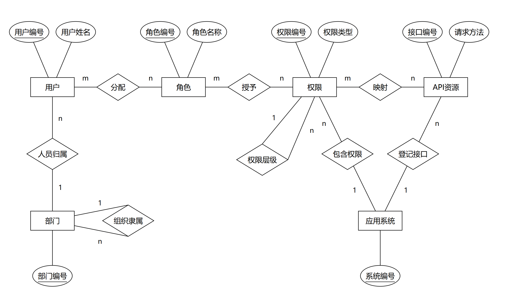

# RBAC 核心整改计划与 Chen 风格 ER 图

> 原版执行计划。以检查纪要及用户补充确定需求，方案建议须经小组评审。
> 采用黑白 Chen 图，保留三段 Mermaid 关系源码。T01 模型与规则已通过本次用户授权的代理评审；四组交互原型/API 契约已获用户确认完成，技术证据及确认记录见5.5；产物随PR #19进入共同基线，业务实现及运行验收尚未完成。
> [整改入口](README.md)提供任务与协作导航；[检查记录复核说明](RBAC检查记录复核说明.md)含技术纪要摘录。

## 1. 目标、依据与本轮边界

以《2-9组检查记录》第一轮技术纪要及用户补充“令牌不属于 RBAC 设计范围”为整改依据。旧需求、旧设计和现有代码用于发现差异，不能反过来扩充本轮范围。逐项复核见[检查记录复核说明](RBAC检查记录复核说明.md)。

**本轮目标：完成“用户—角色—权限—API”的实际授权链路，并支持按部门管理约一万名用户。**

| 项目 | 本轮处理 |
|---|---|
| 用户、角色、权限 | 保留核心对象及用户—角色、角色—权限两组多对多关系 |
| 公司与部门 | 公司并入层级部门，支持本部门及下级部门的人员管理 |
| 菜单、按钮、API | 菜单和按钮组成权限树，API 单独建模并与权限关联 |
| 管理员 | 由角色中的实际管理权限决定，不增加管理员属性，不按角色名判断 |
| 会话、统一登录标识、离职交接、角色版本和复杂业务 | 清除超范围模型和功能；鉴权日志按最新用户要求复用，限最小记录与查询，不恢复完整业务审计 |
| 基础认证 | 仅提供当前用户身份；记录中的令牌登录、会话不写数据库是运行前提，令牌机制不作为 RBAC 设计或验收目标 |
| API 设计 | 必须先评审界面原型，再补齐需求/API 说明并审核契约；不能由旧文档直接批量生成接口 |
| 后端技术 | 使用 Spring Data JPA、AOP、声明式事务和清晰的模块分层；补充图片还要求 CloneFactory 落地，具体课程用法由 T05 核对；沿用 Java 21、Spring Boot、MySQL |
| 前端与课程系统 | 当前按用户安排暂缓开发；下一阶段“权限系统＋课程系统”的要求仍待落实，仅有多系统字段不算完成 |

当前源码已有 Controller、Service、Repository 类及分页、搜索方法，但这不等于满足老师对模块职责和实际使用场景的要求。产品业务仍使用旧部门模型和 JDBC，T02 新 JPA 模型仅在独立测试上下文验证；须补部门树、统一列表场景并切换到 JPA，不能只改类名或文档。

### 1.1 补充依据与本次保持的边界

2026-11-07，结合组长提供的检查图片和老师三份原始 Excel 补充复核。图片补充了跨部门调动、针对用户的权限、部门范围授权、REST 语义、读写声明式事务和 CloneFactory；它们与第一轮 DOCX 摘录分开归属，详见[复核说明](RBAC检查记录复核说明.md#11-补充图片要求)。原始数据用于核对来源和实现适配，不能把旧业务清单整体恢复为整改需求；别组 HTML 不作为本项目需求或验收依据。

用户 2026-11-07 最新补充覆盖此前两项约定：鉴权日志优先复用旧实现；普通员工无本权限系统有效管理权限时拒绝登录，替代“允许登录后显示无权限提示”。这两项属于用户确认，不冒充老师原话。部门管理员的人员管理和组织查询仍限本部门及下级，不扩到所属公司的其他部门；完整组织 CRUD 和固定菜单清单未新增为必做范围。管理员由实际角色权限决定，不增加管理员属性或独立资格模型。

## 2. ER 图与九张表

### 2.1 核心 ER 图



静态图用于核对标准 Chen 符号。下面的 Mermaid 保留相同实体和关系，供编辑讨论；其布局和属性形状受阅读器影响，不能替代静态图的符号检查。

### 2.2 Mermaid 关系源码

<details>
<summary>展开查看 Mermaid 关系源码</summary>


</details>

### 2.3 关系与参与约束

| 关系 | 基数 | 约束 |
|---|---|---|
| 用户—分配—角色 | M:N | 用户可以有多个角色，也可以暂时无角色；角色可以暂时无用户 |
| 角色—授予—权限 | M:N | 角色可以有多个权限；一个权限可以被多个角色使用 |
| 权限—映射—API | M:N | 一个权限可以对应多个 API；同一 API 可以被多个权限复用 |
| 部门—人员归属—用户 | 1:N | 每个用户必须属于一个部门；部门可以暂时无成员 |
| 应用系统—包含权限—权限 | 1:N | 每个权限只属于一个系统 |
| 应用系统—登记接口—API | 1:N | 每个 API 只属于一个系统 |
| 部门—组织隶属—部门 | 1:N | 每个部门最多一个上级；根部门没有上级；禁止循环 |
| 权限—权限层级—权限 | 1:N | 每个权限最多一个父权限；同系统内组成树，按钮不能有子节点 |

额外约束：权限只能映射同系统的 API；用户不直接关联权限，部门不直接授予角色或权限。

### 2.4 从概念模型落地为九张表

六个实体各落一张表，三组 M:N 关系各落一张关联表，得到本方案的 **六个核心实体、九张核心物理表**。九张表是核心模型的落库结果，不是检查记录规定的总表数。复用的 `authorization_logs` 是运行支撑表，不加入核心 Chen ER 图或三段关系源码；不能再用“全库只能九张表”误删日志。

| 表 | 主要字段 | 用途 |
|---|---|---|
| `users` | `id, name, department_id, enabled` | RBAC 用户身份与所属部门 |
| `roles` | `id, code, name, enabled` | 全局共享的角色定义 |
| `permissions` | `id, system_id, parent_id, code, name, type, enabled` | 菜单和按钮权限树，type 为 MENU 或 BUTTON |
| `departments` | `id, parent_id, code, name` | 公司、分公司、部门组成的组织树 |
| `systems` | `id, code, name, enabled` | 权限与 API 所属的系统 |
| `api_resources` | `id, system_id, http_method, path_template, enabled` | 可被授权访问的后端接口 |
| `user_roles` | `user_id, role_id` | 用户拥有的角色 |
| `role_permissions` | `role_id, permission_id` | 角色拥有的权限 |
| `permission_apis` | `permission_id, api_id` | 权限对应的 API |

约定：

- 实体表以 id 为主键；三张关联表以两个外键组成联合主键，防止重复关联。
- 权限编码在系统内唯一；API 的“系统＋请求方法＋路径模板”组合唯一。
- 电话、岗位、已有工号保留为员工资料。已有 username、password_hash 等基础登录字段可作为运行支撑保留，但不属于表中列出的 RBAC 核心字段，不扩展成统一凭证模型，也不以简化为由取消必要的身份校验。
- 不增加 is_admin、角色父节点、直接用户授权、独立管理范围表或登录资格表。
- Java 中系统实体命名为 ApplicationSystem，避免与 System 混淆。

### 2.5 T01 模型核对与 T02 映射基线

本节及下文 T01 核对以代码基线 `e737579` 为依据，由 T01 子 agent 编制，主 agent 按用户本轮授权评审；结论见 [5.3](#53-t01-评审记录与未决项)。这里明确落库约束，不增加正式 API 或第七个核心实体。

| 对象 | T02 需要实现并验证的约束 | 依据归属 |
| --- | --- | --- |
| 用户、角色、权限 | 用户可无角色或多角色；角色可无用户或无权限；用户不直接获权，部门不直接授予角色/权限 | 用户—角色、角色—权限及管理员来源是纪要要求；无角色等参与约束沿用方案 |
| 部门 | `parent_id` 可空，其他父引用必须存在；禁止自指、循环；用户 `department_id` 非空。公司改为部门节点，不保留 `company_id` 和部门负责人授权规则 | 层级部门是纪要要求；每人一个部门是方案建议 |
| 应用系统 | `ApplicationSystem` 对应 `systems`；权限和 API 各有一个非空 `system_id`。系统停用使该系统授权失效，不使有效账号丧失登录资格 | 双系统方向是纪要要求；具体表名与有效性规则是方案建议 |
| 权限树 | `type` 限定 MENU/BUTTON；父节点可空，父子必须同系统；禁止自指、循环，BUTTON 不得有子节点；`(system_id, code)` 唯一 | 菜单/按钮树是纪要要求；约束细节是方案建议 |
| API 与映射 | `(system_id, http_method, path_template)` 唯一；`permission_apis` 两端必须同系统；同 API 可被多个权限引用。父菜单或补出的导航祖先不隐含子 API 授权 | API 独立且与权限关联是纪要要求；M:N 与匹配方案是方案建议 |
| 三组 M:N | `user_roles`、`role_permissions`、`permission_apis` 使用双外键联合主键，重复关联不能产生第二条记录；必要外键必须真实存在 | 前两组 M:N 是纪要要求；第三组及物理结构是方案建议 |
| 员工与登录支撑 | T02 保留 `employee_no`、`username`、`password_hash`，工号和用户名分别唯一；电话、岗位作为资料。仅对经核实的旧库状态按 `ACTIVE→enabled=true`、`DISABLED→false` 转换；未知状态不默认启用。Excel 本身没有工号、口令或状态，T03 须记录字段来源及模型必填适配 | 必要字段沿用原工程，不等于老师原始字段；有效账号规则来自用户；转换与缺项在 T03 核对，见 4.4 |

六个实体使用 `id` 主键；`roles.code`、`departments.code`、`systems.code` 各自唯一。外键和联合唯一性在 MySQL 验证；树循环、BUTTON 子节点和同系统关系在领域写入入口验证，并验证拒绝后无部分写入。不要把 Java 集合去重当作数据库唯一约束，也不要只依靠数据库自引用外键防循环。

T02 的实体结构可以表达多个根，不额外增加唯一根的数据库约束；这只为独立模型验证服务，不赋予任何根节点全局维护权。当前业务以原始部门 Excel 的共同根为组织基线：2026-11-02 只读核对得到 111 个部门、一个名为“总公司”的无上级节点，父名称引用无缺失。该名称仅是来源证据，授权时必须使用 T03 核对后的实际根 ID 与树关系。T03 还须验证无环、连通及全部组织/人员归属；出现多根、孤立或不能覆盖全体拟导入记录时报告异常并阻塞集成，不默认扩大全局范围。具体权限编码、路由和登录别名仍由相应原型/契约票确认。

## 3. 授权规则与接口讨论基线

### 3.1 授权规则

**接口操作权限来自角色，人员管理范围来自操作者所在的部门树；两项同时满足才允许管理操作。**

**当前账号规则（2026-11-07 用户更新）**：账号有效且口令校验通过后，还须具有本权限系统至少一项已评审的有效管理操作权限（包括相应管理查询）才允许登录。普通员工、无角色或无有效管理权限的账号拒绝登录；不能按岗位/角色名称、角色非空或菜单可见判断。最小实现是在既有登录流程复用统一有效权限计算并增加一次拒绝判断，沿用错误响应；不新增管理员属性、登录资格表、额外认证接口或认证流程，也不设计新的令牌机制。管理请求仍逐次校验具体权限与部门范围；登录获准不代表所有管理操作获准。

1. **实际接口鉴权**：在用户和所属系统启用的前提下，沿“用户 → 启用角色 → 启用权限 → 启用 API”检查访问权，匹配服务端识别的请求方法与 Spring 路径模板。不能只隐藏按钮、信任前端传来的权限名，或以模拟鉴权结果替代真实接口拦截。登录准入与接口鉴权复用同一有效权限来源，不能各自维护一份管理员名单。
2. **菜单与授权分开**：拥有父菜单不自动拥有子按钮权限；为了导航展示而补出的祖先菜单不产生额外接口授权。
3. **API 复用**：同一 API 被多个权限关联时，命中任一有效授权即可访问；未授予的 API 保持拒绝。
4. **部门管理员**：由角色中的实际管理权限决定，角色名称和根部门成员身份本身都不授予管理权。须有对应操作权限，且只能管理本部门和下级部门人员；分配的角色权限不得超出自身有效权限。
5. **全局维护**：角色定义、角色授权、系统、权限和 API 映射的修改，要求操作者直属经 T03 核对、覆盖当前全部组织的共同根部门，且拥有对应实际管理权限；普通根节点或部门名称不构成资格。
6. **防止越权**：部门管理员不能修改全局管理员，也不能修改自己的授权或所属部门。调整人员部门时，原部门和目标部门都必须在允许范围内。
7. **管理员保护**：最后一名有效全局管理员不能被停用或撤权；相关检查和修改必须在事务内并通过锁处理并发情况。
8. **默认拒绝**：受控接口未登记、未映射或授权失效时拒绝访问。登录为匿名入口，但成功须满足当前账号规则；本人身份和本人权限查询要求有效登录，不单独要求人员管理权限。撤销管理权限后的管理请求拒绝，再次登录也须拒绝。

**认证边界**：基础认证负责提供可信的当前用户身份，RBAC 仅根据该身份检查角色、权限和部门范围。检查纪要提到令牌登录、会话不写数据库，但不据此规定令牌格式、有效期、签发、刷新或退出方案，也不把更换认证框架列为本轮独立任务。授权变更后的后续请求按最新有效授权判断；这是授权要求，不是令牌生命周期设计。

补充图片中的“针对用户的权限”在本方案落实为：选定范围内人员，查看其当前角色和可分配角色，分配或撤销角色后验证该用户真实 API 访问变化（T10/T11）。不增加用户直接关联权限。图片没有明确要求独立的“权限来源说明页”；是否在原型中展示所选用户的最终有效权限，由 T10 契约评审记录，不冒充老师已指定的新增页面。

### 3.2 原型评审后确认 API 契约

**先原型，后契约，再生成或修改接口代码。**此前按实体列出的整套 CRUD 路由不再作为执行要求；下面只保留需要由原型验证的场景。

| 必须覆盖的场景 | 原型与契约需要确认的内容 |
|---|---|
| 管理端登录准入 | 有效性/口令及有效管理权限均满足才登录成功；普通员工拒绝登录，明确失败提示和错误语义，复用现有流程 |
| 人员列表 | 部门导航、姓名/用户名等搜索、分页、总数、空结果和无权访问；不能一次返回全部人员 |
| 用户角色分配 | 可管理人员、当前角色、可分配角色、保存和失败反馈 |
| 跨部门调动 | 必须覆盖的受限人员变更；原部门和目标部门均须在操作者范围内，范围外调动拒绝，失败不改变原归属与授权 |
| 角色权限配置 | 菜单/按钮树、已选权限、保存语义和越权限制 |
| 菜单/按钮与 API 映射 | 系统归属、请求方法、路径模板和关联关系；不自动扩成每类资源的完整 CRUD 页面 |
| 真实接口访问 | 有权和无权两种结果，确认 AOP 实际拦截受控接口 |
| 鉴权日志 | 复用旧记录及分页查询；仅有日志查询权限且满足全局维护范围的账号可查看，部门管理员拒绝；不纳入归档、导出或完整审计平台 |
| 下一阶段双系统 | 权限系统与课程系统的独立资源归属，以及角色变化对两类接口访问结果的影响；课程侧场景尚待落实 |

原型逐项评审后，补齐需求/API 说明中的请求方法、路径、字段、响应、错误、分页、部门范围及权限条件，再作为代码生成和验收的契约。当前暂缓前端开发不代表取消原型要求；原型未评审前，可先做模型、JPA 和可独立验证的授权规则，不按旧清单批量生成最终 Controller。

本方案暂用以下简化约定，均属于实现默认值，不是老师逐项指定的格式：

- 沿用现有统一响应外壳；分页返回 items、total、page、size。第 0 页起，默认每页 20 条、最多 100 条。
- 部门筛选包含下级；先限制操作者管理范围，再应用筛选和搜索。部门树只返回可管理范围。
- 三类授权关系采用整体替换，候选请求体为 `{"ids":[...]}`，空数组表示清空；写入整体成功或整体回滚。
- 人员以原始数据导入为主，不增加注册、找回密码流程。角色、权限、系统和 API 默认通过停用处理，不增加批量物理删除流程。
- 移除独立管理权限、管理范围、交接及业务目录演示；保留最小鉴权日志记录/查询，移除日志归档和授权变更历史等扩展。登录只增加本节的权限准入判断，认证机制继续作为运行支撑。

2026-11-07 四票契约集中在[统一原型与 API 契约](RBAC原型与API契约.md)，含可直接打开的HTML原型、逐项请求/响应/错误/范围和验收案例。技术核对与随后用户确认的区别见5.5；本轮不生成正式Controller。

T04/T06/T08/T10 及后续 T14 的逐项契约评审须检查 REST 语义：资源命名、HTTP 方法、路径与参数、响应及错误状态是否与行为相符，查询不得夹带业务写操作。用户列表必须明确部门分组、搜索与分页。评审的是具体场景，不因要求 REST 就补出无场景的整套 CRUD。

### 3.3 T01 有效全局管理员与保护边界

以下是本次代理评审确认的方案规则，不是纪要逐项规定。**有效全局管理员必须是同一个有效用户，直属经导入核对的共同根部门，且经启用角色、启用权限、启用 API 及启用系统，实际拥有必要维护能力集合 K。**可汇总本人多个角色的有效能力，不能把不同用户的零散权限拼成一名管理员；计数按不同用户，不能按角色或关联记录计数。

当前必要维护能力集合 K 固定为四类：角色定义的必要维护、角色权限配置、人员角色分配、菜单/按钮及 API 映射维护，并包含完成这些操作所需的查询能力。它只涵盖本轮必要操作，不自动扩成每个实体的完整 CRUD。T06/T08/T10 负责把这四类能力落实到经评审的具体操作、编码和 API 映射；T07/T09/T11 必须共用同一能力判定。若原型新增系统停用等会影响维护恢复能力的操作，须先统一评审、回写 K 并同步所有写切片，不能由单票自行改变保护标准。

四类K的本轮已确认契约统一为[契约2.3的全部实际方法与模板](RBAC原型与API契约.md#common)：users.read、users.roles.write、resources.read、resources.write、roles.read、roles.write、roles.permissions.write（均带rbac.前缀）。允许同用户多角色及多权限OR映射覆盖；日志、停人、调动不进K。系统code=rbac、共同根和所有实际ID须由后续来源核对，不能固定为模拟1。T06仅必要资源字段/停用与映射，不纳入系统停用或method/path编辑；这些方案已由本轮用户确认采用，不冒充老师逐项要求。

### 3.4 事务、映射与课程技术落地

读写业务均须有清楚的 Service 声明式事务边界：查询采用只读事务约定，写操作整体成功或回滚；并发保护沿用 3.3，共享检查不能各自采用不同锁与计数口径。T05 首先验证查询链路，T07/T09/T11 验证各自写事务，T13 做跨入口复核。不能用 Repository 类名或局部事务注解代替真实调用证据。

CloneFactory 是补充图片明确提及的课程技术要求，原 DOCX 没有该词；当前项目未落实，已有 `DtoMapper` 的 `ObjectMapper.convertValue` 不能算作完成。T05 负责核对课程指定的来源、用法与最小 DTO 映射方式，并在首个真实业务调用中使用和验证；T07/T09/T11 复用该方式，T12 清理旧映射残留，T13 核对实际使用。当前没有老师提供的示例，不能擅自指定第三方依赖、编造课程用法或为凑名词另造框架；来源未落实时明确记录未决项，相关映射不得声称验收通过。此项不新增核心实体或独立任务。

### 3.5 复用最小鉴权日志

旧 `AuditController`、`AuditService`、`AuditRepository`、`AuditRecorder`、`RequestAuditFilter`、`AuditDtos`、`authorization_logs` 及日志列表是复用起点。已有过滤器记录登录和 401/403；真实 API 的允许/拒绝记录须随 AOP 衔接，不能把旧模拟鉴权日志当作完成证据。保留时间、可识别操作者、方法/路径、结果/原因及 requestId 等必要信息，单次判定避免重复记录；沿用不记录口令、令牌、请求体和查询串的边界。

T04 评审登录拒绝、日志记录与全局查询的最小契约；T05 在既有链路接入最小记录和受保护分页/筛选查询，将相关 JDBC 适配为 JPA，复用既有结构与校验，不另造日志平台。日志查询须同时满足对应实际权限及全局维护范围，部门管理员即使构造请求也不能查看。T06/T07 将已评审的日志查询权限/API 纳入资源配置，T08/T09 保持角色授权与全局限制一致。

不恢复 `/archive`、导出、日志变更历史或全业务操作审计；T12 删除这些扩展及旧权限/会话耦合，保留最小日志链和必要错误上下文。日志不是维持管理员恢复能力的新增 K 项。旧库和历史日志保持原位；本轮不要求全量迁移历史，若选用历史记录须核对用户引用，不能把旧 user_id 误接到新人员。旧页面只做本范围必要兼容/清理，正式新前端仍暂缓，页面存在不代表已验收。

有效管理员计数覆盖同一个已确认的共同维护域，按 distinct 用户计算；每一名被计入的用户均须单独拥有完整 K，不能按角色或分支分别拼接。会改变该集合的写入以修改后状态判定至少保留一人，首次可信初始化另由 T05 原子建立必要基线。

拥有某项管理权限可执行该项允许范围内的操作，不要求所有管理人员都拥有整个 K。K 专用于“至少保留一名能继续维护授权的有效用户”防护，不是登录资格，不增加管理员字段或特殊角色名。

| 会改变有效管理员集合的变更 | 必须检查的后果 | 对应票 |
| --- | --- | --- |
| 用户停用、用户移出根部门、用户角色替换/解除 | 用户是否仍有效、仍处于允许维护域，并仍拥有 K | T11 |
| 角色停用、角色权限替换/解除 | 不能只检查用户状态；保留角色名或空角色不等于保留能力 | T09 |
| 权限停用、API 停用、映射解除或改到其他 API | 必须确认实际维护接口仍可访问；有权限节点但无有效映射不算能力 | T07 |
| 系统停用或改变所属系统、权限树/部门树调整 | 系统有效性、同系统关系或根部门身份可能变化，相关写入也必须遵守同一保护 | T07；若其他契约纳入树维护则由该切片承担 |
| 同时撤权、停用或移动不同管理员 | 以事务修改后的完整状态重新判定；并发写入共用稳定的锁定顺序/保护点，失败整体回滚 | T07/T09/T11 |

旧实现 [`ManagementAccessRepository.java`](../../src/main/java/com/municipal/rbac/ManagementAccessRepository.java) 第 10、22、26 行仍依赖“系统管理员”、GLOBAL 和 `management.grant` 计数/锁定；这只能作为重写防护的差异依据，不能直接保留判定。锁不能继续依赖某个可被改名或停用的角色代码。具体锁实现由写切片共同决定并做并发验证，不在 T01 宣称已完成。

部门管理员不得修改有效全局管理员，也不得修改自身授权或所属部门；移动其他人员时原部门和目标部门均须处于本人部门及后代范围。分配角色要比较目标角色的有效权限与操作者本人的有效权限，而不是比较角色名。共同根部门成员也须有相应实际权限；共同根尚未完成来源与覆盖核对时，禁止全局维护。部门的 `parent_id` 为空不等于可管理所有组织，也不按“总公司”等名称判断管理员。

## 4. 实施顺序、架构与数据

| 阶段 | 工作 | 完成条件 |
|---|---|---|
| ① 模型评审 | 核对核心实体、关系、部门范围和功能取舍 | 图、表和授权规则一致，老师要求与方案默认值分开标注 |
| ② JPA 与授权规则 | 建立新表、导入组织人员，整理 Service/Repository 和角色权限计算 | 数据可核对，核心持久化使用 JPA，授权规则可独立验证 |
| ③ 原型与 API 评审 | 按场景评审界面原型，补齐需求/API 契约 | 原型和契约逐项确认；正式前端暂缓不妨碍开展原型评审 |
| ④ 实际接口与 AOP | 依据已确认契约实现人员查询、授权修改及接口拦截 | 真实 HTTP 请求受角色权限和部门范围控制；不得跳过阶段③ |
| ⑤ 验收与交付 | 同步初始化、配置、测试、文档和演示，提交 PR | 分别记录已验证的 RBAC 后端结果及仍待完成的双系统演示，不以结构预留代替验收 |

实施约定：

- 沿用 `refactor/rbac-core-backend` 分支；首次建立时以确认后的 main 为起点。按阶段提交，使用 PR 审阅，不自行合并。
- 保留本地未跟踪的小组文档，避免随重构误删或批量提交。
- Controller 负责 HTTP 输入输出；Service 负责业务规则和事务；Repository 使用 Spring Data JPA。使用明确的实体与 DTO，减少跨层通用 Map。
- AOP 统一检查实际接口授权；部门范围、可授予角色和管理员保护由 Service 在事务中验证。
- 删除旧功能时，同时处理调用方、DTO、初始化、测试、配置和说明文档，不能只删表。

数据处理采用 **独立整改数据库导入并核对，再切换配置** 的方式，保留原库和原始 Excel。

- 按原部门表恢复组织树，将员工逐一关联到对应部门，保留原人员资料。
- 原始权限清单只作参考，当前仅整理权限系统所需的菜单、按钮和真实 API。不得将旧目录中的全部应用、业务功能点或 OA 等模块整包迁入新系统；课程系统目录在对应场景确认后补充。
- RBAC 的 API 按评审后实际实现登记，未知课程接口不编造。只登记两个系统名称或保留 system_id，不代表已经满足下一阶段双系统要求；须有明确课程侧受控场景和可复核的授权结果。
- 旧角色分配、管理权限和范围逐项转换；移除按“系统管理员”等角色名绑定 GLOBAL/COMPANY/DEPARTMENT 范围的旧规则，改为实际管理权限加部门树。不能明确对应的授权先不启用并记录差异，防止扩大权限。
- 变更权限编码或接口时同步更新初始化和测试。旧前端后续适配经原型确认的新契约；HTTP 验证须在相应接口实现后执行，不能把本次文档复核或旧报告当作验证结果。

### 4.1 T01 工程复用、替换与删除对照

下表均为源码静态核对后的迁移边界，尚未执行删除；行号对应 `e737579`，源码变化后须重新查找。每个切片迁移本次调用和测试，T12 再完成全仓残留检查，不能把仍被其他切片使用的共享实现提前删掉。

| 处理 | 源码证据与现状 | 需要到达的调用、初始化、测试、配置和文档范围 |
| --- | --- | --- |
| 复用工程骨架，加入 JPA/AOP | [`pom.xml`](../../pom.xml) 第 4、6、11—15 行为 Java 21、Spring Boot、Web、JDBC、MySQL；[`RbacApplication.java`](../../src/main/java/com/municipal/rbac/RbacApplication.java) 第 6—9 行是既有启动入口 | T02 继续同一 Maven 工程并保留 MySQL；JDBC 在旧调用迁完前保留。AOP 随真实接口切片接入，不为模型测试另建产品工程 |
| 复用响应、异常处理与最小日志上下文 | [`ApiResponse.java`](../../src/main/java/com/municipal/rbac/ApiResponse.java) 第 4 行；[`ApiResponseAdvice.java`](../../src/main/java/com/municipal/rbac/ApiResponseAdvice.java) 第 15 行和 [`ApiExceptionHandler.java`](../../src/main/java/com/municipal/rbac/ApiExceptionHandler.java) 第 24—25 行调用 `RequestAuditFilter` | 保留统一外壳、HTTP 状态、安全错误及 requestId；T05 适配可信操作者和日志记录，T12 清理旧耦合时不得删断这些调用 |
| 复用 Excel 读取，替换初始化策略 | [`ExcelXmlReader.java`](../../src/main/java/com/municipal/rbac/ExcelXmlReader.java) 第 13、30 行处理工作簿及禁用外部实体；[`DataInitializer.java`](../../src/main/java/com/municipal/rbac/DataInitializer.java) 第 14—28、38—53、62—64 行导入旧五类角色/范围/目录，仅核对上级而不保存树关系 | T03 仅导组织人员并核对来源与异常；T05 建最小已评审授权基线；T12 移除旧角色名授予、旧整包目录、默认初始化路径及相关测试假设。三份 Excel 原位保留，权限清单不整包迁入 |
| 替换组织及用户持久化 | [`schema.sql`](../../src/main/resources/schema.sql) 第 2、9、20 行为 companies、无 parent 的 departments、可空用户部门；[`ManagementService.java`](../../src/main/java/com/municipal/rbac/ManagementService.java) 第 88—95 行拒绝 parentId | T02 建树模型，T03 迁人员；T05/T11 迁查询和受限变更；T12 处理旧公司 CRUD、Requests/Responses 组织字段、`Organizations.vue`、`main.js` 路由、初始化及测试。旧公司/部门 ID 不直接混作新 ID，来源对应由 T03 核对 |
| 替换双轨授权及旧范围 | [`ManagementAccessRepository.java`](../../src/main/java/com/municipal/rbac/ManagementAccessRepository.java) 第 9—14 行把独立管理权限、GLOBAL/COMPANY/DEPARTMENT 与角色名绑定；[`ManagementController.java`](../../src/main/java/com/municipal/rbac/ManagementController.java) 第 9—18 行提供旧管理权限/范围接口 | T05 统一用户—角色—权限—API 和部门范围；T09/T11 迁角色配置与人员分配。T12 删除 `role_management_permissions`、`management_scopes`、Scope/Assignments DTO、`ManagementGrants.vue`、`RoleManagementEditor.vue` 及其前端调用和测试；不把旧范围静默翻译成更大授权 |
| 复用分页/搜索行为，替换 SQL 和重复列表 | [`ApplicationService.java`](../../src/main/java/com/municipal/rbac/ApplicationService.java) 第 27—52 行已有两个列表入口；[`ApplicationRepository.java`](../../src/main/java/com/municipal/rbac/ApplicationRepository.java) 第 9—16、29—34 行已有筛选、计数、分页，但依赖旧公司/范围/交接 | T04 先确认唯一列表场景与分页契约，T05 以 JPA 在部门范围内检索、计数和分页；迁同切片 DTO 和测试。`Users.vue`、旧调用和说明由 T12 收口，正式新页面仍暂缓 |
| 替换业务功能目录和模拟鉴权 | [`schema.sql`](../../src/main/resources/schema.sql) 第 36—86 行为 applications/modules/features/actions/permissions；[`ApiController.java`](../../src/main/java/com/municipal/rbac/ApiController.java) 第 17、43—50 行及 [`ApplicationService.java`](../../src/main/java/com/municipal/rbac/ApplicationService.java) 第 18 行仍靠前端传权限名返回模拟结果 | T06/T08 先做原型/契约；T07/T09 迁菜单/按钮—API 映射及角色授权，T05 起由 AOP 拦真实接口。T12 移除旧目录结构、`Portal.vue`/`System.vue` 调用、旧鉴权演示及测试，不把目录展示判为真实授权完成 |
| 删除会话表与统一登录标识依赖 | [`AuthRepository.java`](../../src/main/java/com/municipal/rbac/AuthRepository.java) 第 14—17 行读写 `login_identifiers`/`sessions`；[`DatabaseConstraints.java`](../../src/main/java/com/municipal/rbac/DatabaseConstraints.java) 第 12—17 行建旧外键/标识触发器；[`AuthService.java`](../../src/main/java/com/municipal/rbac/AuthService.java) 第 8—23 行依赖数据库会话 | T04/T05 按 4.2 衔接；T12 检查 schema、触发器、`deploy/install-login-constraints.sql`、会话配置、测试及登录说明。新链路就绪前旧调用不提前删；整改库不能启动这些旧组件 |
| 删除交接和审计扩展，复用鉴权日志 | [`ApiController.java`](../../src/main/java/com/municipal/rbac/ApiController.java) 第 51—56 行；[`AuditController.java`](../../src/main/java/com/municipal/rbac/AuditController.java) 第 4—9 行；[`RequestAuditFilter.java`](../../src/main/java/com/municipal/rbac/RequestAuditFilter.java) 第 24—28 行；[`ApplicationRepository.java`](../../src/main/java/com/municipal/rbac/ApplicationRepository.java) 第 28、34、38、65 行混合日志/交接/会话 | T05 复用 authorization_logs、Audit* 最小记录/查询及 requestId，迁 JPA 和统一权限；T12 删除 handovers、authorization_changes、归档接口、扩展 DTO 及对应前端调用/测试/配置，保留日志查询链及必要旧页面适配，按 3.5 验证 |
| 清理测试、配置和历史说明 | [`AccessBoundaryTest.java`](../../src/test/java/com/municipal/rbac/AccessBoundaryTest.java) 第 25—81 行绑定会话/交接；[`IdentifierConstraintTest.java`](../../src/test/java/com/municipal/rbac/IdentifierConstraintTest.java) 第 16—42 行绑定标识触发器；[`application.yml`](../../src/main/resources/application.yml) 第 2、14、18—20 行开启旧本地配置/SQL/初始化/会话设置 | 各票保留越权、回滚、分页、日志脱敏和数据异常等有效测试意图并改成新模型；T12 清除审计扩展、旧范围、标识/会话及失效原型断言，更新普通员工登录拒绝的旧假设。检查 `frontend/tests`、部署脚本、README、docs；`docs/legacy` 只作差异参考 |

当前 schema 中没有独立角色版本表或角色版本字段；按纪要将“角色版本”排除于新模型，不能为凑删除清单新增对象，也不能宣称已删除不存在的表。T12 仍须核对文档中残留的版本/交接约定。

### 4.2 T01 最小身份衔接与隔离边界

基础登录复用现有 `BCryptPasswordEncoder.matches` 及有效性检查（`AuthService.java` 第 12 行），再复用有效权限查询实施 3.1 的管理端准入。账号有效或拥有任意角色均不足以登录，须具备本权限系统有效管理操作权限。新身份以 `users.id` 唯一标识；每次受控请求由后端读取最新启用状态、角色、权限和部门，客户端不得提供可直接信任的用户 ID、权限集合或管理员标记。

当前代码把 Bearer 解析、数据库会话和当前用户查询绑在一起；库中不存在可直接复用的无会话实现。T05 必须把可信当前身份与新用户读取衔接后，才可宣称真实 HTTP 链可用；测试注入身份只能用于模型/规则测试，不能代替基础身份验收。T01/T02 不设计令牌格式、有效期、刷新或退出机制，也不恢复会话实体；基础运行衔接不扩成独立认证功能票。

当前最小身份衔接基线为唯一 username 匹配并保留原口令哈希及有效性校验；旧页面还承诺工号/手机号，是否继续支持这两个别名由 T04 原型和契约明确（G3），不以旧页面直接确定新契约。即使保留别名，也不得恢复统一登录标识实体、免口令入口或注册/找回密码功能。T03 导入未知账号状态或不明确部门归属时记录异常，不默认启用或赋权。

T02 在同一 Maven 工程使用旧启动包 `com.municipal.rbac` 扫描范围之外的兄弟包（如 `com.municipal.rbaccore`）放新模型；测试显式选择实体、JPA Repository 和必要自动配置，不新增替代产品 `SpringBootApplication`。只接独立整改 MySQL 测试库，关闭旧 SQL 初始化（`spring.sql.init.mode=never`），不扫描旧 `DataInitializer` 和 `DatabaseConstraints`，不继承旧库连接或旧本地配置导入。仅关闭 `rbac.initialize` 不足以隔离：`DatabaseConstraints` 仍会运行，且原配置 `sql.init.mode=always` 仍会建旧表。测试前核对实际数据源和加载组件，验证没有旧表/触发器及原库写入。

T02 保留原启动和旧调用；新模型暂不接产品 Controller。T05/T07/T09/T11 逐块集成，T12 才切换正式启动/配置并收掉旧实现。隔离测试通过只证明新持久化模型，不证明新产品已启动、原型/契约已评审或界面已验收。课程受控场景仍由 T14/T15 单独落实。

### 4.3 T02 独立模型与验证

同一 Maven 工程加入 Spring Data JPA；新六实体及六个 JpaRepository 位于旧启动扫描范围之外的 `com.municipal.rbaccore`。六实体映射九张表，三组关联使用双外键联合主键。树移动、权限类型及 API 映射由领域入口先验证再变更；关联集合只读，事务由调用方管理。产品入口与旧 JDBC 调用保留，新模型没有正式 Controller、页面、认证或导入功能。

CoreModelJpaTest 使用显式测试配置和独立配置名 `application-core-model-test`，不加载旧 application.yml/本地导入，不扫描 DataInitializer、DatabaseConstraints，SQL 初始化为 never。数据源实例化前校验 URL，只允许本机显式端口的 `rbac_core_t02_test`；须使用仅有该一次性库权限的账号。测试使用 create-drop，会创建和删除该库中的模型表；连接配置缺失时失败，不跳过测试。

复现时准备 MySQL 8 及 Java 21，在本机设置 RBAC_CORE_TEST_DB_URL、RBAC_CORE_TEST_DB_USER、RBAC_CORE_TEST_DB_PASSWORD，口令不写入仓库。URL 示例：`jdbc:mysql://127.0.0.1:3317/rbac_core_t02_test?connectionTimeZone=UTC`。从仓库根目录执行，Maven 不在 PATH 时使用本机绝对路径：

```powershell
mvn -B -ntp '-Dtest=CoreModelRulesTest,CoreModelJpaTest,ExcelXmlReaderTest,InfrastructureBoundaryTest,InitializerValidationTest,RuntimeBoundaryTest,RequestAuditBoundaryTest' test
mvn -B -ntp -DskipTests package
```

2026-11-02，子 agent 在独立 MySQL 8.4.13 上验证：52 项通过（新模型 37 项、既有无库单测 15 项），失败/错误/跳过均为 0；Spring Boot 打包成功。实查九表、11 个外键、三组联合主键，七类唯一性、11 类缺失引用和三类非空拒绝；清空 JPA 上下文后读回多角色/无角色、共享 API 和父子关系，并验证树移动、跨系统拒绝与领域失败事务回滚。上下文没有旧表、触发器、初始化器或正式 Controller；账号仅能写独立测试库。

2026-11-02，主 agent 依据用户“进行 T02 评审，没问题就合并然后 close”的明确授权完成技术评审；基线为 `6ba488f`，实现提交为 `84f77c5`，本次收尾仅更新文档。独立 Standards 复核为 0 项明文违规、1 条非阻塞 P3 possible Duplicated Code：Department 与 Permission 的祖先遍历形态相似，但领域约束不同、重复有限，不为此新增通用树抽象；独立 Spec 复核为缺失/部分 0、范围扩展 0、实现错误 0。主 agent 核对源码、Surefire 报告和打包产物后通过五项验收，合入及关闭状态以 [PR #18](https://github.com/minxuanbo/ooad-course-project/pull/18) 和 [Issue #3](https://github.com/minxuanbo/ooad-course-project/issues/3) 为准；仅代表代理技术评审，不冒充老师或真人组员签字。

| T02 验收 | 本次核对证据 |
| --- | --- |
| 复用原工程及所需 JPA | pom.xml 仅加入 Spring Data JPA，保留 Java/Spring Boot/MySQL 和旧产品入口 |
| 核心实体、关联与约束 | 六实体映射九表，数据库约束测试与领域规则测试覆盖联合主键、唯一性、外键、同系统及树约束 |
| 小样例完整数据链 | CoreModelJpaTest 清空上下文后读回多角色/无角色、共享 API、部门及权限父子关系 |
| 独立整改库隔离 | 显式测试配置、数据源 URL 守卫、never 初始化及专库账号；实查无旧表、触发器或旧初始化器 |
| 共存及接口边界 | 4.2 和本节记录集成责任；旧调用保留，diff 无正式 Controller、产品页面或新认证功能 |

本次核对已有 52 项测试及 package 成功记录，未重复运行；PR 未产生 CI check runs，不把本地证据称为 CI 通过。未运行全量 mvn verify、旧库集成、真实 HTTP、并发授权或界面验收，JaCoCo 门槛未改。T03 须在本票合入共同基线后负责真实数据导入；T05/T07/T09/T11 集成时须重新核对扫描、事务及初始化，T12 做最终切换。原型/API 契约仍是正式接口前置，正式前端暂缓，课程 T14/T15 为后续；原库、Excel、本地资料保留。

### 4.4 原始数据复核与导入前置

2026-11-07 核对老师提供的三份 Excel 与仓库根目录副本，文件大小及 SHA-256 全部一致；权限清单原件名含 `(1)`，仓库副本不含。完整摘要、哈希和原始单元格异常见[复核说明](RBAC检查记录复核说明.md#12-原始数据复核)。原件不得覆盖或修改。

- 员工恰为 10,000 人，用户名非空且唯一；原表只有姓名、用户名、分公司、部门、岗位、电话号码。工号、口令哈希、有效状态和角色分配不是 Excel 原始字段；部门编码也是导入映射，不能标成原表已有编号。重名人员按用户名等已核实标识匹配，不能只按姓名。
- 部门共 111 个节点，唯一共同根为“总公司”，无缺失上级、无环且连通。244 人直接匹配原部门名，9,756 人结合分公司前缀匹配，10,000 人均有唯一归属；数据库导入后仍须重新核对实际外键和树关系，不能用本次静态核对代替 JPA/MySQL 验收。
- 没有员工直属共同根节点，“总公司”的负责人对应员工实际属于“公司领导”。原定“直属共同根且具备实际权限”的全局维护规则保持不变。T03 核对旧库可复用维护账号、归属及缺项，记录初始化方案；T05 仅在来源与方案经评审后建立最小授权基线。不得按负责人姓名、岗位或角色名称自动授予权限，也不得静默移动原始员工来凑条件；若无可用账号或明确方案，相关初始化保持阻塞并写明缺项。
- T03 先核对旧库可用的工号、哈希及状态来源，再说明模型必填字段如何满足；没有来源时列出缺项和待确认映射，不伪造工号、密码、有效状态或把用户名自动冒充工号。确需调整必填约束时，先回写模型决策并按本票最小范围评审，不恢复凭证/会话模型。原始人员资料与可登录账号是否就绪分开记录，不默认一万人全部启用。
- 权限清单为 18 个系统、115 个模块、359 个功能点及 5 类角色的业务矩阵，没有真实请求方法/路径，也没有员工角色分配。岗位“部门经理”不等于本项目“部门管理员”；清单中的“全部”不能推导跨部门范围。仅按已评审的实际接口建立菜单/按钮—API 映射，不整包导入业务目录或按岗位自动赋权。
- 三个工作表的范围标记均为 `A1`，实际包含全部数据；读取时须覆盖底层单元格。权限表有合并单元格，分组恢复须遵循合并范围；`H117`、`G310` 的 `view`、`I340` 空白及“本人”限制须记录，选用时明确转换或拒绝，不把空白当允许、不丢失数据范围语义。

T03 可开展只读数据整理，但全量导入验收须落实字段来源、必填适配、账号状态和初始维护账号的交接方案；T05 在原型/API 契约及初始化前置满足后再接正式链路。两票分别记录数据与授权责任，不互设循环依赖。

## 5. 组员讨论与验证清单

本方案默认：**角色全局共享；每人一个部门；管理范围为本部门及后代；不支持跨部门临时委托；不引入角色继承。**根部门全局维护、API 多对多映射、停用替代删除和分页参数也是为简化实现选定的建议，并非检查记录逐项指定；不据此声称课程已正式要求 RBAC0。修改默认值时同步更新图、表、原型、接口和测试。管理员始终由实际管理权限决定，组织位置只限定范围。

### 5.1 模型评审

- [ ] 矩形是否只有六个核心实体，是否还存在超范围对象？
- [ ] 八个菱形关系的含义、基数和参与约束是否正确？
- [ ] 是否能沿图解释“某用户为什么可以访问某个 API”？
- [ ] 公司并入部门树后，原组织和人员能否准确对应？
- [ ] 管理员是否由角色权限决定，部门范围是否清楚？
- [ ] 是否避免“父菜单自动授予所有子权限”？
- [ ] 三个 M:N 关系是否分别准确转换成三张关联表？
- [ ] 旧功能删除后，初始化、接口、测试和文档是否同步收敛？
- [ ] 是否完成“原型 → 需求/API 说明 → 契约评审”的前置步骤，而非继续由旧文档直接生成接口？
- [ ] 是否将下一阶段课程系统的受控场景列为待办，避免把多系统字段等同于双系统验收？

### 5.2 实施后验收

| 场景 | 预期结果 |
|---|---|
| 有效账号无管理权限或普通员工 | 登录拒绝，不建立成功登录状态；直接请求管理 API 也拒绝，不能只隐藏菜单 |
| 有有效管理权限但目标人员超出部门范围 | 可通过登录准入，范围外管理请求仍被拒绝 |
| 用户无角色或角色无有效管理权限 | 登录拒绝；仅有其他系统业务权限也不能登录本管理端 |
| 只授予父菜单 | 子按钮对应 API 仍被拒绝 |
| 分配角色后再次访问 | 后续请求按最新角色权限放行对应 API |
| 撤权、停用用户、角色或所属系统 | 后续请求不能继续使用失效授权，与令牌格式或生命周期无关 |
| 部门管理员访问本部门、下级部门、同级其他部门 | 前两类按权限允许，第三类拒绝 |
| 授予超出自身权限的角色 | 拒绝，原授权保持不变 |
| 树形成循环或跨系统关联权限与 API | 拒绝保存 |
| 并发撤销全局管理员 | 至少保留一名有效管理员，失败事务回滚 |
| 鉴权日志访问与内容 | 有日志查询权限的全局维护者可分页查看；部门管理员请求拒绝；登录及真实鉴权结果可追踪，无口令/令牌等敏感内容 |
| 约一万名用户分页、搜索和部门筛选 | 分页与总数准确，无范围外人员 |
| 迁移核对 | 员工、组织和保留授权可追溯到来源，旧业务目录没有整包复活 |
| 跨部门调动 | 原、目标部门均在允许范围内且具备对应操作权限；越界或失败时归属及授权不部分改变 |
| 数据与初始维护账号 | 10,000 名员工、111 个组织节点核对；缺失字段与根节点无直属员工均有明确来源/处理记录，不按岗位自动提权 |
| 课程技术与契约 | 实际调用使用 JPA、AOP、读写声明式事务及已核对的 CloneFactory；REST 契约逐项评审，未落实项不得报完成 |
| 下一阶段双系统（待落实） | 权限系统和课程系统均有受控场景，并能复核授权前后结果；只有系统目录记录不能判定通过 |

### 5.3 T01 评审记录与未决项

| 角色 | 人员/状态 | 结论 |
| --- | --- | --- |
| 编制 | T01 子 agent，2026-11-02 | 对照纪要、用户补充、计划和 `e737579` 源码形成模型及迁移核对 |
| Standards 初审 | 独立 Standards 子 agent | 原提交 0 项规范问题；保留三段 Mermaid、Chen 图片及单一执行计划 |
| Spec 初审 | 独立 Spec 子 agent | 原提交有 2 项规则缺口：K 仍为候选、共同根及计数域未定；主 agent 已修正 2.5/3.3 |
| 评审决定 | 主 agent，依据用户本轮明确授权，2026-11-02 | 通过以下模型、规则和迁移边界；仅代表代理技术评审，不冒充老师或真人组员验收 |

| 编号 | 本次确认的基线 | 后续责任与边界 |
| --- | --- | --- |
| M1 | 通过 2.3—2.5 的六实体、九表、三组 M:N、单部门归属及约束，采用 4.2 的独立整改库和测试隔离 | T02 按此实现并实测，不能以文档代替 MySQL/JPA 结果 |
| G1 | 通过 3.3 的四类完整维护能力 K；按同一共同维护域内、各自拥有完整 K 的不同有效用户计数 | T06/T08/T10 落实具体操作、编码及映射，T07/T09/T11 共用事务保护；这些票未完成前不得生成正式接口 |
| G2 | 当前以源部门表中的唯一“总公司”根为共同组织根依据；授权使用实际根 ID 和树关系，不使用名称或任意空 parent_id | T03 继续验证组织无环、连通与全量人员归属；异常阻塞数据集成，全局维护不得提前开放；T02 的森林样例不提供授权 |
| G3 | 通过唯一 username、原口令哈希和有效性校验的最小身份衔接；不增加凭证或会话实体 | 工号/手机号别名的取舍留 T04 原型/契约，T05 再衔接运行身份；不新增认证功能 |

T01 当时六项验收的证据覆盖模型与需求归属、账号规则、管理员及根部门判定、复用/替换/删除、最小身份与清理边界及本节评审记录。当时无剩余模型或业务规则阻塞；2026-11-07 新增登录准入和日志复用要求由 5.4 及下游票接续，不能引用旧验收证明新规则已完成。

T01 已经 PR #17 合入共同基线且 Issue #2 已关闭；T04/T06/T08/T10 可按各自范围开展，T02 证据见 4.3；正式接口仍依赖对应原型/API 契约评审，T14/T15 仍须另行确认启动。T01 仅完成文档评审；T02 独立模型测试不代表业务接口验收，三段 Mermaid 和 Chen 图片保持完整。

### 5.4 补充复核的责任与状态

2026-11-07 本次仅更新执行依据和票面说明，保留 T01/T02 已有评审及合入记录，不把补充要求标为已实现。T03 负责真实数据与来源缺项；T04 评审管理端登录拒绝、人员检索及最小日志契约，T05 实现初始授权、管理端准入、日志复用和首个课程技术闭环。T06/T08/T10 补 REST 契约核对，T10/T11 明确跨部门调动及针对用户的角色授权；T07/T09/T11 复用事务和映射约定，T12 清理旧实现但保留最小日志链，T13 验收这些补充要求。T14/T15 仍为后续，原表提及培训“课程管理”不能替代真实课程受控场景。15 票及直接依赖保持不变，不自动认领、启动或验收下游任务。


### 5.5 四票原型、契约与用户确认（2026-11-07）

本轮仅T04/#5、T06/#7、T08/#9、T10/#11。四票原生Blocked by开工核对均只有closed #2；PR #17及5.3提供前置证据。共同核对基线c2e3adad3ce72934bc1000c7b9143d3131ab0c3e；准备阶段未改变依赖、认领或票状态。随后用户确认并授权完成四票，见本节末。

产物为[共享HTML原型](prototype/index.html)及[统一契约](RBAC原型与API契约.md)。先制作可操作原型，再逐项核对REST、DTO、错误、分页/total、实际权限/系统/范围、整体替换及完整K保护；技术检查、独立审查结论见[契约8](RBAC原型与API契约.md#review)。角色/资源全目录要求共同根和实际权限，人员候选按本人权限子集；跨部门调动双范围；日志root+日志API且不要求K。

[契约9](RBAC原型与API契约.md#decisions)记录本轮用户接受的username别名取舍、本人DTO、日志total/归档字段、必要维护路由、候选规则及完整K。真实账号/哈希/状态、根及初始维护者来源交T03/T05；CloneFactory指定来源仍缺。默认角色共享、root维护及整体替换属于方案选择，不冒充老师逐项规定。T10不新增独立权限来源页，以模拟下一请求解释角色变化。

用户在查看实际原型及验收路线后明确表示“应该可以了，更新推送，对应的标为完成”。据此于2026-11-07接受T04/T06/T08/T10当前原型/API契约准备产物，勾选本票验收并关闭#5/#7/#9/#11；不声称用户逐项亲手运行全部案例，不代表老师或其他组员验收。独立技术评审与用户确认分别记录，真实HTTP/JPA/AOP、事务/锁并发、正式前端及双系统仍未验收。

四票契约评审条件已满足，但T05仍需T03完成并取得T04已评审产物；T07/T09/T11仍分别需T05及对应契约。用户随后明确授权合入PR #19并清理本轮及T01/T02任务分支，产物随PR进入共同基线。后续开工仍须获取包含PR #19的最新基线，不能以关票宣称全部实现票可直接开工。原有依赖不变，本轮不执行下游。
