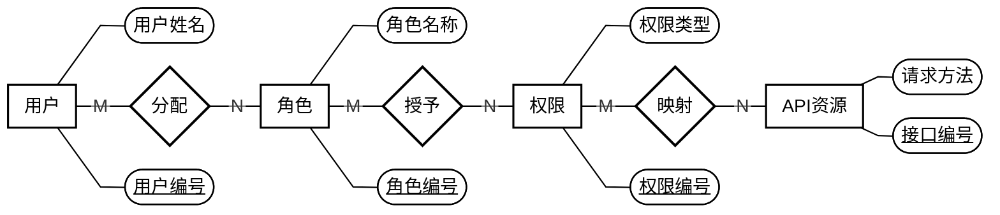

# RBAC 核心整改计划与 Chen 风格 ER 图

> 原版执行计划：以老师检查纪要、补充图片和用户确认确定需求，方案选择经小组评审。
> [整改入口](README.md)提供任务导航，[复核说明](RBAC检查记录复核说明.md)记录需求归属，进度与评审证据见第 5 节。

## 1. 目标、依据与本轮边界

以《2-9组检查记录》第一轮技术纪要为基础，结合补充图片及用户确认整改；令牌机制属于运行支撑。旧需求、设计与代码用于差异核对，逐项依据见[复核说明](RBAC检查记录复核说明.md)。

**本轮目标：完成“用户—角色—权限—API”的实际授权链路，并支持按部门管理约一万名用户。**

| 项目 | 本轮处理 |
|---|---|
| 用户、角色、权限 | 保留核心对象及用户—角色、角色—权限两组多对多关系 |
| 公司与部门 | 公司并入层级部门，支持本部门及下级部门的人员管理 |
| 菜单、按钮、API | 菜单和按钮组成权限树，API 单独建模并与权限关联 |
| 管理员 | 由角色中的实际管理权限决定，不增加管理员属性，不按角色名判断 |
| 会话、统一登录标识、离职交接、角色版本和复杂业务 | 清除超范围模型和功能；鉴权日志按最新用户要求复用，限最小记录与查询，不恢复完整业务审计 |
| 基础认证 | 仅提供当前用户身份；记录中的令牌登录、会话不写数据库是运行前提，令牌机制不作为 RBAC 设计或验收目标 |
| API 设计 | 必须先评审界面原型，再补齐需求/API 说明并审核契约；不能由旧文档直接批量生成接口 |
| 后端技术 | 使用 Spring Data JPA、AOP、声明式事务和清晰的模块分层；补充图片还要求 CloneFactory 落地，具体课程用法由 T05 核对；沿用 Java 21、Spring Boot、MySQL |
| 前端与课程系统 | 当前按用户安排暂缓开发；下一阶段“权限系统＋课程系统”的要求仍待落实，仅有多系统字段不算完成 |

现有 Controller、Service、Repository 及分页搜索可复用；产品业务仍使用旧部门模型和 JDBC。T02 新 JPA 模型已完成独立验证，后续须接入部门树、统一列表及真实业务调用。

### 1.1 补充依据与本次保持的边界

2026-11-07 补充检查图片要求跨部门调动、针对用户的权限、部门范围授权、REST、读写声明式事务和 CloneFactory，来源见[复核说明](RBAC检查记录复核说明.md#11-补充图片要求)。老师三份 Excel 用于核对数据及导入适配，权限目录按已评审场景选取；别组 HTML 作为交流参考。

用户于 2026-11-07 确认：复用最小鉴权日志；普通员工及无有效管理权限账号拒绝登录，取代此前登录后提示方案。部门管理员仍管理本部门及下级；本轮保留部门树查询，完整组织 CRUD 和固定菜单清单尚未列为必做项。管理员由角色的实际权限决定。

<a id="login"></a>

### 1.2 登录要求与统一账号口径（2026-11-08）

按课堂要求支持“工号或手机号＋密码”，用户确认“用户名就是工号”。本节取代此前仅 username 登录、另查工号来源的方案，来源见[复核说明 1.3](RBAC检查记录复核说明.md#13-登录要求与字段口径)。第一轮检查清理独立统一标识模型，基本登录方式按本节保留。

| 字段/输入 | 唯一含义与规则 |
| --- | --- |
| `users.id` | 内部主键，供用户角色关系及日志引用；工号或手机号登录均得到同一 ID |
| `users.username` | **工号，也是用户名和登录名**；非空、唯一字符串，最多 100 字符。直接取员工表“用户名”，保留前导零和字母 |
| `users.phone` | 同一用户的手机号，最多32字符；非空时唯一，空白归一为 null；没有手机号仍可用工号登录 |
| `users.password_hash`、`enabled` | 继续提供口令与有效性支撑，真实来源仍须核对；手机号不另设口令、状态或权限 |
| 登录 `{account,password}` | 一个输入框接收工号或手机号；account 去首尾空白后按 `username` 或 `phone` 等值匹配，password 不 trim；两种入口执行完全相同的口令、有效性和管理权限检查 |

`id` 负责内部关联，`username` 负责业务识别与登录，两者职责不同。目标模型删除重复工号 `employee_no`/`employeeNo`，使用用户表直接匹配工号或手机号。两者均按字符串等值查询；判重与查询采用一致的 MySQL 字符比较规则。导入及账号写入口校验各字段唯一性和跨用户碰撞：同一输入命中不同用户时拒绝并报告冲突；登录统一返回 `LOGIN_FAILED`。同时命中同一用户的两个字段按一个用户处理，不按长度、数字特征或字段优先级选择账号。

T03 在导入前修正用户映射、约束和测试，保留来源与 ID 对应，已有冲突先报告再处理。T04 双入口补充原型/契约已技术复核并获用户确认，证据见[契约8.1](RBAC原型与API契约.md#login-review)及Issue #5；T05仍需T03完成并取得本次修订合入后的共同基线再实现。T12 清理旧标识表、触发器、重复字段及调用，T13 验证同身份、同授权及一致失败规则。历史验收保留，新增要求按本次修正验收；15 票及直接依赖不变。

## 2. ER 图与九张表

### 2.1 核心 ER 图


静态图用于核对标准 Chen 符号；三段 Mermaid 保留相同实体和关系，便于编辑讨论，其布局和属性形状随阅读器变化。图中“用户编号”表示内部主键 `users.id`。

### 2.2 Mermaid 关系源码

<details>
<summary>展开查看 Mermaid 关系源码</summary>




</details>

### 2.3 关系与参与约束

| 关系 | 基数 | 约束 |
|---|---|---|
| 用户—分配—角色 | M:N | 用户可以有多个角色，也可以暂时无角色；角色可以暂时无用户 |
| 角色—授予—权限 | M:N | 角色可以有多个权限；一个权限可以被多个角色使用 |
| 权限—映射—API | M:N | 一个权限可以对应多个 API；同一 API 可以被多个权限复用 |
| 部门—人员归属—用户 | 1:N | 每个用户必须属于一个部门；部门可以暂时无成员 |
| 应用系统—包含权限—权限 | 1:N | 每个权限只属于一个系统 |
| 应用系统—登记接口—API | 1:N | 每个 API 只属于一个系统 |
| 部门—组织隶属—部门 | 1:N | 每个部门最多一个上级；根部门没有上级；禁止循环 |
| 权限—权限层级—权限 | 1:N | 每个权限最多一个父权限；同系统内组成树，按钮不能有子节点 |

额外约束：权限只能映射同系统的 API；用户不直接关联权限，部门不直接授予角色或权限。

### 2.4 从概念模型落地为九张表

六个实体表加三张 M:N 关联表，构成本方案的**六个核心实体、九张核心物理表**。九表是方案的映射选择；复用的 `authorization_logs` 属于运行支撑，保留在核心 ER 和三段关系源码之外。

| 表 | 主要字段 | 用途 |
|---|---|---|
| `users` | `id, name, department_id, enabled` | RBAC 用户身份与所属部门 |
| `roles` | `id, code, name, enabled` | 全局共享的角色定义 |
| `permissions` | `id, system_id, parent_id, code, name, type, enabled` | 菜单和按钮权限树，type 为 MENU 或 BUTTON |
| `departments` | `id, parent_id, code, name` | 公司、分公司、部门组成的组织树 |
| `systems` | `id, code, name, enabled` | 权限与 API 所属的系统 |
| `api_resources` | `id, system_id, http_method, path_template, enabled` | 可被授权访问的后端接口 |
| `user_roles` | `user_id, role_id` | 用户拥有的角色 |
| `role_permissions` | `role_id, permission_id` | 角色拥有的权限 |
| `permission_apis` | `permission_id, api_id` | 权限对应的 API |

约定：

- 实体表以 id 为主键；三张关联表以两个外键组成联合主键，防止重复关联。
- 权限编码在系统内唯一；API 的“系统＋请求方法＋路径模板”组合唯一。
- 登录字段按 [1.2](#login)：`username` 为工号，`phone` 为同账号另一入口，`password_hash` 校验口令；岗位作为资料保留，登录字段归入现有用户表。
- 不增加 is_admin、角色父节点、直接用户授权、独立管理范围表或登录资格表。
- Java 中系统实体命名为 ApplicationSystem，避免与 System 混淆。

### 2.5 T01 模型核对与 T02 映射基线

T01 以 `e737579` 为代码基线，由子 agent 核对、主 agent 按用户授权评审，结论见 [5.3](#53-t01-评审记录与未决项)。本节作为 T02 落库约束基线。

| 对象 | 当前映射与需实现验证的约束（T02历史证据见4.3） | 依据归属 |
| --- | --- | --- |
| 用户、角色、权限 | 用户可无角色或多角色；角色可无用户或无权限；用户不直接获权，部门不直接授予角色/权限 | 用户—角色、角色—权限及管理员来源是纪要要求；无角色等参与约束沿用方案 |
| 部门 | `parent_id` 可空，其他父引用必须存在；禁止自指、循环；用户 `department_id` 非空。公司改为部门节点，不保留 `company_id` 和部门负责人授权规则 | 层级部门是纪要要求；每人一个部门是方案建议 |
| 应用系统 | `ApplicationSystem` 对应 `systems`；权限和 API 各有一个非空 `system_id`。系统停用使该系统授权失效；若因此不再有本权限系统有效管理操作权限，按3.1拒绝登录 | 双系统方向是纪要要求；具体表名与有效性规则是方案建议 |
| 权限树 | `type` 限定 MENU/BUTTON；父节点可空，父子必须同系统；禁止自指、循环，BUTTON 不得有子节点；`(system_id, code)` 唯一 | 菜单/按钮树是纪要要求；约束细节是方案建议 |
| API 与映射 | `(system_id, http_method, path_template)` 唯一；`permission_apis` 两端必须同系统；同 API 可被多个权限引用。父菜单或补出的导航祖先不隐含子 API 授权 | API 独立且与权限关联是纪要要求；M:N 与匹配方案是方案建议 |
| 三组 M:N | `user_roles`、`role_permissions`、`permission_apis` 使用双外键联合主键，重复关联不能产生第二条记录；必要外键必须真实存在 | 前两组 M:N 是纪要要求；第三组及物理结构是方案建议 |
| 员工与登录支撑 | 只保留唯一工号`username`、可空且非空值唯一的`phone`及`password_hash`，不另设`employee_no`。T03修正重复字段及对应约束/测试，Excel“用户名”直接作为工号来源。2026-11-10用户确认按新项目初始化：员工全部启用、员工统一初始口令与管理员独立口令分别从部署配置读取；不复用旧哈希、状态或授权，详见4.4—4.5 | 工号/手机号登录按课堂要求；用户名即工号由2026-11-08用户明确。T02历史证据保留，新项目初始化按2026-11-10确认执行 |

六个实体以 `id` 为主键；`roles.code`、`departments.code`、`systems.code` 各自唯一。MySQL 验证外键与联合唯一性；领域写入口验证树循环、BUTTON 子节点及同系统关系，失败后保持原状态。数据库唯一约束防重复，自引用外键校验父引用，领域入口另检循环。

T02 允许多根用于独立模型测试。业务组织以原始 Excel 的共同根为基线：2026-11-02 静态核对为 111 个部门、一个“总公司”根且父引用完整；T03 继续验证无环、连通及全量归属。多根、孤立或覆盖不全时报告异常并阻塞集成。全局维护使用核实后的实际根 ID、树关系和操作权限；具体编码/路由交相应原型契约，登录按 [1.2](#login)。

## 3. 授权规则与接口讨论基线

### 3.1 授权规则

**接口操作权限来自角色，人员管理范围来自操作者所在的部门树；两项同时满足才允许管理操作。**

**管理端准入**：按 [1.2](#login)定位用户，账号有效、口令正确，且至少具有一项本系统已评审的有效管理操作权限（含管理查询）才可登录。普通员工、无角色或无有效管理权限时拒绝；岗位、角色名、角色非空及菜单可见均不作为准入依据。沿既有登录和错误响应复用统一有效权限计算，增加准入判断；管理员属性、资格表、额外认证接口及令牌机制均不新增。每次管理请求另校验具体权限和部门范围。

1. **实际接口鉴权**：在用户和所属系统启用的前提下，沿“用户 → 启用角色 → 启用权限 → 启用 API”检查访问权，匹配服务端识别的请求方法与 Spring 路径模板。不能只隐藏按钮、信任前端传来的权限名，或以模拟鉴权结果替代真实接口拦截。登录准入与接口鉴权复用同一有效权限来源，不能各自维护一份管理员名单。
2. **菜单与授权分开**：拥有父菜单不自动拥有子按钮权限；为了导航展示而补出的祖先菜单不产生额外接口授权。
3. **API 复用**：同一 API 被多个权限关联时，命中任一有效授权即可访问；未授予的 API 保持拒绝。
4. **部门管理员**：由角色中的实际管理权限决定，角色名称和根部门成员身份本身都不授予管理权。须有对应操作权限，且只能管理本部门和下级部门人员；分配的角色权限不得超出自身有效权限。
5. **全局维护**：角色定义、角色授权、系统、权限和 API 映射的修改，要求操作者直属经 T03 核对、覆盖当前全部组织的共同根部门，且拥有对应实际管理权限；普通根节点或部门名称不构成资格。
6. **防止越权**：部门管理员不能修改全局管理员，也不能修改自己的授权或所属部门。调整人员部门时，原部门和目标部门都必须在允许范围内。
7. **管理员保护**：最后一名有效全局管理员不能被停用或撤权；相关检查和修改必须在事务内并通过锁处理并发情况。
8. **默认拒绝**：受控接口未登记、未映射或授权失效时拒绝访问。登录为匿名入口，但成功须满足当前账号规则；本人身份和本人权限查询要求有效登录，不单独要求人员管理权限。撤销管理权限后的管理请求拒绝，再次登录也须拒绝。

**认证边界**：基础认证提供可信当前身份，RBAC 按最新角色、权限和部门范围处理后续请求。令牌登录、会话不落库为运行前提；格式、时效、签发、刷新及退出沿基础设施处理，认证框架调整不列为独立整改任务。

“针对用户的权限”通过 T10/T11 落实：选择范围内人员，查看当前及可分配角色，分配/撤销后验证真实 API 访问变化。沿用角色授权；最终有效权限的展示方式由 T10 契约评审确定，独立来源说明页属于方案取舍。

### 3.2 原型评审后确认 API 契约

**先原型，后契约，再实现接口。** 按下列场景确认操作范围，替代此前按实体预列整套 CRUD 的方式。

| 必须覆盖的场景 | 原型与契约需要确认的内容 |
|---|---|
| 管理端登录准入 | 工号/手机号使用同一入口、同一用户、同一口令及授权判断；用户名即工号。有管理权限的有效账号成功，普通员工拒绝；覆盖错误口令、停用、未知和歧义输入 |
| 人员列表 | 部门导航、姓名/工号搜索、分页、总数、空结果和无权访问；不能一次返回全部人员 |
| 用户角色分配 | 可管理人员、当前角色、可分配角色、保存和失败反馈 |
| 跨部门调动 | 必须覆盖的受限人员变更；原部门和目标部门均须在操作者范围内，范围外调动拒绝，失败不改变原归属与授权 |
| 角色权限配置 | 菜单/按钮树、已选权限、保存语义和越权限制 |
| 菜单/按钮与 API 映射 | 系统归属、请求方法、路径模板和关联关系；不自动扩成每类资源的完整 CRUD 页面 |
| 真实接口访问 | 有权和无权两种结果，确认 AOP 实际拦截受控接口 |
| 鉴权日志 | 复用旧记录及分页查询；仅有日志查询权限且满足全局维护范围的账号可查看，部门管理员拒绝；不纳入归档、导出或完整审计平台 |
| 下一阶段双系统 | 权限系统与课程系统的独立资源归属，以及角色变化对两类接口访问结果的影响；课程侧场景尚待落实 |

原型评审后，补齐方法、路径、字段、响应、错误、分页、部门范围及权限条件，作为实现与验收契约。正式前端暂缓期间仍完成原型；模型、JPA 和独立授权规则可先验证，正式 Controller 依赖对应契约评审。

本方案暂用以下简化约定，均属于实现默认值，不是老师逐项指定的格式：

- 沿用现有统一响应外壳；分页返回 items、total、page、size。第 0 页起，默认每页 20 条、最多 100 条。
- 部门筛选包含下级；先限制操作者管理范围，再应用筛选和搜索。部门树只返回可管理范围。
- 三类授权关系采用整体替换，候选请求体为 `{"ids":[...]}`，空数组表示清空；写入整体成功或整体回滚。
- 人员以原始数据导入为主，不增加注册、找回密码流程。角色、权限、系统和 API 默认通过停用处理，不增加批量物理删除流程。
- 移除独立管理权限、管理范围、交接及业务目录演示；保留最小鉴权日志记录/查询，移除日志归档和授权变更历史等扩展。登录只增加本节的权限准入判断，认证机制继续作为运行支撑。

四组产物见[统一原型与 API 契约](RBAC原型与API契约.md)：可运行 HTML、请求/响应/错误/范围及验收案例。2026-11-07 评审和用户确认见 5.5；正式接口由后续业务票实现。

T04/T06/T08/T10 及后续 T14 逐项审核 REST：资源命名、HTTP 方法、路径、参数、响应与错误符合场景，查询无业务写操作。人员列表须覆盖部门分组、搜索和分页；操作范围由评审场景确定。

### 3.3 T01 有效全局管理员与保护边界

以下为代理评审确认的方案规则。**有效全局管理员是直属已核实共同根的同一个有效用户，经启用角色、权限、同系统 API 及系统，拥有完整维护能力集合 K。** 本人多个角色可汇总，按 distinct 用户计数；不同用户的零散权限分别计算。

K 固定为角色定义维护、角色权限配置、人员角色分配、菜单/按钮及 API 映射维护四类能力，包含必要查询。T06/T08/T10 落实具体操作、编码及映射，T07/T09/T11 共用判定。新增系统停用等影响维护恢复能力的场景时，先统一评审并回写 K，再同步所有写入票。

具体 K 为[契约 2.3](RBAC原型与API契约.md#common)列明的全部方法与模板：`rbac.users.read`、`rbac.users.roles.write`、`rbac.resources.read`、`rbac.resources.write`、`rbac.roles.read`、`rbac.roles.write`、`rbac.roles.permissions.write`。本人多角色、多权限 OR 映射均可覆盖；日志、停人和调动不计入 K。真实 `rbac` 系统 ID、共同根及各资源 ID 由来源核对产生。T06 维护必要资源字段、停用及映射，系统停用和 method/path 编辑留在当前范围之外；这些属于用户已确认的方案选择。

管理员保护覆盖同一已确认共同维护域，按修改后完整状态至少保留一名各自拥有完整 K 的有效用户；首次可信初始化由 T05 原子建立基线。

管理人员按具体权限在允许范围内操作。完整 K 只用于保留至少一名可继续维护授权的用户；登录和单项操作按各自权限判断。

| 会改变有效管理员集合的变更 | 必须检查的后果 | 对应票 |
| --- | --- | --- |
| 用户停用、用户移出根部门、用户角色替换/解除 | 用户是否仍有效、仍处于允许维护域，并仍拥有 K | T11 |
| 角色停用、角色权限替换/解除 | 不能只检查用户状态；保留角色名或空角色不等于保留能力 | T09 |
| 权限停用、API 停用、映射解除或改到其他 API | 必须确认实际维护接口仍可访问；有权限节点但无有效映射不算能力 | T07 |
| 系统停用或改变所属系统、权限树/部门树调整 | 系统有效性、同系统关系或根部门身份可能变化，相关写入也必须遵守同一保护 | T07；若其他契约纳入树维护则由该切片承担 |
| 同时撤权、停用或移动不同管理员 | 以事务修改后的完整状态重新判定；并发写入共用稳定的锁定顺序/保护点，失败整体回滚 | T07/T09/T11 |

旧 [`ManagementAccessRepository.java`](../../src/main/java/com/municipal/rbac/ManagementAccessRepository.java) 第 10、22、26 行使用“系统管理员”、GLOBAL 和 `management.grant` 计数/锁定。新保护改用实际 K，并由写入票共同确定稳定锁点、顺序及并发验证；可改名或停用的角色代码不作为锁依据。

部门管理员拒绝修改有效全局管理员及自己的授权/部门。调动须同时满足原、目标部门范围；角色分配比较有效权限子集。全局维护须先核实共同根及覆盖范围，再检查实际权限；部门名和空 `parent_id` 只作为组织资料。

### 3.4 事务、映射与课程技术落地

Service 明确声明式事务边界：查询采用只读事务，写操作整体成功或回滚。T05 验证首个查询链，T07/T09/T11 验证各自写入，T13 复核跨入口行为；管理员保护共用 3.3 的判定与锁策略，以实际调用、回滚及并发证据验收。

CloneFactory按用户指定的老师项目核对：`cn.edu.xmu:clonefactory:0.0.1-SNAPSHOT`，provided依赖及显式注解处理器。T05真实DTO调用使用课程生成的`CloneFactory.copy`；固定来源、构建步骤及兼容性见4.6。T07/T09/T11复用，旧`DtoMapper`留给T12清理，不以其`ObjectMapper.convertValue`充当课程映射器。

### 3.5 复用最小鉴权日志

复用 `AuditController`、`AuditService`、`AuditRepository`、`AuditRecorder`、`RequestAuditFilter`、`AuditDtos`、`authorization_logs` 及日志列表。既有过滤器记录登录及 401/403，真实 API 的允许/拒绝记录由 AOP 衔接。保留时间、可识别操作者、方法/路径、结果/原因和 requestId；单次判定只记一次，口令、令牌、请求体和查询串排除在记录之外。

T04 评审登录拒绝、最小记录及全局分页/筛选查询，T05 接入真实链路并将相关 JDBC 迁 JPA。查询同时要求日志 API 权限和全局维护范围，部门管理员直接请求也拒绝。T06/T07 配置相应权限/API，T08/T09 保持角色授权与全局限制一致。

日志范围为最小记录与查询；`/archive`、导出、变更历史及全业务审计由 T12 清理，同时保留必要错误上下文。旧库和历史日志原位保留，历史全量迁移不列为本轮任务；选用历史记录时核对旧、新用户引用。旧页面做必要兼容与清理，正式新前端继续暂缓。

## 4. 实施顺序、架构与数据

| 阶段 | 工作 | 完成条件 |
|---|---|---|
| ① 模型评审 | 核对核心实体、关系、部门范围和功能取舍 | 图、表和授权规则一致，老师要求与方案默认值分开标注 |
| ② JPA 与授权规则 | 建立新表、导入组织人员，整理 Service/Repository 和角色权限计算 | 数据可核对，核心持久化使用 JPA，授权规则可独立验证 |
| ③ 原型与 API 评审 | 按场景评审界面原型，补齐需求/API 契约 | 原型和契约逐项确认；正式前端暂缓不妨碍开展原型评审 |
| ④ 实际接口与 AOP | 依据已确认契约实现人员查询、授权修改及接口拦截 | 真实 HTTP 请求受角色权限和部门范围控制；不得跳过阶段③ |
| ⑤ 验收与交付 | 同步初始化、配置、测试、文档和演示，提交 PR | 分别记录已验证的 RBAC 后端结果及仍待完成的双系统演示，不以结构预留代替验收 |

实施约定：

- 沿用 `refactor/rbac-core-backend` 分支；首次建立时以确认后的 main 为起点。按阶段提交，使用 PR 审阅，不自行合并。
- 保留本地未跟踪的小组文档，避免随重构误删或批量提交。
- Controller 负责 HTTP 输入输出；Service 负责业务规则和事务；Repository 使用 Spring Data JPA。使用明确的实体与 DTO，减少跨层通用 Map。
- AOP 统一检查实际接口授权；部门范围、可授予角色和管理员保护由 Service 在事务中验证。
- 删除旧功能时，同时处理调用方、DTO、初始化、测试、配置和说明文档，不能只删表。

数据处理采用 **独立整改数据库导入并核对，再切换配置** 的方式，保留原库和原始 Excel。2026-11-10用户明确按新项目初始化，不再迁移旧账号、哈希、状态和授权；以下历史迁移对照用于识别待替换调用，不作为恢复旧数据的指令。

- 按原部门表恢复组织树，将员工逐一关联到对应部门，保留原人员资料。
- 原始权限清单只作参考，当前仅整理权限系统所需的菜单、按钮和真实 API。不得将旧目录中的全部应用、业务功能点或 OA 等模块整包迁入新系统；课程系统目录在对应场景确认后补充。
- RBAC 的 API 按评审后实际实现登记，未知课程接口不编造。只登记两个系统名称或保留 system_id，不代表已经满足下一阶段双系统要求；须有明确课程侧受控场景和可复核的授权结果。
- 旧角色分配、管理权限和范围逐项转换；移除按“系统管理员”等角色名绑定 GLOBAL/COMPANY/DEPARTMENT 范围的旧规则，改为实际管理权限加部门树。不能明确对应的授权先不启用并记录差异，防止扩大权限。
- 变更权限编码或接口时同步更新初始化和测试。旧前端后续适配经原型确认的新契约；HTTP 验证须在相应接口实现后执行，不能把本次文档复核或旧报告当作验证结果。

### 4.1 T01 工程复用、替换与删除对照

下表为 `e737579` 源码的静态迁移对照，行号随源码变化重新查找。各业务票迁移本票调用与测试，T12 全仓检查残留；共享旧实现随调用迁完后移除。

| 处理 | 源码证据与现状 | 需要到达的调用、初始化、测试、配置和文档范围 |
| --- | --- | --- |
| 复用工程骨架，加入 JPA/AOP | [`pom.xml`](../../pom.xml) 第 4、6、11—15 行为 Java 21、Spring Boot、Web、JDBC、MySQL；[`RbacApplication.java`](../../src/main/java/com/municipal/rbac/RbacApplication.java) 第 6—9 行是既有启动入口 | T02 继续同一 Maven 工程并保留 MySQL；JDBC 在旧调用迁完前保留。AOP 随真实接口切片接入，不为模型测试另建产品工程 |
| 复用响应、异常处理与最小日志上下文 | [`ApiResponse.java`](../../src/main/java/com/municipal/rbac/ApiResponse.java) 第 4 行；[`ApiResponseAdvice.java`](../../src/main/java/com/municipal/rbac/ApiResponseAdvice.java) 第 15 行和 [`ApiExceptionHandler.java`](../../src/main/java/com/municipal/rbac/ApiExceptionHandler.java) 第 24—25 行调用 `RequestAuditFilter` | 保留统一外壳、HTTP 状态、安全错误及 requestId；T05 适配可信操作者和日志记录，T12 清理旧耦合时不得删断这些调用 |
| 复用 Excel 读取，替换初始化策略 | [`ExcelXmlReader.java`](../../src/main/java/com/municipal/rbac/ExcelXmlReader.java) 第 13、30 行处理工作簿及禁用外部实体；[`DataInitializer.java`](../../src/main/java/com/municipal/rbac/DataInitializer.java) 第 14—28、38—53、62—64 行导入旧五类角色/范围/目录，仅核对上级而不保存树关系 | T03 仅导组织人员并核对来源与异常；T05 建最小已评审授权基线；T12 移除旧角色名授予、旧整包目录、默认初始化路径及相关测试假设。三份 Excel 原位保留，权限清单不整包迁入 |
| 替换组织及用户持久化 | [`schema.sql`](../../src/main/resources/schema.sql) 第 2、9、20 行为 companies、无 parent 的 departments、可空用户部门；[`ManagementService.java`](../../src/main/java/com/municipal/rbac/ManagementService.java) 第 88—95 行拒绝 parentId | T02 建树模型，T03 迁人员；T05/T11 迁查询和受限变更；T12 处理旧公司 CRUD、Requests/Responses 组织字段、`Organizations.vue`、`main.js` 路由、初始化及测试。旧公司/部门 ID 不直接混作新 ID，来源对应由 T03 核对 |
| 替换双轨授权及旧范围 | [`ManagementAccessRepository.java`](../../src/main/java/com/municipal/rbac/ManagementAccessRepository.java) 第 9—14 行把独立管理权限、GLOBAL/COMPANY/DEPARTMENT 与角色名绑定；[`ManagementController.java`](../../src/main/java/com/municipal/rbac/ManagementController.java) 第 9—18 行提供旧管理权限/范围接口 | T05 统一用户—角色—权限—API 和部门范围；T09/T11 迁角色配置与人员分配。T12 删除 `role_management_permissions`、`management_scopes`、Scope/Assignments DTO、`ManagementGrants.vue`、`RoleManagementEditor.vue` 及其前端调用和测试；不把旧范围静默翻译成更大授权 |
| 复用分页/搜索行为，替换 SQL 和重复列表 | [`ApplicationService.java`](../../src/main/java/com/municipal/rbac/ApplicationService.java) 第 27—52 行已有两个列表入口；[`ApplicationRepository.java`](../../src/main/java/com/municipal/rbac/ApplicationRepository.java) 第 9—16、29—34 行已有筛选、计数、分页，但依赖旧公司/范围/交接 | T04 先确认唯一列表场景与分页契约，T05 以 JPA 在部门范围内检索、计数和分页；迁同切片 DTO 和测试。`Users.vue`、旧调用和说明由 T12 收口，正式新页面仍暂缓 |
| 替换业务功能目录和模拟鉴权 | [`schema.sql`](../../src/main/resources/schema.sql) 第 36—86 行为 applications/modules/features/actions/permissions；[`ApiController.java`](../../src/main/java/com/municipal/rbac/ApiController.java) 第 17、43—50 行及 [`ApplicationService.java`](../../src/main/java/com/municipal/rbac/ApplicationService.java) 第 18 行仍靠前端传权限名返回模拟结果 | T06/T08 先做原型/契约；T07/T09 迁菜单/按钮—API 映射及角色授权，T05 起由 AOP 拦真实接口。T12 移除旧目录结构、`Portal.vue`/`System.vue` 调用、旧鉴权演示及测试，不把目录展示判为真实授权完成 |
| 删除会话表与统一登录标识依赖 | [`AuthRepository.java`](../../src/main/java/com/municipal/rbac/AuthRepository.java) 第 14—17 行读写 `login_identifiers`/`sessions`；[`DatabaseConstraints.java`](../../src/main/java/com/municipal/rbac/DatabaseConstraints.java) 第 12—17 行建旧外键/标识触发器；[`AuthService.java`](../../src/main/java/com/municipal/rbac/AuthService.java) 第 8—23 行依赖数据库会话 | T03先修正重复工号字段，T04/T05按1.2和4.2衔接；T12检查重复字段残留、schema、触发器、`deploy/install-login-constraints.sql`、会话配置、测试及登录说明。新链路就绪前旧调用不提前删；整改库不能启动这些旧组件 |
| 删除交接和审计扩展，复用鉴权日志 | [`ApiController.java`](../../src/main/java/com/municipal/rbac/ApiController.java) 第 51—56 行；[`AuditController.java`](../../src/main/java/com/municipal/rbac/AuditController.java) 第 4—9 行；[`RequestAuditFilter.java`](../../src/main/java/com/municipal/rbac/RequestAuditFilter.java) 第 24—28 行；[`ApplicationRepository.java`](../../src/main/java/com/municipal/rbac/ApplicationRepository.java) 第 28、34、38、65 行混合日志/交接/会话 | T05 复用 authorization_logs、Audit* 最小记录/查询及 requestId，迁 JPA 和统一权限；T12 删除 handovers、authorization_changes、归档接口、扩展 DTO 及对应前端调用/测试/配置，保留日志查询链及必要旧页面适配，按 3.5 验证 |
| 清理测试、配置和历史说明 | [`AccessBoundaryTest.java`](../../src/test/java/com/municipal/rbac/AccessBoundaryTest.java) 第 25—81 行绑定会话/交接；[`IdentifierConstraintTest.java`](../../src/test/java/com/municipal/rbac/IdentifierConstraintTest.java) 第 16—42 行绑定标识触发器；[`application.yml`](../../src/main/resources/application.yml) 第 2、14、18—20 行开启旧本地配置/SQL/初始化/会话设置 | 各票保留越权、回滚、分页、日志脱敏和数据异常等有效测试意图并改成新模型；T12 清除审计扩展、旧范围、标识/会话及失效原型断言，更新普通员工登录拒绝的旧假设。检查 `frontend/tests`、部署脚本、README、docs；`docs/legacy` 只作差异参考 |

源码基线没有独立角色版本表或字段；新模型排除角色版本，T12 核对文档中的版本及交接残留约定。

### 4.2 T01 最小身份衔接与隔离边界

基础登录复用 `AuthService.java` 第 12 行的 `BCryptPasswordEncoder.matches`、有效性检查及 3.1 的统一管理准入。可信身份以 `users.id` 关联新用户；受控请求读取最新启用状态、角色、权限和部门，客户端用户 ID、权限或管理员标记不作为可信依据。

现有 Bearer 解析、数据库会话与当前用户查询耦合，尚无可直接复用的无会话实现。T05 负责可信身份与新用户读取的真实 HTTP 衔接；测试注入身份用于模型/规则验证。令牌细节沿 3.1 的认证边界处理，基础衔接归入 T05。

工号/手机号统一定位同一`users.id`，再校验该用户当前哈希、有效状态和管理权限，字段及登录范围按[1.2](#login)。按2026-11-10用户确认，初始哈希/状态来自4.4的新项目配置，不复用旧库。注册、找回密码、免口令入口及独立凭证/会话实体留在范围之外；T03拒绝不明归属，T05取得修正后的T04复核结论及T03输入后实现。

T02 在同一 Maven 工程使用旧启动包 `com.municipal.rbac` 扫描范围之外的兄弟包（如 `com.municipal.rbaccore`）放新模型；测试显式选择实体、JPA Repository 和必要自动配置，不新增替代产品 `SpringBootApplication`。只接独立整改 MySQL 测试库，关闭旧 SQL 初始化（`spring.sql.init.mode=never`），不扫描旧 `DataInitializer` 和 `DatabaseConstraints`，不继承旧库连接或旧本地配置导入。仅关闭 `rbac.initialize` 不足以隔离：`DatabaseConstraints` 仍会运行，且原配置 `sql.init.mode=always` 仍会建旧表。测试前核对实际数据源和加载组件，验证没有旧表/触发器及原库写入。

T02 保留原启动与旧调用，新模型独立验证；T05/T07/T09/T11 逐块接入，T12 切换正式启动/配置并清理旧实现。产品 HTTP、正式界面和课程 T14/T15 按各自任务验收。

### 4.3 T02 独立模型与验证

同一 Maven 工程加入 Spring Data JPA，六实体及六个 JpaRepository 位于 `com.municipal.rbaccore`，在旧启动扫描范围之外。实体映射九表，三组关联采用双外键联合主键；树移动、权限类型及 API 映射先由领域入口验证，集合只读，事务由调用方管理。产品入口和 JDBC 暂保留，正式 Controller、页面、认证及导入交后续票。

CoreModelJpaTest 使用显式测试配置和独立配置名 `application-core-model-test`，不加载旧 application.yml/本地导入，不扫描 DataInitializer、DatabaseConstraints，SQL 初始化为 never。数据源实例化前校验 URL，只允许本机显式端口的 `rbac_core_t02_test`；须使用仅有该一次性库权限的账号。测试使用 create-drop，会创建和删除该库中的模型表；连接配置缺失时失败，不跳过测试。

复现时准备 MySQL 8 及 Java 21，在本机设置 RBAC_CORE_TEST_DB_URL、RBAC_CORE_TEST_DB_USER、RBAC_CORE_TEST_DB_PASSWORD，口令不写入仓库。URL 示例：`jdbc:mysql://127.0.0.1:3317/rbac_core_t02_test?connectionTimeZone=UTC`。从仓库根目录执行，Maven 不在 PATH 时使用本机绝对路径：

```powershell
mvn -B -ntp '-Dtest=CoreModelRulesTest,CoreModelJpaTest,ExcelXmlReaderTest,InfrastructureBoundaryTest,InitializerValidationTest,RuntimeBoundaryTest,RequestAuditBoundaryTest' test
mvn -B -ntp -DskipTests package
```

2026-11-02，子 agent 在独立 MySQL 8.4.13 上验证：52 项通过（新模型 37 项、既有无库单测 15 项），失败/错误/跳过均为 0；Spring Boot 打包成功。实查九表、11 个外键、三组联合主键，七类唯一性、11 类缺失引用和三类非空拒绝；清空 JPA 上下文后读回多角色/无角色、共享 API 和父子关系，并验证树移动、跨系统拒绝与领域失败事务回滚。上下文没有旧表、触发器、初始化器或正式 Controller；账号仅能写独立测试库。

2026-11-02，主 agent 按用户“进行 T02 评审，没问题就合并然后 close”授权完成评审，基线 `6ba488f`、实现 `84f77c5`。独立 Standards：明文违规 0，非阻塞 P3 观察 1 项（Department/Permission 祖先遍历相似，但领域约束不同，保留各自实现）；Spec：缺失/部分、扩展、错误均为 0。源码、Surefire 报告及打包产物支持下表五项验收；合入和关票记录见 [PR #18](https://github.com/minxuanbo/ooad-course-project/pull/18) 与 [Issue #3](https://github.com/minxuanbo/ooad-course-project/issues/3)。

| T02 验收 | 本次核对证据 |
| --- | --- |
| 复用原工程及所需 JPA | pom.xml 仅加入 Spring Data JPA，保留 Java/Spring Boot/MySQL 和旧产品入口 |
| 核心实体、关联与约束 | 六实体映射九表，数据库约束测试与领域规则测试覆盖联合主键、唯一性、外键、同系统及树约束 |
| 小样例完整数据链 | CoreModelJpaTest 清空上下文后读回多角色/无角色、共享 API、部门及权限父子关系 |
| 独立整改库隔离 | 显式测试配置、数据源 URL 守卫、never 初始化及专库账号；实查无旧表、触发器或旧初始化器 |
| 共存及接口边界 | 4.2 和本节记录集成责任；旧调用保留，diff 无正式 Controller、产品页面或新认证功能 |

评审核对已有 52 项测试与打包证据，未重复运行；PR 无 CI check runs，JaCoCo 门槛保持原值。全量 `mvn verify`、旧库集成、真实 HTTP、并发授权及界面验收待对应任务验证。T03 负责真实导入；T05/T07/T09/T11 接入时核对扫描、事务与初始化，T12 最终切换。正式接口的原型/契约前置、前端暂缓及课程后续范围继续适用，原库、Excel 和本地资料保留。

2026-11-08 修正：52 项测试对应当时含 `employee_no`、`username` 的模型，作为历史证据保留。T03 按 [1.2](#login) 删除重复映射、调整构造/调用/夹具，并独立补工号与手机号唯一性、跨用户碰撞及导入验证，结果另按T03证据记录。

### 4.4 原始数据复核与导入前置

2026-11-07，老师三份 Excel 与仓库副本的大小和 SHA-256 均一致；权限清单原件名含 `(1)`。摘要、哈希及异常单元格见[复核说明](RBAC检查记录复核说明.md#12-原始数据复核)，原件保留原位。

- 员工恰为10,000人，原表六列为姓名、用户名、分公司、部门、岗位、电话号码。按1.2，“用户名”直接映射唯一工号`username`，“电话号码”映射`phone`；没有另一个名为“工号”的列不构成缺项。原表不提供口令哈希、有效状态或角色分配；部门编码仍是导入映射。重名人员按工号等已核实标识匹配，不能只按姓名。
- 部门共 111 个节点，唯一共同根为“总公司”，无缺失上级、无环且连通。244 人直接匹配原部门名，9,756 人结合分公司前缀匹配，10,000 人均有唯一归属；数据库导入后仍须重新核对实际外键和树关系，不能用本次静态核对代替 JPA/MySQL 验收。
- 原表没有员工直属共同根节点；“总公司”的负责人薛峰属于“公司领导”，该节点共有10名员工。2026-11-10用户明确批准导入转换：将“公司领导”来源节点合并到唯一“总公司”目标节点，其10名人员归属总公司；原表111个组织来源映射为110个目标部门。原件不改，两个组织来源分别保留，不能建立两个同名总公司节点。其他人员按原表组织路径归属，不再按负责人姓名推导人员或权限。
- T03按新项目初始化：保留单工号`username`并删除重复字段、构造参数、约束及夹具；校验工号/非空手机号唯一及跨用户碰撞。员工全部启用，员工统一初始口令和管理员独立口令从部署配置读取并分别生成BCrypt哈希，每个用户独立盐；不迁移旧账号、旧ID、哈希、状态或授权。保留原六列、源文件SHA-256、实际行号、来源唯一键与新ID映射。独立创建账号名默认`admin`的维护账号并归属总公司，总用户数10001、根直属人员11名；不增加管理员实体、字段、资格表或新的管理范围模型。
- 权限清单为 18 个系统、115 个模块、359 个功能点及 5 类角色的业务矩阵，没有真实请求方法/路径，也没有员工角色分配。岗位“部门经理”不等于本项目“部门管理员”；清单中的“全部”不能推导跨部门范围。仅按已评审的实际接口建立菜单/按钮—API 映射，不整包导入业务目录或按岗位自动赋权。
- 三个工作表的范围标记均为 `A1`，实际包含全部数据；读取时须覆盖底层单元格。权限表有合并单元格，分组恢复须遵循合并范围；`H117`、`G310` 的 `view`、`I340` 空白及“本人”限制须记录，选用时明确转换或拒绝，不把空白当允许、不丢失数据范围语义。

T03只建组织、账号和来源，不分配任何角色。启用及已有口令不代表可以登录管理端；T05须建立实际授权及准入校验后才能验收可登录账号。保留原有“本人部门及后代”的范围规则，根归属本身不授予任何管理权限。

用户同时确认首次批量授权不能依赖逐人操作：T05须提供经过确认的“工号—角色”初始化规则/清单、预检数量及冲突报告，在同一事务内批量建立关联；管理员配置完整维护角色，员工基础角色及各级管理角色按确认清单批量配置，不从岗位自动猜授管理权限、不整包迁移旧五类角色/范围。普通员工不得因此获得本系统管理权限。重复初始化不重置已调整授权、不恢复已撤销关联，失败整体回滚；T11负责后续日常人员授权维护。具体角色及员工映射按用户随后确认的4.6首次规则落实，不在T03预建空角色或默认授权。

### 4.5 T03离线导入与交接

同一Maven工程中的`com.municipal.rbaccore.importing`提供离线导入上下文，显式扫描新实体和JPA仓储，不启动HTTP、不扫描旧初始化器/约束组件，不改产品默认入口。九张核心表和六个核心实体保持不变；额外的`import_sources`仅保存导入来源支撑，分别引用部门或用户，原组织三列、员工六列保留为JSON，不保存口令或哈希副本，不进入核心ER。

首次部署步骤：

1. 在MySQL 8中单独创建`rbac_core`库及仅有该库权限的账号，字符集`utf8mb4`、排序规则`utf8mb4_0900_bin`。原库保持原状。
2. 显式选择该库执行[建表脚本](../../deploy/rbac-core-schema.sql)。脚本只含`CREATE TABLE IF NOT EXISTS`，不清空或重建已有表；导入上下文仅`ddl-auto=validate`，结构不符时拒绝。
3. 部署环境设置`RBAC_CORE_DB_URL`（例如`jdbc:mysql://127.0.0.1:3307/rbac_core?connectionTimeZone=UTC`）、`RBAC_CORE_DB_USER`、`RBAC_CORE_DB_PASSWORD`、`RBAC_CORE_EMPLOYEE_PASSWORD`和`RBAC_CORE_ADMIN_PASSWORD`。后两项必须分别显式提供，无旧口令默认值，不通过命令行参数或Git传递。可选`RBAC_CORE_SOURCE_DIR`指定原件目录，`RBAC_CORE_ADMIN_USERNAME`默认`admin`；实际部署秘密由部署环境提供。
4. 先在仓库根执行`mvn package`，再运行`java "-Dloader.main=com.municipal.rbaccore.importing.CoreImportCommand" -cp target/rbac0-0.1.0.jar org.springframework.boot.loader.launch.PropertiesLauncher`。通过现有Spring Boot包的加载器选择离线入口，不改变产品默认主程序；命令使用[独立配置](../../src/main/resources/application-core-import.yml)，不加载旧本地配置。预期报告为来源组织111、目标部门110、员工10000、新建账号10001；输出不含个人明细或秘密。
5. 相同原件重复执行只核对来源与组织，不重置密码、状态、已调整岗位/手机号/人员调动或授权。重复执行仍核对现有账号的跨字段歧义。源文件、源行、来源映射或组织结构不一致时报告错误，不自动覆盖；首次遇到无来源的已有人员/部门拒绝合并。保留完整事务以支持失败回滚后安全重试。

部门编码为原名UTF-8的SHA-256加`org-`前缀，与行序及自增值无关；已合并的两个来源使用相同目标编码。账号工号/手机号使用显式`utf8mb4_0900_bin`列，按trim后的字符串精确比较、保留前导零；同用户双字段同值允许，跨用户任意字段碰撞拒绝，错误只定位来源记录，不输出标识值。T05查询及后续账号写入口须沿用相同比较规则。

错误码包括`SOURCE_READ_FAILED`、`SOURCE_HEADER_INVALID`、`SOURCE_COUNT_MISMATCH`、`SOURCE_FIELD_INVALID`、`ORGANIZATION_INVALID`、`DEPARTMENT_UNRESOLVED`、`IDENTIFIER_CONFLICT`、`BOOTSTRAP_CONFIG_INVALID`、`IMPORT_DATABASE_UNSAFE`、`TARGET_NOT_EMPTY`、`SOURCE_MAPPING_INCOMPLETE`、`SOURCE_CHANGED`、`TARGET_TREE_CHANGED`、`DATA_CONFLICT`及`IMPORT_DATABASE_ERROR`。数据库约束冲突在导入Service事务边界内翻译，不输出驱动异常、SQL或口令。

验证使用本机独立`rbac_core_t02_test`及`rbac_core_t03_test`库，后者执行同一建表脚本并由JPA校验；旧链路回归另接隔离`rbac_test`，不连接原业务库。测试口令及降低成本的BCrypt强度仅存在于测试夹具；生产使用默认强度。T03验证完整导入、来源读回、领导节点合并、密码分离、失败回滚、重复执行及既有授权保留，不构成正式登录、HTTP、页面或T05批量授权验收。

2026-11-10本地验证记录：先见证单工号/手机号归一两项行为失败、全量导入行为失败及错误collation未被拦截，再实现修复。以MySQL 8.4、JDK25编译至Java21目标版本执行109项完整回归；新增3项边界测试后对相关8项再验证，当前20份Surefire报告合计112项，失败/错误/跳过均0。旧日志UTC边界夹具依赖UTC JVM，完整回归使用`-DtestJvmArgs="-Xmx384m -Duser.timezone=UTC"`，未改旧业务或删除断言。Spring Boot打包通过，打包后的离线入口实际验证会在数据源初始化前拒绝旧库URL。

全量来源逐条读回核对：111组织来源、110目标部门、10000员工、独立管理员及10112条支撑来源记录；根直属11人、初始角色及用户角色关联为0。强制唯一约束和非唯一性数据库错误均回滚至空库，重试成功；重复执行保留密码哈希、停用、岗位/手机号、人员调动和已授角色。缺失来源、来源内容改变、组织编码改变、管理员配置改变、无来源已有数据、实际列collation不符及跨用户标识碰撞均验证拒绝。三份原件SHA-256保持1.2复核值，ER的PNG/SVG和核心关系结构未改。

检查边界：执行`mvn jacoco:report jacoco:check@coverage-check`后，原有六项MISSEDCOUNT=0门槛未通过（指令727、分支91、行80、复杂度97、方法16、类1未覆盖）。用户随后明确要求JaCoCo先不作为本次T03阻塞；规则保持不变，不宣称`mvn verify`或全覆盖通过。

独立代理技术评审：依据用户提供的`code-review`，两路代理首次受用量限制未返回结论；用户确认恢复后重新启动两路新上下文审核。固定基线`0d1270251ece3588abdbaab3c9926ea37065ef91`，代码及测试HEAD为`2320332c15d77825f382bf8ae273546e6e85896e`。Standards明文违规0、有实际影响的possible smells 0；Spec缺失/部分0、范围扩展0、实现错误0。结论按当前新项目初始化规则形成，不以旧迁移方案或未实现的下游功能评判T03。之后只作评审记录及状态文档收尾，无业务代码变更。

交付[PR #21](https://github.com/minxuanbo/ooad-course-project/pull/21)，base为`refactor/rbac-core-backend`。主代理按用户授权维护合入及Issue #4状态；不以代理技术评审冒充老师或真人组员验收。本地报告及秘密留在Git之外，最终合入/关票以GitHub记录为准。T05接入本票数据并按确认清单首次批量授权，T03本票不提前授予角色或实现下游接口。


### 4.6 T05 五角色首次授权与实际管理链路

2026-11-10按用户补充确认：Excel中的“系统管理后台”是业务系统，和当前RBAC权限管理系统分开。Excel五角色业务矩阵不能直接当作RBAC自身管理准入；权限和API始终按所属system_id隔离，运行时不按岗位或角色名称鉴权。本票从共同基线`70c3bef823a909bb2873185f029daad56b51d424`接续T03/T04，不修改原始Excel或核心ER。

首次初始化仅应用下列已确认规则，按工号输出可核对清单，不再采用早期三角色/119负责人候选方案：

| 初始角色 | 明确分类条件（顺序匹配） | 账号数 | RBAC自身权限 |
| --- | --- | ---: | --- |
| 系统管理员 | T03单独创建的维护账号，默认admin | 1 | 完整维护、人员管理及日志查询 |
| 公司领导 | 原员工分公司=总公司且部门=公司领导，或分公司=部门 | 64 | 查询、分配人员角色、停用、调动，限本人部门及后代 |
| 部门经理 | 其余人员岗位精确为部长/副部长 | 106 | 同上 |
| 项目经理 | 其余人员岗位精确为项目经理/项目副经理 | 72 | 同上 |
| 普通员工 | 其余人员；不以主任、负责人或项目总工程师猜测提升 | 9758 | 无RBAC管理操作权限，不能登录管理端 |

共10001人，每人首次一个角色。三个管理角色均不配置角色定义维护、资源配置或日志查询。10名原公司领导随T03归入总公司，因而人员管理范围覆盖总公司及全部分公司；分公司直属领导范围仅覆盖其分公司及后代。后续调岗不自动按岗位改角色，T11维护角色分配；上述“按确认岗位建立初始清单”取代旧文中“不得按岗位猜授”的泛化表述，运行时仍完全依据有效授权链。

初始化核对原件SHA、来源行/六列、工号、初始部门及110部门；预检冲突返回BOOTSTRAP_CONFLICT，不覆盖现存无回执授权。首次在同一Service事务中建立rbac系统、1个导航菜单、10个按钮权限、20个已评审API、5角色及10001条人员关联；以共同根行锁串行化，与完整K检查同一事务。bootstrap_receipts仅记录本次初始化摘要及完成时间，不是管理员资格/凭证表。失败整批回滚；相同回执重复执行不恢复撤权、不启用已停资源、不重置后续角色调整，规则或原件改变时拒绝重新授予。工号清单只由离线preview-file输出新的CSV，不提交万人资料。

正式HTTP切片为登录/退出、本人及本人权限、部门树、唯一人员分页列表和最小日志查询。Controller用DTO校验/VO响应，Service只读事务，真实AOP读取Spring的HTTP方法及服务端模板，JPA按用户→角色→权限→同系统API完整启用链计算；多角色/多权限按OR，父菜单不隐含子按钮权限。人员SQL先约束部门再筛选、计数和分页，可见范围根parentId投影为null，不修改实际组织关系。后续T07/T09/T11复用同一权限计算、根锁、完整K和映射；本票目录中的后续API只作授权基线，不提供未实现的写接口。

可信身份沿旧32随机字节Base64URL Bearer及12小时外形，以进程内临时索引接新users.id，无会话表或新令牌协议；退出撤销、重启失效，每请求重新检查账号及授权。日志复用共享requestId/过滤器事件端口，整改适配为JPA独立事务，登录/真实鉴权一次记录且不存口令、令牌、请求体、手机号登录输入或查询串；允许/拒绝均记录，匿名拒绝由过滤器补记。写日志失败只发异常类型运维事件，保持原授权结论；查询存储故障仍返回安全错误。查询同时要求日志API及共同根，完整K用于至少一名维护者保护，不额外限制每位查询者；无归档/导出接口。快照total与筛选绑定、keyset分页，游标签名防篡改且重启后需重新查询。

**课程CloneFactory来源及复现：**用户指定老师的[course-project-mgt](https://gitee.com/mingqcn/course-project-mgt)，核对提交`fde08d5dd417abc543145aff33ca8378deb9ca36`的backend/pom.xml及docs/backend-design.md。实际处理器来自老师[spring-fundamentals](https://gitee.com/mingqcn/spring-fundamentals)提交`237f49c52bdc72da30383571bb2f985ac54a514a`的clonefactory模块，仓库Apache-2.0许可；不复制源码或jar进本项目。版本与老师一致，保留本项目Java21、Boot3.5.6、Lombok1.18.42，避免无关框架升级。

在新的临时目录克隆并固定源码后安装依赖（Maven须在PATH，或替换为实际mvn路径）：

```powershell
git clone https://gitee.com/mingqcn/spring-fundamentals .local/course-clonefactory
git -C .local/course-clonefactory checkout --detach 237f49c52bdc72da30383571bb2f985ac54a514a
Push-Location .local/course-clonefactory/clonefactory
mvn -Dmaven.compiler.proc=full clean org.apache.maven.plugins:maven-compiler-plugin:3.14.0:compile jar:jar install:install
Pop-Location
mvn clean test-compile
```

显式proc=full兼容本机JDK25默认关闭隐式注解处理，避免缺少AutoService注册导致不生成映射类。处理器忽略final字段且按getX读取：映射Result采用普通字段/Lombok，实体primitive布尔字段显式排除后补值，再由课程映射器转VO；关系、集合元素类型和时间格式转换显式处理。真实HTTP断言token、expiresIn、身份、分页total和日志字段，不能只验证生成类存在。

**新项目运行次序：**先按4.4执行T03原始组织/人员导入，再对显式rbac_core执行`deploy/rbac-core-runtime.sql`（仅新增最小日志及初始化回执）。必须配置RBAC_CORE_DB_URL/USER/PASSWORD及RBAC_CORE_SOURCE_DIR；禁旧初始化，ddl-auto=validate，脚本不删除或覆盖现有表。打包后从仓库根执行：

```powershell
mvn -DskipTests package
java -Dloader.main=com.municipal.rbaccore.runtime.CoreBootstrapCommand -cp target/rbac0-0.1.0.jar org.springframework.boot.loader.launch.PropertiesLauncher --rbac.core.preview-file=.local/initial-role-preview.csv
java -Dloader.main=com.municipal.rbaccore.runtime.CoreBootstrapCommand -cp target/rbac0-0.1.0.jar org.springframework.boot.loader.launch.PropertiesLauncher
java -Dloader.main=com.municipal.rbaccore.runtime.CoreRuntimeCommand -cp target/rbac0-0.1.0.jar org.springframework.boot.loader.launch.PropertiesLauncher
```

CSV默认拒绝覆盖；预检不写授权。HTTP默认8081，可配置PORT。默认java -jar仍是旧产品入口，最终切换归T12；本票通过独立上下文隔离旧Controller/JDBC/初始化器。当前只初始化RBAC自身资源，不整包导入18个业务系统，也不在本票扩展课程业务。

验证须显式配置本机独立的RBAC_CORE_HTTP_TEST_DB_URL（rbac_core_t05_test）及共用测试凭据；其他T02/T03/旧链路变量按各测试原说明配置，测试库均可清空且不得指向业务库。`mvn clean test-compile test '-DtestJvmArgs=-Xmx512m -Duser.timezone=UTC'`包含旧链路回归。JaCoCo按用户要求暂不作本票阻塞，保留原规则，不把test/package成功写成verify全覆盖通过。2026-11-10本地完整回归128项，失败/错误/跳过均0；另补齐手机号停用/错口令、双入口权限与导航一致、退出撤销后重跑T05共16项通过。Spring Boot打包成功，使用隔离T05库验证打包入口输出10001行预检清单、重复初始化成功且不重授，真实HTTP匿名401、admin登录200、人员total=10001。原三Excel及ER资源保持不变。两路新上下文代理按用户提供的code-review审核，固定基线70c3bef，初审HEAD1e1626a：Standards发现集中日志缺开始记录/失败耗时1项P3，Spec发现最大合法页码返回500而非空页1项P2；均在0a0f6d0修复。分页先见证HTTP expected200实际500的RED，再修复并跑完整128项0失败/错误/跳过；两原代理只读增量复核后Standards明文违规/有效smell均0，Spec缺失/范围扩展/实现错误均0。此为代理技术评审，不冒充老师或真人验收；合入和Issue完成以GitHub记录为准。


### 4.7 T07 本系统资源目录与映射维护

从T05合并提交`8afac1357f89902d8c96e6ac49e8486f784f487d`建立独立分支`codex/t07-resource-mapping`，对应Issue #8。前置T05 PR #22及T06原型/契约PR #19均已进入共同基线；历史T06中的账号/CloneFactory缺项已由T03/T05解决，本票不以其旧未决项重复阻塞。

按T06第4节接入7个操作：GET systems、permissions/tree、api-resources、permissions/{id}/apis；PUT permissions/{id}/apis；PATCH permissions/{id}及api-resources/{id}。所有端点复用T05实际AOP、统一有效授权链、共同根范围、最小日志与DTO映射，保持既有响应及method/path命名。目录只返回code=rbac；业务后台仍是另一个系统，不能把Excel业务矩阵整包导入或按角色名放行。

权限树仅维护parentId/type/enabled；API仅维护enabled；不增加系统CRUD、权限新增/删除、API注册或方法/路径编辑。树保留停用项，父节点停用不隐含子按钮撤权。已保存映射独立完整读取，按API ID排序，保留停用关联；API候选按相同系统/搜索谓词计数、ID升序分页，极大越末页返回空items及total。VO保持既定字段；API反向引用可由权限树及各节点完整映射构造，本票不增加反向查询或未经评审的摘要字段。

资源MVC预检在参数解析前复用统一授权/全局守卫，合法直接目标先核对系统边界，提前拒绝只记一次鉴权日志；原Controller AOP及根锁后重新鉴权保留。请求DTO对搜索词先trim再验长度，并验证正安全整数、唯一数组、必填、非空PATCH及字段存在性；Jackson拒绝数字枚举、字符串布尔、小数/字符串ID及未知/内部字段。parentId省略保持原值，显式null清除父级；type/enabled的null拒绝。业务树和同系统关联在Service校验，未知关联/跨系统关联400；直接外系统目标或目录403，已许可范围未知目标404。映射先整组校验再替换，不静默去重或部分提交；重复相同PUT不重复建关系。

所有资源写操作在Service事务内先取得T05同一可信共同根的悲观写锁，再重新检查当前身份/实际HTTP模板权限及全局范围，然后修改、在保存边界捕获DB冲突，最后重算同一用户完整K；清零返回409 LAST_ADMIN_REQUIRED并回滚字段/全部映射。权限、API停用及映射清空/改到别的API都走同一保护。拿锁后再次鉴权防止排队期间被撤权的旧请求继续执行；后续T09/T11共用同一根锁及完整K，不按角色名或人数粗略计数。

数据库结构复用T02/T03/T05，核心ER、原件及初始化目录均不改。T05已登记20个已评审API，本票接入其中7个，不修改五角色首次规则。后续角色/人员写操作仍由T09/T11实现，默认产品入口切换由T12处理，旧JDBC及模拟产品路径继续隔离在整改上下文之外。本票真实资源调用不依赖旧目录/模拟鉴权。

复现沿4.6的CloneFactory安装、T03导入、T05首次授权和CoreRuntimeCommand启动步骤；本票不新增部署口令或初始化入口。测试新增本机专库rbac_core_t07_test，配置RBAC_CORE_RESOURCE_TEST_DB_URL及既有RBAC_CORE_TEST_DB_USER/PASSWORD，profile=core-resource-test仅允许该库，测试执行原有两个建表脚本并由JPA validate核对，禁止指向业务库。

```powershell
mvn clean test-compile test '-DtestJvmArgs=-Xmx512m -Duser.timezone=UTC'
mvn -DskipTests package
```

CoreResourcesHttpT07Test的小型真实JPA夹具仅位于隔离测试库，不替代T03/T05万人来源验收。覆盖真实读写、范围/系统/输入、OR及实时失效、树约束、保存失败回滚、最后K，以及两名完整维护者并发失去各自必要能力仅一次成功；另用同步观察点验证请求经过AOP后等待数据库根锁，期间被撤权则拿锁后拒绝，无固定睡眠、模拟仓储或模拟鉴权。2026-11-10最终clean test-compile test共144项，失败/错误/跳过均0；首次7项缺失接口HTTP404的RED、数字枚举非法输入被接受、测试profile误接部署库的RED均已见证后修复。最终Spring Boot打包及jar实测通过：系统/树/API页读取、映射保存、权限停用后真实日志请求立即403、恢复200、数字枚举400；原始三Excel与ER资源哈希不变。

两路新上下文代理按用户code-review固定基线8afac13审核代码222697a：Standards明文违规/需修改smell均0；Spec发现2项P2（搜索词应trim后检查长度、输入非法与无权组合请求应先返回401/403）。两项均见证真实HTTP RED后在6b28de6修复；原代理只读增量复核后Standards及Spec各0项剩余发现。新增组合测试还验证外系统目标携带非法字段先403及恰一条AUTHORIZATION记录。以上为代理技术评审，不冒充老师或真人验收；合入/关票以Issue #8及PR为准。JaCoCo沿用户确认不作本次阻塞，原规则保留，不声称verify全覆盖。

## 5. 组员讨论与验证清单

方案默认：**角色全局共享、每人一个部门、管理范围为本部门及后代；跨部门临时委托与角色继承留在范围之外。** 根部门全局维护、API 多对多、停用替代删除及分页参数也属于实现建议，课程尚未正式指定 RBAC0。变更时同步图、表、原型、契约和测试；实际管理权限决定可做什么，组织位置决定管理范围。

### 5.1 模型评审

- [ ] 矩形是否只有六个核心实体，是否还存在超范围对象？
- [ ] 八个菱形关系的含义、基数和参与约束是否正确？
- [ ] 是否能沿图解释“某用户为什么可以访问某个 API”？
- [ ] 公司并入部门树后，原组织和人员能否准确对应？
- [ ] 管理员是否由角色权限决定，部门范围是否清楚？
- [ ] 是否避免“父菜单自动授予所有子权限”？
- [ ] 三个 M:N 关系是否分别准确转换成三张关联表？
- [ ] 旧功能删除后，初始化、接口、测试和文档是否同步收敛？
- [ ] 是否完成“原型 → 需求/API 说明 → 契约评审”的前置步骤，而非继续由旧文档直接生成接口？
- [ ] 是否将下一阶段课程系统的受控场景列为待办，避免把多系统字段等同于双系统验收？

### 5.2 实施后验收

| 场景 | 预期结果 |
|---|---|
| 有效账号无管理权限或普通员工 | 登录拒绝，不建立成功登录状态；直接请求管理 API 也拒绝，不能只隐藏菜单 |
| 有有效管理权限但目标人员超出部门范围 | 可通过登录准入，范围外管理请求仍被拒绝 |
| 用户无角色或角色无有效管理权限 | 登录拒绝；仅有其他系统业务权限也不能登录本管理端 |
| 只授予父菜单 | 子按钮对应 API 仍被拒绝 |
| 分配角色后再次访问 | 后续请求按最新角色权限放行对应 API |
| 撤权、停用用户、角色或所属系统 | 后续请求不能继续使用失效授权，与令牌格式或生命周期无关 |
| 部门管理员访问本部门、下级部门、同级其他部门 | 前两类按权限允许，第三类拒绝 |
| 授予超出自身权限的角色 | 拒绝，原授权保持不变 |
| 树形成循环或跨系统关联权限与 API | 拒绝保存 |
| 并发撤销全局管理员 | 至少保留一名有效管理员，失败事务回滚 |
| 鉴权日志访问与内容 | 有日志查询权限的全局维护者可分页查看；部门管理员请求拒绝；登录及真实鉴权结果可追踪，无口令/令牌等敏感内容 |
| 约一万名用户分页、搜索和部门筛选 | 分页与总数准确，无范围外人员 |
| 迁移核对 | 员工、组织和保留授权可追溯到来源，旧业务目录没有整包复活 |
| 跨部门调动 | 原、目标部门均在允许范围内且具备对应操作权限；越界或失败时归属及授权不部分改变 |
| 数据与初始维护账号 | 原始10000名员工、111个组织来源映射到110个目标部门；公司领导10人归入总公司，加独立管理员共10001个账号，初始全部启用但不自动授予角色；T05按确认清单批量初始化授权 |
| 课程技术与契约 | 实际调用使用 JPA、AOP、读写声明式事务及已核对的 CloneFactory；REST 契约逐项评审，未落实项不得报完成 |
| 下一阶段双系统（待落实） | 权限系统和课程系统均有受控场景，并能复核授权前后结果；只有系统目录记录不能判定通过 |

### 5.3 T01 评审记录与未决项

| 角色 | 人员/状态 | 结论 |
| --- | --- | --- |
| 编制 | T01 子 agent，2026-11-02 | 对照纪要、用户补充、计划和 `e737579` 源码形成模型及迁移核对 |
| Standards 初审 | 独立 Standards 子 agent | 原提交 0 项规范问题；保留三段 Mermaid、Chen 图片及单一执行计划 |
| Spec 初审 | 独立 Spec 子 agent | 原提交有 2 项规则缺口：K 仍为候选、共同根及计数域未定；主 agent 已修正 2.5/3.3 |
| 评审决定 | 主 agent，依据用户本轮明确授权，2026-11-02 | 通过以下模型、规则和迁移边界；仅代表代理技术评审，不冒充老师或真人组员验收 |

| 编号 | 本次确认的基线 | 后续责任与边界 |
| --- | --- | --- |
| M1 | 通过 2.3—2.5 的六实体、九表、三组 M:N、单部门归属及约束，采用 4.2 的独立整改库和测试隔离 | T02 按此实现并实测，不能以文档代替 MySQL/JPA 结果 |
| G1 | 通过 3.3 的四类完整维护能力 K；按同一共同维护域内、各自拥有完整 K 的不同有效用户计数 | T06/T08/T10 落实具体操作、编码及映射，T07/T09/T11 共用事务保护；这些票未完成前不得生成正式接口 |
| G2 | 当前以源部门表中的唯一“总公司”根为共同组织根依据；授权使用实际根 ID 和树关系，不使用名称或任意空 parent_id | T03 继续验证组织无环、连通与全量人员归属；异常阻塞数据集成，全局维护不得提前开放；T02 的森林样例不提供授权 |
| G3（历史） | 2026-11-02通过唯一username的身份衔接并将其他入口留待T04；此账号取舍已被2026-11-08的1.2覆盖 | 当前必须按工号`username`/手机号登录；T03改模型，T04补充复核，T05衔接运行身份；不增加凭证/会话实体 |

T01 的六项历史验收覆盖模型与需求归属、账号、管理员及共同根、迁移对照、身份/清理边界和评审记录，当时无剩余模型或规则阻塞。后续新增的登录准入、日志和双入口要求按当前计划由下游接续。

T01 文档评审经 PR #17 合入，Issue #2 已关闭；T02 独立模型证据见 4.3。原型/契约完成情况见 5.5，正式接口按对应前置实施；课程 T14/T15 等小组另行确认启动。

### 5.4 补充复核的责任与状态

2026-11-07 补充要求沿原 15 票接续：T03 核对数据与来源，T04 评审准入/检索/日志，T05 实现最小授权、登录准入、日志和首个课程技术闭环。T06/T08/T10 审 REST，T10/T11 覆盖角色分配及调动；T07/T09/T11 复用事务和映射，T12 清理旧链，T13 验收。课程 T14/T15 仍为后续实际受控场景；各票保留既有依赖，由组员认领。


### 5.5 四票原型、契约与用户确认（2026-11-07）

本轮涵盖 T04/#5、T06/#7、T08/#9、T10/#11，开工时原生前置均为 T01/#2，证据为 PR #17 及 5.3。共同基线为 `c2e3adad3ce72934bc1000c7b9143d3131ab0c3e`。

产物为[交互原型](prototype/index.html)及[统一契约](RBAC原型与API契约.md)。先原型，后核对 REST、DTO、错误、分页/total、权限/系统/范围、整体替换及 K 保护；技术证据见[契约第 8 节](RBAC原型与API契约.md#review)。全局目录要求共同根及实际权限，人员候选要求权限子集，调动检查双范围，日志要求共同根及日志 API。

[契约第 9 节](RBAC原型与API契约.md#decisions)记录本人 DTO、日志 total/归档字段、维护路由、候选及完整 K 等已确认方案。旧 username 单入口已由 1.2 取代；账号/哈希/状态、根及初始维护者来源交 T03/T05，CloneFactory指定来源与版本已在4.6核实。T10 用模拟下一请求说明角色变更，独立权限来源页留在范围之外。

2026-11-07，用户查看原型及验收路线后表示“应该可以了，更新推送，对应的标为完成”，据此确认四组准备产物并关闭 #5/#7/#9/#11。技术评审与用户确认分别记录；真实 HTTP/JPA/AOP、事务/锁并发、正式前端及双系统由后续任务验收。

产物经用户授权随 PR #19 合入共同基线。2026-11-08 T04 登录补充产物已获用户确认，合入证据见 Issue #5；T05已取得包含T03 PR #21及T04修订的共同基线70c3bef；T07/T09/T11 各自等待 T05 与对应契约。后续从最新共同基线开工，原依赖保持不变。
