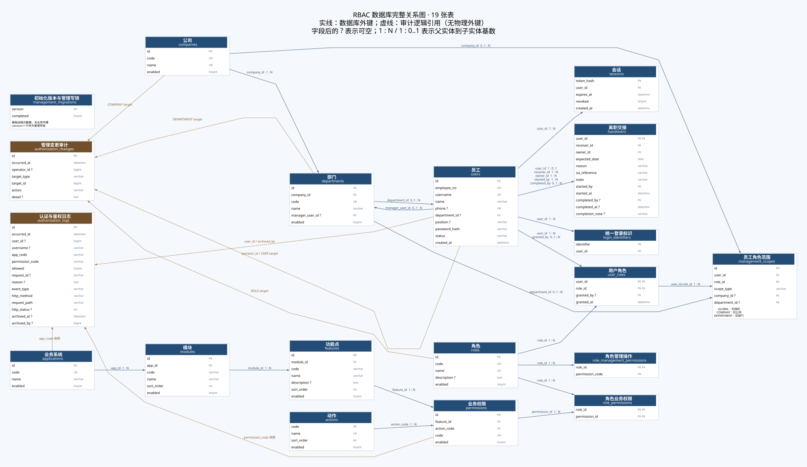

= 市政公司统一权限管理系统：数据库设计文档
:lang: zh-CN
:toc: left
:toclevels: 3
:sectnums:
:sectanchors:
:source-highlighter: highlight.js
:revnumber: 6.0
:revdate: 2026-10-27

== 文档目的与约定

本文定义系统的数据模型、函数依赖、实体关系、字段、完整性约束、索引、数据生命周期与初始化 SQL，作为数据库开发和设计评审依据。
与《详细设计文档》配套：本文件规定持久化事实与数据库约束，详设规定调用权限、接口和业务事务。表中存在字段不等于开放该字段的编辑接口。
模型以从空库建立完整结构为前提。字段字典、关系清单和 SQL 定义在本文完整给出；ER 图提供直观导航。

== 设计范围与存储约定

系统采用 RBAC0，划分组织人员、业务目录、授权关系、会话、审计领域，共 18 张表。
MySQL 8.0.16+ / 8.4，InnoDB、utf8mb4_0900_bin。业务标识区分大小写；工号、手机号使用字符串，缺失手机号为 NULL。
时间采用 UTC DATETIME(3)，预计交接日期采用 DATE；连接指定 UTC，会话隔离级别 READ COMMITTED。
实体使用 BIGINT 主键，关联使用复合主键。密码使用 BCrypt，会话只存 SHA-256 摘要。

配套 link:图表/07-数据库ER图.md[实体关系图]。本文定义模型、约束与数据访问规则。

== 函数依赖与第三范式

[cols="2,4",options="header"]
|===
|关系 |候选键与依赖
|companies |id、code、name 分别唯一；公司名称只由公司键决定。
|departments |id 或 code 决定 company_id、name、manager_user_id、enabled；(company_id,name) 唯一。没有父部门字段。
|users |id、username、employee_no 为候选键；phone 允许多行 NULL，非空值唯一，因此不将可空 phone 视为严格关系模型候选键。department_id 关联部门，不重复存 company_id 或公司名称。
|management_scopes |id 决定 user_id、role_id、scope_type 及范围目标。COMPANY 行只存 company_id，DEPARTMENT 行只存 department_id；不保存 department_id → company_id 的传递依赖。
|user_roles / role_permissions |复合主键决定授予关系；不存角色名、用户姓名或权限说明。
|role_management_permissions |(role_id,permission_code) 为主键，不重复存操作名称；名称来自管理权限目录。
|modules / features / permissions |分别引用直接上级，权限只存 feature_id、action_code 和独立 code；不重复系统／模块／功能名称。权限 code 是稳定业务标识，不要求重命名后重建。
|login_identifiers |identifier → user_id；identifier 是跨登录字段共享的候选键。此表是由用户别名通过触发器维护的唯一性登记投影，不能独立修改为另一份用户资料。
|===

每个基础属性保持原子性，多对多拆为关联表；非主属性依赖整个候选键，非键属性不通过另一非键属性决定存储的基础事实。
部门授权的公司在查询时 JOIN 推导；API 为选择和显示可同时携带 companyId 与 departmentId，持久化前校验二者归属但不重复存储。
管理范围 CHECK 区分三个互斥形状：GLOBAL 两个组织字段均空；COMPANY 仅公司非空；DEPARTMENT 仅部门非空。
复合外键 (user_id,role_id) 关联 user_roles，撤角色级联撤范围。角色的操作与同角色范围连接，不允许跨角色拼接。

审计表中的登录名／代码是事件发生时快照，反映历史事实而非当前实体名称，不受当前用户改名函数依赖约束。
审计主体和归档操作者采用逻辑引用，不设置物理外键，以容纳未知主体及不存在的目录编码；这是一项保留快照和宽松事件输入的设计取舍，而非所有外键都必然导致级联删除；归档只改归档元数据，不改原事件。

== 登录标识唯一性

用户名、工号、手机号共同登记到 login_identifiers 主键空间。同人多个字段同值只保留一条登记，不同用户任何字段占用同一值会触发数据库约束失败。
users AFTER INSERT / AFTER UPDATE 触发器与用户写入处于同一事务：插入时声明非空标识；更新三种登录字段时撤销该用户旧登记，再声明新标识；与其他用户冲突时整个语句回滚，不能遗留部分登记。
仅名称、状态或部门变化不重建别名；用户删除通过外键级联删除登记。并发插入由主键锁与唯一性约束仲裁，不依赖应用层先查后写。
空库导入逐条经过数据库触发器；跨用户标识冲突使导入事务失败，不自动改名、合并或删除账号。源空手机号规范化为 NULL 后不登记。登录只通过统一登记表定位一个用户。
触发器安装属于数据库初始化职责；应用无需超级权限。数据库和测试环境都必须具备该约束，不能仅验证应用端校验。

== 关系与完整性

公司 1:N 部门，部门 1:N 用户；技术账号可无部门。部门至多一名负责人，负责人字段不决定角色。
应用 1:N 模块 1:N 功能点；功能点与动作通过 permissions 结合，(feature_id,action_code) 唯一。
用户 M:N 角色，角色 M:N 业务权限，角色 1:N 管理操作，用户角色 1:N 管理范围。
用户 1:N 会话，用户 1:0..1 离职交接；接收人、负责人、发起人、完成人分别引用 users。
enabled、revoked、allowed 限定 0/1；用户状态 ACTIVE/DISABLED，交接状态 HANDOVER/DEPARTED；EMPLOYED 是派生值。
组织新增／改名不移动部门，不存在子部门继承。员工所属部门调整是独立业务，不通过范围编辑隐式修改。

== 日志模型、分页与归档

authorization_logs 保存功能鉴权、应用准入、登录成功／失败、未认证和请求拒绝事件。
user_id 与 username 可空；认证事件的 app_code/permission_code 可为空字符串。请求方法、路径、状态和服务端请求号用于定位，禁止存密码、令牌、完整请求体和查询串。
username、app_code、permission_code 是事件快照；不要求拒绝请求引用一个当前有效目录项。
查询以 MAX(id) 作为插入 ID 上界；这不是跨页事务快照。后续条件 id ≤ snapshotId 且 id < beforeId，按 id DESC，取 limit+1 判断后页。
用户、系统、结果、事件和时间过滤均使用绑定参数；from 含、to 不含。索引支持按用户/id、系统/id、归档状态/时间/id 访问，实际组合性能需用 EXPLAIN 验证。
归档为批量设置 archived_at、archived_by，按截止时间和 id 上界选择；批次事务记录 ARCHIVE_LOGS 到 authorization_changes。
逻辑归档仍在同一表，不承诺减少物理存储；ALL/ACTIVE/ARCHIVED 均可查询，不自动清理。长期冷存储不在当前范围。
日志查询上界排除后续更大 ID 的事件，但不冻结归档状态；筛选归档状态时发生并发归档应重新查询。

== 事务与初始化

schema.sql 创建缺失表。DatabaseConstraints 补充 departments.manager_user_id → users.id 的循环外键。
DatabaseConstraints 在导入前建立登录标识触发器，username、employee_no、phone 共享唯一命名空间；冲突使插入或更新回滚。
DataInitializer 仅在 users 为空且初始化开关打开时，事务性读取三份 Excel，建立公司、部门、员工、角色和目录；部门表的源父名称仅做输入完整性校验，不建立部门树。
岗位映射优先项目岗位，再公司领导，再部长／副部长及负责人；业务员工保留普通员工基础角色。
默认管理操作和范围与员工导入在同一事务完成；非空库不重复导入或重新授予权限，保留人工调整。
管理写操作先锁 roles 中 code=系统管理员的固定行，再核验当前权限、目标范围和最后平台管理员约束。
角色范围整体替换、角色授权、离职撤权各自原子提交；离职完成同时删除角色、级联范围、停用账号、撤会话、更新交接状态和留痕。
认证失败审计使用独立事务，避免业务回滚删除失败事件；数据库不可用时不能保证事件持久化。

== 表目录

[cols="3,3,3,1",options="header"]
|===
|表 |用途 |主键 |字段数
|companies |公司 |id |4
|departments |部门 |id |6
|users |用户／员工 |id |10
|applications |业务应用 |id |4
|modules |应用模块 |id |6
|features |功能点 |id |7
|actions |动作字典 |code |4
|permissions |业务权限 |id |5
|roles |角色 |id |5
|user_roles |用户角色关联 |user_id,role_id |4
|role_permissions |角色业务权限关联 |role_id,permission_id |2
|sessions |登录会话 |token_hash |5
|authorization_logs |认证与鉴权事件 |id |15
|authorization_changes |管理变更审计 |id |7
|handovers |离职交接 |user_id |12
|role_management_permissions |角色管理操作 |role_id,permission_code |2
|management_scopes |员工角色管理范围 |id |6
|login_identifiers |统一登录标识登记 |identifier |2
|===

== 实体关系与删除策略

图中实线表示外键，虚线表示审计逻辑引用；同一对实体的多个外键可以合并标注。下表逐项列出全部 23 个物理外键，避免将合并连线误认为缺少关系。父记录可对应 0 至多条子记录；handovers.user_id 为主键，因此离职主体至多对应一条交接记录。可空子外键允许不关联父记录。

[cols="4,3,2",options="header"]
|===
|子表／字段 |父表／字段 |删除父记录时
|departments.company_id |companies.id |RESTRICT / NO ACTION
|users.department_id |departments.id |RESTRICT / NO ACTION
|modules.app_id |applications.id |RESTRICT / NO ACTION
|features.module_id |modules.id |RESTRICT / NO ACTION
|permissions.feature_id |features.id |RESTRICT / NO ACTION
|permissions.action_code |actions.code |RESTRICT / NO ACTION
|user_roles.user_id |users.id |CASCADE
|user_roles.role_id |roles.id |CASCADE
|user_roles.granted_by |users.id |RESTRICT / NO ACTION
|role_permissions.role_id |roles.id |CASCADE
|role_permissions.permission_id |permissions.id |CASCADE
|sessions.user_id |users.id |RESTRICT / NO ACTION
|handovers.user_id |users.id |RESTRICT / NO ACTION
|handovers.receiver_id |users.id |RESTRICT / NO ACTION
|handovers.owner_id |users.id |RESTRICT / NO ACTION
|handovers.started_by |users.id |RESTRICT / NO ACTION
|handovers.completed_by |users.id |RESTRICT / NO ACTION
|role_management_permissions.role_id |roles.id |CASCADE
|management_scopes.user_id,role_id |user_roles.user_id,role_id |CASCADE
|management_scopes.company_id |companies.id |RESTRICT / NO ACTION
|management_scopes.department_id |departments.id |RESTRICT / NO ACTION
|login_identifiers.user_id |users.id |CASCADE
|departments.manager_user_id |users.id |RESTRICT / NO ACTION
|===

未声明 ON UPDATE 的外键采用 RESTRICT／NO ACTION。标识主键不通过业务接口更新。
RESTRICT 外键阻止删除仍被引用的主体，CASCADE 只用于依附关系清理；离职流程保留 users，通过状态与撤权完成处置，不直接删除员工。
所有外键更新与删除策略必须与业务权限区分：能通过数据库约束不代表操作者有权执行该 SQL。

== 完整字段字典

长度单位为字符，VARCHAR 上限不等于 UTF-8 字节数。默认值“无”表示插入时必须提供（或字段可空并采用 NULL）；自增字段由数据库生成。PK 为主键，UK 为唯一约束，FK 为物理外键。复合键在各表约束行完整列出。

=== companies（公司）

[cols="2,2,1,2,1,5",options="header"]
|===
|字段 |类型 |可空 |默认值 |键 |业务含义
|id |BIGINT |否 |自动生成 |PK |代理主键，自增生成
|code |VARCHAR(100) |否 |无 |UK |稳定业务编码
|name |VARCHAR(191) |否 |无 |UK |显示名称
|enabled |TINYINT |否 |1 |— |0 停用，1 启用
|===

约束摘要（各条为表定义中的约束子句，完整可执行定义见文末）：

[source,sql]
----
CHECK (enabled IN (0,1))
----

=== departments（部门）

[cols="2,2,1,2,1,5",options="header"]
|===
|字段 |类型 |可空 |默认值 |键 |业务含义
|id |BIGINT |否 |自动生成 |PK |代理主键，自增生成
|company_id |BIGINT |否 |无 |FK |所属／范围公司 ID
|code |VARCHAR(100) |否 |无 |UK |稳定业务编码
|name |VARCHAR(191) |否 |无 |— |显示名称
|manager_user_id |BIGINT |是 |无 |FK |部门负责人用户 ID，可未指定
|enabled |TINYINT |否 |1 |— |0 停用，1 启用
|===

约束摘要（各条为表定义中的约束子句，完整可执行定义见文末）：

[source,sql]
----
UNIQUE KEY uk_department_name (company_id,name)
FOREIGN KEY (company_id) REFERENCES companies(id)
CHECK (enabled IN (0,1))
----

负责人外键待 users 建立后补充。数据库只保证负责人存在，不保证其属于本部门；初始负责人按本部门人员匹配，组织维护接口不提供负责人编辑。

=== users（用户／员工）

[cols="2,2,1,2,1,5",options="header"]
|===
|字段 |类型 |可空 |默认值 |键 |业务含义
|id |BIGINT |否 |自动生成 |PK |代理主键，自增生成
|employee_no |VARCHAR(100) |否 |无 |UK |员工工号，保留前导零
|username |VARCHAR(100) |否 |无 |UK |登录名
|name |VARCHAR(100) |否 |无 |— |显示名称
|phone |VARCHAR(32) |是 |无 |UK |手机号，源缺失值规范化为 NULL
|department_id |BIGINT |是 |无 |FK |所属／范围部门 ID
|position |VARCHAR(191) |是 |无 |— |岗位文本，用于初始角色映射
|password_hash |VARCHAR(100) |否 |无 |— |BCrypt 密码摘要，不存明文
|status |VARCHAR(16) |否 |'ACTIVE' |— |ACTIVE 或 DISABLED
|created_at |DATETIME(3) |否 |CURRENT_TIMESTAMP(3) |— |记录创建时刻（UTC）
|===

约束摘要（各条为表定义中的约束子句，完整可执行定义见文末）：

[source,sql]
----
FOREIGN KEY (department_id) REFERENCES departments(id)
CHECK (status IN ('ACTIVE','DISABLED'))
INDEX idx_users_name (name)
INDEX idx_users_dept (department_id)
----

=== applications（业务应用）

[cols="2,2,1,2,1,5",options="header"]
|===
|字段 |类型 |可空 |默认值 |键 |业务含义
|id |BIGINT |否 |自动生成 |PK |代理主键，自增生成
|code |VARCHAR(191) |否 |无 |UK |稳定业务编码
|name |VARCHAR(191) |否 |无 |— |显示名称
|enabled |TINYINT |否 |1 |— |0 停用，1 启用
|===

约束摘要（各条为表定义中的约束子句，完整可执行定义见文末）：

[source,sql]
----
CHECK (enabled IN (0,1))
----

=== modules（应用模块）

[cols="2,2,1,2,1,5",options="header"]
|===
|字段 |类型 |可空 |默认值 |键 |业务含义
|id |BIGINT |否 |自动生成 |PK |代理主键，自增生成
|app_id |BIGINT |否 |无 |FK |所属应用 ID
|code |VARCHAR(100) |否 |无 |— |稳定业务编码
|name |VARCHAR(191) |否 |无 |— |显示名称
|sort_order |INT |否 |0 |— |非负展示顺序
|enabled |TINYINT |否 |1 |— |0 停用，1 启用
|===

约束摘要（各条为表定义中的约束子句，完整可执行定义见文末）：

[source,sql]
----
FOREIGN KEY (app_id) REFERENCES applications(id)
UNIQUE KEY uk_module_code (app_id,code)
UNIQUE KEY uk_module_name (app_id,name)
INDEX idx_module_sort (app_id,sort_order,id)
CHECK (sort_order>=0), CHECK (enabled IN (0,1))
----

=== features（功能点）

[cols="2,2,1,2,1,5",options="header"]
|===
|字段 |类型 |可空 |默认值 |键 |业务含义
|id |BIGINT |否 |自动生成 |PK |代理主键，自增生成
|module_id |BIGINT |否 |无 |FK |所属模块 ID
|code |VARCHAR(100) |否 |无 |— |稳定业务编码
|name |VARCHAR(191) |否 |无 |— |显示名称
|description |TEXT |是 |无 |— |说明文本
|sort_order |INT |否 |0 |— |非负展示顺序
|enabled |TINYINT |否 |1 |— |0 停用，1 启用
|===

约束摘要（各条为表定义中的约束子句，完整可执行定义见文末）：

[source,sql]
----
FOREIGN KEY (module_id) REFERENCES modules(id)
UNIQUE KEY uk_feature_code (module_id,code)
UNIQUE KEY uk_feature_name (module_id,name)
INDEX idx_feature_sort (module_id,sort_order,id)
CHECK (sort_order>=0), CHECK (enabled IN (0,1))
----

=== actions（动作字典）

[cols="2,2,1,2,1,5",options="header"]
|===
|字段 |类型 |可空 |默认值 |键 |业务含义
|code |VARCHAR(32) |否 |无 |PK |稳定业务编码
|name |VARCHAR(32) |否 |无 |UK |显示名称
|sort_order |INT |否 |0 |— |非负展示顺序
|enabled |TINYINT |否 |1 |— |0 停用，1 启用
|===

约束摘要（各条为表定义中的约束子句，完整可执行定义见文末）：

[source,sql]
----
CHECK (sort_order>=0), CHECK (enabled IN (0,1))
----

=== permissions（业务权限）

[cols="2,2,1,2,1,5",options="header"]
|===
|字段 |类型 |可空 |默认值 |键 |业务含义
|id |BIGINT |否 |自动生成 |PK |代理主键，自增生成
|feature_id |BIGINT |否 |无 |FK |所属功能点 ID
|action_code |VARCHAR(32) |否 |无 |FK |动作字典编码
|code |VARCHAR(512) |否 |无 |UK |稳定业务编码
|enabled |TINYINT |否 |1 |— |0 停用，1 启用
|===

约束摘要（各条为表定义中的约束子句，完整可执行定义见文末）：

[source,sql]
----
FOREIGN KEY (feature_id) REFERENCES features(id)
FOREIGN KEY (action_code) REFERENCES actions(code)
UNIQUE KEY uk_permission_function (feature_id,action_code)
CHECK (enabled IN (0,1))
----

=== roles（角色）

[cols="2,2,1,2,1,5",options="header"]
|===
|字段 |类型 |可空 |默认值 |键 |业务含义
|id |BIGINT |否 |自动生成 |PK |代理主键，自增生成
|code |VARCHAR(100) |否 |无 |UK |稳定业务编码
|name |VARCHAR(100) |否 |无 |UK |显示名称
|description |TEXT |是 |无 |— |说明文本
|enabled |TINYINT |否 |1 |— |0 停用，1 启用
|===

约束摘要（各条为表定义中的约束子句，完整可执行定义见文末）：

[source,sql]
----
CHECK (enabled IN (0,1))
----

=== user_roles（用户角色关联）

[cols="2,2,1,2,1,5",options="header"]
|===
|字段 |类型 |可空 |默认值 |键 |业务含义
|user_id |BIGINT |否 |无 |PK/FK |关联用户 ID
|role_id |BIGINT |否 |无 |PK/FK |关联角色 ID
|granted_by |BIGINT |是 |无 |FK |授予者用户 ID，可为空
|granted_at |DATETIME(3) |否 |CURRENT_TIMESTAMP(3) |— |授予时间（UTC）
|===

约束摘要（各条为表定义中的约束子句，完整可执行定义见文末）：

[source,sql]
----
PRIMARY KEY (user_id,role_id)
FOREIGN KEY (user_id) REFERENCES users(id) ON DELETE CASCADE
FOREIGN KEY (role_id) REFERENCES roles(id) ON DELETE CASCADE
FOREIGN KEY (granted_by) REFERENCES users(id)
----

=== role_permissions（角色业务权限关联）

[cols="2,2,1,2,1,5",options="header"]
|===
|字段 |类型 |可空 |默认值 |键 |业务含义
|role_id |BIGINT |否 |无 |PK/FK |关联角色 ID
|permission_id |BIGINT |否 |无 |PK/FK |关联业务权限 ID
|===

约束摘要（各条为表定义中的约束子句，完整可执行定义见文末）：

[source,sql]
----
PRIMARY KEY (role_id,permission_id)
FOREIGN KEY (role_id) REFERENCES roles(id) ON DELETE CASCADE
FOREIGN KEY (permission_id) REFERENCES permissions(id) ON DELETE CASCADE
----

=== sessions（登录会话）

[cols="2,2,1,2,1,5",options="header"]
|===
|字段 |类型 |可空 |默认值 |键 |业务含义
|token_hash |CHAR(64) |否 |无 |PK |随机令牌的 SHA-256 十六进制摘要
|user_id |BIGINT |否 |无 |FK |关联用户 ID
|expires_at |DATETIME(3) |否 |无 |— |会话到期时刻（UTC）
|revoked |TINYINT |否 |0 |— |0 有效，1 撤销；仍需判断到期与账号状态
|created_at |DATETIME(3) |否 |CURRENT_TIMESTAMP(3) |— |记录创建时刻（UTC）
|===

约束摘要（各条为表定义中的约束子句，完整可执行定义见文末）：

[source,sql]
----
FOREIGN KEY (user_id) REFERENCES users(id)
CHECK (revoked IN (0,1))
INDEX idx_sessions_user (user_id)
INDEX idx_sessions_expiry (expires_at)
----

=== authorization_logs（认证与鉴权事件）

[cols="2,2,1,2,1,5",options="header"]
|===
|字段 |类型 |可空 |默认值 |键 |业务含义
|id |BIGINT |否 |自动生成 |PK |代理主键，自增生成
|occurred_at |DATETIME(3) |否 |CURRENT_TIMESTAMP(3) |— |事件发生时间（UTC）
|user_id |BIGINT |是 |无 |— |关联用户 ID
|username |VARCHAR(100) |是 |无 |— |登录名
|app_code |VARCHAR(191) |否 |无 |— |事件应用编码快照；认证事件可为空串
|permission_code |VARCHAR(512) |否 |无 |— |权限／管理操作编码，语义由所在表决定
|allowed |TINYINT |否 |无 |— |0 拒绝／失败，1 允许／成功
|request_id |VARCHAR(191) |是 |无 |— |跟踪号；通用鉴权为业务传入号，认证／准入为服务端号
|reason |TEXT |是 |无 |— |判定原因或交接说明
|event_type |VARCHAR(32) |否 |'AUTHORIZATION' |— |事件分类，不以外键限制未知主体
|http_method |VARCHAR(16) |否 |'' |— |HTTP 方法；非请求型事件可为空串
|request_path |VARCHAR(512) |否 |'' |— |路径，不包含查询参数
|http_status |INT |是 |无 |— |HTTP 状态；非请求型事件可为空
|archived_at |DATETIME(3) |是 |无 |— |归档时刻；NULL 表示活动记录
|archived_by |BIGINT |是 |无 |— |归档操作者 ID，逻辑引用
|===

约束摘要（各条为表定义中的约束子句，完整可执行定义见文末）：

[source,sql]
----
CHECK (allowed IN (0,1))
INDEX idx_auth_logs_time (occurred_at)
INDEX idx_auth_logs_user (user_id)
INDEX idx_log_user_id (user_id,id)
INDEX idx_log_app_id (app_code,id)
INDEX idx_log_archive_time (archived_at,occurred_at,id)
----

用户与目录编码是事件快照／逻辑引用；不因未知用户或不存在的权限编码而丢弃拒绝事件。归档只更新 archived_at、archived_by。

=== authorization_changes（管理变更审计）

[cols="2,2,1,2,1,5",options="header"]
|===
|字段 |类型 |可空 |默认值 |键 |业务含义
|id |BIGINT |否 |自动生成 |PK |代理主键，自增生成
|occurred_at |DATETIME(3) |否 |CURRENT_TIMESTAMP(3) |— |事件发生时间（UTC）
|operator_id |BIGINT |是 |无 |— |操作者 ID，逻辑引用，可为空
|target_type |VARCHAR(32) |否 |无 |— |USER／ROLE／COMPANY／DEPARTMENT／AUDIT 等目标类型
|target_id |BIGINT |否 |无 |— |目标 ID；AUDIT 批处理使用 0
|action |VARCHAR(64) |否 |无 |— |变更动作码
|detail |TEXT |是 |无 |— |变更摘要，可保存结构化文本，不存凭据
|===

约束摘要（各条为表定义中的约束子句，完整可执行定义见文末）：

[source,sql]
----
INDEX idx_changes_target (target_type,target_id,id)
----

=== handovers（离职交接）

[cols="2,2,1,2,1,5",options="header"]
|===
|字段 |类型 |可空 |默认值 |键 |业务含义
|user_id |BIGINT |否 |无 |PK/FK |关联用户 ID
|receiver_id |BIGINT |否 |无 |FK |交接接收人用户 ID
|owner_id |BIGINT |否 |无 |FK |交接负责人用户 ID
|expected_date |DATE |否 |无 |— |预计完成日，不含时间与时区
|reason |VARCHAR(1000) |否 |无 |— |判定原因或交接说明
|oa_reference |VARCHAR(200) |否 |'' |— |OA 参考号，可为空串，不表示已获外部批准
|state |VARCHAR(16) |否 |无 |— |HANDOVER／DEPARTED；EMPLOYED 不入表
|started_by |BIGINT |否 |无 |FK |发起者用户 ID
|started_at |DATETIME(3) |否 |CURRENT_TIMESTAMP(3) |— |发起时间（UTC）
|completed_by |BIGINT |是 |无 |FK |完成操作者，未完成为空
|completed_at |DATETIME(3) |是 |无 |— |完成时间，未完成为空
|completion_note |VARCHAR(1000) |是 |无 |— |完成说明，未完成为空
|===

约束摘要（各条为表定义中的约束子句，完整可执行定义见文末）：

[source,sql]
----
FOREIGN KEY (user_id) REFERENCES users(id)
FOREIGN KEY (receiver_id) REFERENCES users(id)
FOREIGN KEY (owner_id) REFERENCES users(id)
FOREIGN KEY (started_by) REFERENCES users(id)
FOREIGN KEY (completed_by) REFERENCES users(id)
CHECK (state IN ('HANDOVER','DEPARTED'))
----

=== role_management_permissions（角色管理操作）

[cols="2,2,1,2,1,5",options="header"]
|===
|字段 |类型 |可空 |默认值 |键 |业务含义
|role_id |BIGINT |否 |无 |PK/FK |关联角色 ID
|permission_code |VARCHAR(64) |否 |无 |PK |权限／管理操作编码，语义由所在表决定
|===

约束摘要（各条为表定义中的约束子句，完整可执行定义见文末）：

[source,sql]
----
PRIMARY KEY(role_id,permission_code)
FOREIGN KEY(role_id) REFERENCES roles(id) ON DELETE CASCADE
----

permission_code 来自应用固定的 11 项管理操作目录，由服务层白名单校验；此表不关联业务权限表 permissions。

=== management_scopes（员工角色管理范围）

[cols="2,2,1,2,1,5",options="header"]
|===
|字段 |类型 |可空 |默认值 |键 |业务含义
|id |BIGINT |否 |自动生成 |PK |代理主键，自增生成
|user_id |BIGINT |否 |无 |FK |关联用户 ID
|role_id |BIGINT |否 |无 |FK |关联角色 ID
|scope_type |VARCHAR(16) |否 |无 |— |GLOBAL／COMPANY／DEPARTMENT
|company_id |BIGINT |是 |无 |FK |所属／范围公司 ID
|department_id |BIGINT |是 |无 |FK |所属／范围部门 ID
|===

约束摘要（各条为表定义中的约束子句，完整可执行定义见文末）：

[source,sql]
----
FOREIGN KEY(user_id,role_id) REFERENCES user_roles(user_id,role_id) ON DELETE CASCADE
FOREIGN KEY(company_id) REFERENCES companies(id)
FOREIGN KEY(department_id) REFERENCES departments(id)
CHECK ((scope_type='GLOBAL' AND company_id IS NULL AND department_id IS NULL)
OR (scope_type='COMPANY' AND company_id IS NOT NULL AND department_id IS NULL)
OR (scope_type='DEPARTMENT' AND company_id IS NULL AND department_id IS NOT NULL))
INDEX idx_management_scope_user(user_id,role_id)
----

相同范围由服务端以完整输入值去重；不声明跨可空列的数据库唯一约束。部门范围的 company_id 必须为空，所属公司通过 departments 关联取得。

=== login_identifiers（统一登录标识登记）

[cols="2,2,1,2,1,5",options="header"]
|===
|字段 |类型 |可空 |默认值 |键 |业务含义
|identifier |VARCHAR(100) |否 |无 |PK |用户名、工号、非空手机号的统一唯一键
|user_id |BIGINT |否 |无 |FK |关联用户 ID
|===

约束摘要（各条为表定义中的约束子句，完整可执行定义见文末）：

[source,sql]
----
FOREIGN KEY(user_id) REFERENCES users(id) ON DELETE CASCADE
INDEX idx_login_identifier_user(user_id)
----

== 索引与访问路径设计

主键和唯一约束同时生成唯一索引；InnoDB 为外键所需且不存在的前缀索引补充索引，不依赖其自动命名。下表列出显式普通索引。

[cols="2,3,3,5",options="header"]
|===
|表 |索引名 |列顺序 |服务查询
|users |idx_users_name |name |姓名索引；前置 % 的包含匹配不能保证使用范围扫描
|users |idx_users_dept |department_id |部门过滤与组织范围连接
|modules |idx_module_sort |app_id,sort_order,id |应用内模块顺序
|features |idx_feature_sort |module_id,sort_order,id |模块内功能顺序
|sessions |idx_sessions_user |user_id |按用户撤销会话
|sessions |idx_sessions_expiry |expires_at |到期筛选的访问路径，不意味着自动清理任务
|authorization_logs |idx_auth_logs_time |occurred_at |按事件时间筛选
|authorization_logs |idx_auth_logs_user |user_id |按用户筛选
|authorization_logs |idx_log_user_id |user_id,id |用户过滤与 id 游标
|authorization_logs |idx_log_app_id |app_code,id |应用过滤与 id 游标
|authorization_logs |idx_log_archive_time |archived_at,occurred_at,id |归档状态与截止时间筛选；排序代价仍需评估
|authorization_changes |idx_changes_target |target_type,target_id,id |按目标获取最近变更
|management_scopes |idx_management_scope_user |user_id,role_id |员工角色范围关联
|login_identifiers |idx_login_identifier_user |user_id |删除／重建某用户的标识登记
|===

登录使用 login_identifiers 主键等值查找再定位 users；会话校验使用 sessions.token_hash 主键。
人员列表使用范围谓词与可选公司／部门条件，ORDER BY users.id，LIMIT/OFFSET；深页会增加扫描成本。
审计使用主键 ID 上界分页，避免大 OFFSET；username、allowed、event_type 等组合不保证被单一索引完整覆盖。索引取舍需依据 EXPLAIN、数据分布与写入成本评审，不增加未经分析的全组合索引。
角色及目录有效性使用 EXISTS，避免多角色连接把权限计数放大。显式 idx_auth_logs_user 与复合 idx_log_user_id 有前缀重叠，需在容量评估中比较读收益和维护成本，不能宣称所有索引互不冗余。

== 数据生命周期与敏感数据

[cols="2,3,5",options="header"]
|===
|数据类别 |产生／更新 |保留与删除边界
|基础组织／人员／目录 |空库导入；公司部门名称编码可维护 |业务接口不提供通用物理删除；组织与用户状态控制不等于历史删除。
|角色关联与范围 |授权事务写入 |撤销角色级联删除其范围；保留变更审计。
|登录标识 |用户插入／别名变更触发器维护 |用户删除级联删除登记；用户停用不释放标识，以免产生歧义。
|会话 |登录创建，退出／离职标记撤销 |到期与撤销后不可认证；不定义自动物理清理周期。
|认证／鉴权日志 |认证、准入与鉴权产生 |批量逻辑归档，事件主体与结果保持；不定义自动过期删除或外部冷存储。
|管理变更／离职记录 |与对应写事务同时产生 |保留追溯记录；不提供撤销审计、删除交接或恢复离职接口。
|===

手机号和姓名属于人员资料；令牌、密码明文不得写审计。password_hash 与 token_hash 不应暴露到业务 DTO。
日志中的账号可能来自失败登录输入，查询者必须具有 GLOBAL audit.read。数据访问最小权限与敏感内容最小返回由服务层落实，关系数据库约束不替代访问控制。
备份应包含表、外键与触发器，使用受控凭据访问；恢复验证应核对行数、孤儿引用和登录标识一致性。本文不设定无依据的保留天数、RPO 或 RTO。

== 数据完整性验证准则

[cols="3,3,5",options="header"]
|===
|规则 |保证层 |预期验证
|跨字段登录唯一 |触发器＋主键／非空约束 |两用户跨字段占用同值失败；同用户同值成功；更新冲突回滚原登记。
|组织与基础引用存在 |外键 |不存在的公司、部门、角色、权限或用户引用被拒绝。
|角色范围形状 |CHECK＋复合外键 |GLOBAL 无组织；COMPANY 仅公司；DEPARTMENT 仅部门；未持有角色不能建立范围。
|角色范围合法性与平台保护 |Service 事务 |部门归属与启用状态正确；平台角色与范围匹配；最后管理员不可撤销。
|启用、状态、顺序 |CHECK |布尔值只允许 0/1，状态属于指定集合，sort_order 非负。
|空库初始化 |初始化事务＋约束 |约束先存在，导入失败无半份业务数据；非空库不覆盖人工授权。
|离职与审计原子性 |Service 事务 |失败时保留原业务状态；成功时所有撤权与审计一致。
|===

== 物理 SQL 定义

=== 建表定义

以下定义包含全部 18 张表，字符集使用 utf8mb4_0900_bin。支持 CHECK 的 MySQL 版本为 8.0.16 及以上；下列触发器脚本中的 CREATE TRIGGER IF NOT EXISTS 语法要求 MySQL 8.0.29 及以上，数据库基线选用 MySQL 8.4。

[source,sql]
----
-- MySQL 8.0.16+ / 8.4, InnoDB, UTF-8; all DATETIME values are UTC.
CREATE TABLE IF NOT EXISTS companies (
  id BIGINT PRIMARY KEY AUTO_INCREMENT,
  code VARCHAR(100) NOT NULL UNIQUE,
  name VARCHAR(191) NOT NULL UNIQUE,
  enabled TINYINT NOT NULL DEFAULT 1,
  CHECK (enabled IN (0,1))
) ENGINE=InnoDB DEFAULT CHARSET=utf8mb4 COLLATE=utf8mb4_0900_bin;
CREATE TABLE IF NOT EXISTS departments (
  id BIGINT PRIMARY KEY AUTO_INCREMENT,
  company_id BIGINT NOT NULL,
  code VARCHAR(100) NOT NULL UNIQUE,
  name VARCHAR(191) NOT NULL,
  manager_user_id BIGINT,
  enabled TINYINT NOT NULL DEFAULT 1,
  UNIQUE KEY uk_department_name (company_id,name),
  FOREIGN KEY (company_id) REFERENCES companies(id),
  CHECK (enabled IN (0,1))
) ENGINE=InnoDB DEFAULT CHARSET=utf8mb4 COLLATE=utf8mb4_0900_bin;
CREATE TABLE IF NOT EXISTS users (
  id BIGINT PRIMARY KEY AUTO_INCREMENT,
  employee_no VARCHAR(100) NOT NULL UNIQUE,
  username VARCHAR(100) NOT NULL UNIQUE,
  name VARCHAR(100) NOT NULL,
  phone VARCHAR(32) UNIQUE,
  department_id BIGINT,
  position VARCHAR(191),
  password_hash VARCHAR(100) NOT NULL,
  status VARCHAR(16) NOT NULL DEFAULT 'ACTIVE',
  created_at DATETIME(3) NOT NULL DEFAULT CURRENT_TIMESTAMP(3),
  FOREIGN KEY (department_id) REFERENCES departments(id),
  CHECK (status IN ('ACTIVE','DISABLED')),
  INDEX idx_users_name (name),
  INDEX idx_users_dept (department_id)
) ENGINE=InnoDB DEFAULT CHARSET=utf8mb4 COLLATE=utf8mb4_0900_bin;
CREATE TABLE IF NOT EXISTS applications (
  id BIGINT PRIMARY KEY AUTO_INCREMENT,
  code VARCHAR(191) NOT NULL UNIQUE,
  name VARCHAR(191) NOT NULL,
  enabled TINYINT NOT NULL DEFAULT 1,
  CHECK (enabled IN (0,1))
) ENGINE=InnoDB DEFAULT CHARSET=utf8mb4 COLLATE=utf8mb4_0900_bin;
CREATE TABLE IF NOT EXISTS modules (
  id BIGINT PRIMARY KEY AUTO_INCREMENT,
  app_id BIGINT NOT NULL,
  code VARCHAR(100) NOT NULL,
  name VARCHAR(191) NOT NULL,
  sort_order INT NOT NULL DEFAULT 0,
  enabled TINYINT NOT NULL DEFAULT 1,
  FOREIGN KEY (app_id) REFERENCES applications(id),
  UNIQUE KEY uk_module_code (app_id,code),
  UNIQUE KEY uk_module_name (app_id,name),
  INDEX idx_module_sort (app_id,sort_order,id),
  CHECK (sort_order>=0), CHECK (enabled IN (0,1))
) ENGINE=InnoDB DEFAULT CHARSET=utf8mb4 COLLATE=utf8mb4_0900_bin;
CREATE TABLE IF NOT EXISTS features (
  id BIGINT PRIMARY KEY AUTO_INCREMENT,
  module_id BIGINT NOT NULL,
  code VARCHAR(100) NOT NULL,
  name VARCHAR(191) NOT NULL,
  description TEXT,
  sort_order INT NOT NULL DEFAULT 0,
  enabled TINYINT NOT NULL DEFAULT 1,
  FOREIGN KEY (module_id) REFERENCES modules(id),
  UNIQUE KEY uk_feature_code (module_id,code),
  UNIQUE KEY uk_feature_name (module_id,name),
  INDEX idx_feature_sort (module_id,sort_order,id),
  CHECK (sort_order>=0), CHECK (enabled IN (0,1))
) ENGINE=InnoDB DEFAULT CHARSET=utf8mb4 COLLATE=utf8mb4_0900_bin;
CREATE TABLE IF NOT EXISTS actions (
  code VARCHAR(32) PRIMARY KEY,
  name VARCHAR(32) NOT NULL UNIQUE,
  sort_order INT NOT NULL DEFAULT 0,
  enabled TINYINT NOT NULL DEFAULT 1,
  CHECK (sort_order>=0), CHECK (enabled IN (0,1))
) ENGINE=InnoDB DEFAULT CHARSET=utf8mb4 COLLATE=utf8mb4_0900_bin;
CREATE TABLE IF NOT EXISTS permissions (
  id BIGINT PRIMARY KEY AUTO_INCREMENT,
  feature_id BIGINT NOT NULL,
  action_code VARCHAR(32) NOT NULL,
  code VARCHAR(512) NOT NULL UNIQUE,
  enabled TINYINT NOT NULL DEFAULT 1,
  FOREIGN KEY (feature_id) REFERENCES features(id),
  FOREIGN KEY (action_code) REFERENCES actions(code),
  UNIQUE KEY uk_permission_function (feature_id,action_code),
  CHECK (enabled IN (0,1))
) ENGINE=InnoDB DEFAULT CHARSET=utf8mb4 COLLATE=utf8mb4_0900_bin;
CREATE TABLE IF NOT EXISTS roles (
  id BIGINT PRIMARY KEY AUTO_INCREMENT,
  code VARCHAR(100) NOT NULL UNIQUE,
  name VARCHAR(100) NOT NULL UNIQUE,
  description TEXT,
  enabled TINYINT NOT NULL DEFAULT 1,
  CHECK (enabled IN (0,1))
) ENGINE=InnoDB DEFAULT CHARSET=utf8mb4 COLLATE=utf8mb4_0900_bin;
CREATE TABLE IF NOT EXISTS user_roles (
  user_id BIGINT NOT NULL,
  role_id BIGINT NOT NULL,
  granted_by BIGINT,
  granted_at DATETIME(3) NOT NULL DEFAULT CURRENT_TIMESTAMP(3),
  PRIMARY KEY (user_id,role_id),
  FOREIGN KEY (user_id) REFERENCES users(id) ON DELETE CASCADE,
  FOREIGN KEY (role_id) REFERENCES roles(id) ON DELETE CASCADE,
  FOREIGN KEY (granted_by) REFERENCES users(id)
) ENGINE=InnoDB DEFAULT CHARSET=utf8mb4 COLLATE=utf8mb4_0900_bin;
CREATE TABLE IF NOT EXISTS role_permissions (
  role_id BIGINT NOT NULL,
  permission_id BIGINT NOT NULL,
  PRIMARY KEY (role_id,permission_id),
  FOREIGN KEY (role_id) REFERENCES roles(id) ON DELETE CASCADE,
  FOREIGN KEY (permission_id) REFERENCES permissions(id) ON DELETE CASCADE
) ENGINE=InnoDB DEFAULT CHARSET=utf8mb4 COLLATE=utf8mb4_0900_bin;
CREATE TABLE IF NOT EXISTS sessions (
  token_hash CHAR(64) CHARACTER SET ascii COLLATE ascii_bin PRIMARY KEY,
  user_id BIGINT NOT NULL,
  expires_at DATETIME(3) NOT NULL,
  revoked TINYINT NOT NULL DEFAULT 0,
  created_at DATETIME(3) NOT NULL DEFAULT CURRENT_TIMESTAMP(3),
  FOREIGN KEY (user_id) REFERENCES users(id),
  CHECK (revoked IN (0,1)),
  INDEX idx_sessions_user (user_id),
  INDEX idx_sessions_expiry (expires_at)
) ENGINE=InnoDB DEFAULT CHARSET=utf8mb4 COLLATE=utf8mb4_0900_bin;
CREATE TABLE IF NOT EXISTS authorization_logs (
  id BIGINT PRIMARY KEY AUTO_INCREMENT,
  occurred_at DATETIME(3) NOT NULL DEFAULT CURRENT_TIMESTAMP(3),
  user_id BIGINT,
  username VARCHAR(100),
  app_code VARCHAR(191) NOT NULL,
  permission_code VARCHAR(512) NOT NULL,
  allowed TINYINT NOT NULL,
  request_id VARCHAR(191),
  reason TEXT,
  event_type VARCHAR(32) NOT NULL DEFAULT 'AUTHORIZATION',
  http_method VARCHAR(16) NOT NULL DEFAULT '',
  request_path VARCHAR(512) NOT NULL DEFAULT '',
  http_status INT,
  archived_at DATETIME(3),
  archived_by BIGINT,
  CHECK (allowed IN (0,1)),
  INDEX idx_auth_logs_time (occurred_at),
  INDEX idx_auth_logs_user (user_id),
  INDEX idx_log_user_id (user_id,id),
  INDEX idx_log_app_id (app_code,id),
  INDEX idx_log_archive_time (archived_at,occurred_at,id)
) ENGINE=InnoDB DEFAULT CHARSET=utf8mb4 COLLATE=utf8mb4_0900_bin;
CREATE TABLE IF NOT EXISTS authorization_changes (
  id BIGINT PRIMARY KEY AUTO_INCREMENT,
  occurred_at DATETIME(3) NOT NULL DEFAULT CURRENT_TIMESTAMP(3),
  operator_id BIGINT,
  target_type VARCHAR(32) NOT NULL,
  target_id BIGINT NOT NULL,
  action VARCHAR(64) NOT NULL,
  detail TEXT,
  INDEX idx_changes_target (target_type,target_id,id)
) ENGINE=InnoDB DEFAULT CHARSET=utf8mb4 COLLATE=utf8mb4_0900_bin;
CREATE TABLE IF NOT EXISTS handovers (
  user_id BIGINT PRIMARY KEY,
  receiver_id BIGINT NOT NULL,
  owner_id BIGINT NOT NULL,
  expected_date DATE NOT NULL,
  reason VARCHAR(1000) NOT NULL,
  oa_reference VARCHAR(200) NOT NULL DEFAULT '',
  state VARCHAR(16) NOT NULL,
  started_by BIGINT NOT NULL,
  started_at DATETIME(3) NOT NULL DEFAULT CURRENT_TIMESTAMP(3),
  completed_by BIGINT,
  completed_at DATETIME(3),
  completion_note VARCHAR(1000),
  FOREIGN KEY (user_id) REFERENCES users(id),
  FOREIGN KEY (receiver_id) REFERENCES users(id),
  FOREIGN KEY (owner_id) REFERENCES users(id),
  FOREIGN KEY (started_by) REFERENCES users(id),
  FOREIGN KEY (completed_by) REFERENCES users(id),
  CHECK (state IN ('HANDOVER','DEPARTED'))
) ENGINE=InnoDB DEFAULT CHARSET=utf8mb4 COLLATE=utf8mb4_0900_bin;

-- Role-bound management authorization.
CREATE TABLE IF NOT EXISTS role_management_permissions (
  role_id BIGINT NOT NULL,
  permission_code VARCHAR(64) NOT NULL,
  PRIMARY KEY(role_id,permission_code),
  FOREIGN KEY(role_id) REFERENCES roles(id) ON DELETE CASCADE
) ENGINE=InnoDB DEFAULT CHARSET=utf8mb4 COLLATE=utf8mb4_0900_bin;
CREATE TABLE IF NOT EXISTS management_scopes (
  id BIGINT PRIMARY KEY AUTO_INCREMENT,
  user_id BIGINT NOT NULL,
  role_id BIGINT NOT NULL,
  scope_type VARCHAR(16) NOT NULL,
  company_id BIGINT,
  department_id BIGINT,
  FOREIGN KEY(user_id,role_id) REFERENCES user_roles(user_id,role_id) ON DELETE CASCADE,
  FOREIGN KEY(company_id) REFERENCES companies(id),
  FOREIGN KEY(department_id) REFERENCES departments(id),
  CHECK ((scope_type='GLOBAL' AND company_id IS NULL AND department_id IS NULL)
    OR (scope_type='COMPANY' AND company_id IS NOT NULL AND department_id IS NULL)
    OR (scope_type='DEPARTMENT' AND company_id IS NULL AND department_id IS NOT NULL)),
  INDEX idx_management_scope_user(user_id,role_id)
) ENGINE=InnoDB DEFAULT CHARSET=utf8mb4 COLLATE=utf8mb4_0900_bin;
CREATE TABLE IF NOT EXISTS login_identifiers (
  identifier VARCHAR(100) PRIMARY KEY,
  user_id BIGINT NOT NULL,
  FOREIGN KEY(user_id) REFERENCES users(id) ON DELETE CASCADE,
  INDEX idx_login_identifier_user(user_id)
) ENGINE=InnoDB DEFAULT CHARSET=utf8mb4 COLLATE=utf8mb4_0900_bin;
----

=== 部门负责人循环外键

companies、departments、users 按顺序建立后，检查负责人外键是否存在；不存在时执行以下定义。该约束仅新增一次，不在每次初始化时重复创建。

[source,sql]
----
ALTER TABLE departments
  ADD CONSTRAINT fk_department_manager
  FOREIGN KEY (manager_user_id) REFERENCES users(id);
----

=== 登录标识触发器

两条触发器必须先于用户导入建立。登记冲突时通过 user_id 的非空约束使语句失败，从而撤销用户写入与该语句内的触发器变更；不使用 IGNORE 吞掉跨用户冲突。
更新采用 NULL 安全比较，只在三种登录字段变化时重建该用户登记。触发器由具备适当权限的初始化主体建立；运行期间不向业务调用者暴露 DDL 能力。

[source,sql]
----
DELIMITER $$
CREATE TRIGGER IF NOT EXISTS users_identifier_insert AFTER INSERT ON users FOR EACH ROW BEGIN
  INSERT INTO login_identifiers(identifier,user_id) VALUES(NEW.username,NEW.id),(NEW.employee_no,NEW.id)
  ON DUPLICATE KEY UPDATE user_id=IF(user_id=NEW.id,user_id,NULL);
  IF NEW.phone IS NOT NULL THEN
    INSERT INTO login_identifiers(identifier,user_id) VALUES(NEW.phone,NEW.id)
    ON DUPLICATE KEY UPDATE user_id=IF(user_id=NEW.id,user_id,NULL);
  END IF;
END$$
CREATE TRIGGER IF NOT EXISTS users_identifier_update AFTER UPDATE ON users FOR EACH ROW BEGIN
  IF NOT(OLD.username<=>NEW.username) OR NOT(OLD.employee_no<=>NEW.employee_no) OR NOT(OLD.phone<=>NEW.phone) THEN
    DELETE FROM login_identifiers WHERE user_id=NEW.id;
    INSERT INTO login_identifiers(identifier,user_id) VALUES(NEW.username,NEW.id),(NEW.employee_no,NEW.id)
    ON DUPLICATE KEY UPDATE user_id=IF(user_id=NEW.id,user_id,NULL);
    IF NEW.phone IS NOT NULL THEN
      INSERT INTO login_identifiers(identifier,user_id) VALUES(NEW.phone,NEW.id)
      ON DUPLICATE KEY UPDATE user_id=IF(user_id=NEW.id,user_id,NULL);
    END IF;
  END IF;
END$$
DELIMITER ;
----

同一用户的 username 与 employee_no 可相同，登记主键只占一个值。两用户交换已占用别名不能靠普通单行更新绕过唯一性；本设计不提供别名交换接口。
