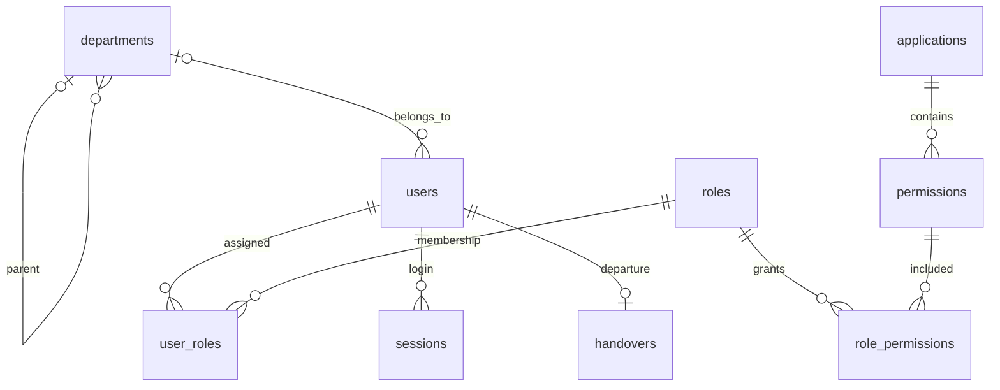

# 市政公司统一权限管理系统——数据库设计文档

版本：1.1；日期：2026-10-15；数据库：MySQL 8.0.16+；存储引擎：InnoDB。

## 本次设计修订范围

第 1–9 节保留现有已实现的 11 表基线，第 10 节给出对照最新原型检查后的目标设计，实施时以该节的字段变更及约束为准。目标为 15 张表，尚未修改 schema.sql、初始化程序、数据库或项目代码。现有结构不能被描述为已完成此次拆分。

配套文件：[目标数据库 ER 图](07-数据库ER图.md)。该图展示第 10 节目标结构；下方第 3 节小图仅用于说明现有结构。

## 1. 设计依据与目标

本项目已经将运行时驱动、DDL、SQL、会话时间处理及集成测试从 SQLite 改为 MySQL，不再以“计划迁移”作为交付状态。旧 data/rbac.db 仅保留为历史来源，不被新后端读取。

设计覆盖身份、部门、业务系统、功能权限、RBAC0 关系、登录会话、鉴权日志、授权变更及离职交接。完整可执行定义以 [schema.sql](../../src/main/resources/schema.sql) 为准，本文提供逻辑解释与逐字段字典；当前共 11 张表。

## 2. 命名、类型与连接规范

| 项目 | 规范 |
|---|---|
| 库名 | 本地业务库 rbac，独立测试库 rbac_test |
| 本地连接 | 项目独立实例 127.0.0.1:3307，不修改系统其他数据库服务 |
| 字符集 | utf8mb4，表排序规则 utf8mb4_0900_bin；代码和登录标识区分大小写 |
| 主键 | 实体主键 BIGINT AUTO_INCREMENT；两张关系表复合主键；会话摘要、交接用户为特殊主键 |
| 电话/工号 | VARCHAR 字符串，保留格式与前导零 |
| 布尔标记 | TINYINT，CHECK 限制 0/1；不是依赖数据库任意非零值 |
| 日期时间 | DATE 用于预计日期；DATETIME(3) 用于 UTC 事件时间 |
| 时间连接 | JDBC connectionTimeZone=UTC 与 forceConnectionTimeZoneToSession=true，避免机器时区影响存储 |
| 事务隔离 | 连接池 READ COMMITTED，避免长事务读取旧授权快照；并不消除所有在途竞争 |
| 连接池 | HikariCP，当前最大 10 个连接 |
| 密钥 | 通过环境变量或 Git 忽略的本地配置加载，不放入源码和文档 |
| 建表策略 | 启动 CREATE TABLE IF NOT EXISTS；不是自动字段迁移工具 |

CHECK 约束需 MySQL 8.0.16 或更新版本才有可靠执行支持。接口字段长度校验并未完全覆盖所有数据库长度约束，异常处理仍需后续完善。

## 3. 现有实现的概念结构与关系

补充关系：handovers.receiver_id、owner_id、started_by、completed_by 均指向 users；user_roles.granted_by 指向 users。authorization_logs.user_id 与 authorization_changes.operator_id/target_id 为审计逻辑引用，不设置物理外键，避免未来主体变更破坏历史。

users.company 当前是非规范化公司名称，不存在 companies 表。组织父子树不产生角色继承；没有 user_permissions 直接授权表。权限只通过 user_roles 和 role_permissions 获得。

## 4. 数据字典

以下“空值”按列约束标注。两张关系表的列分别 NOT NULL 且共同组成主键；各表外键、CHECK、复合索引另见第 5 节。所有时间含义为 UTC。

### departments（部门表）

支持组织树。部门名称当前全局唯一，分公司部门以组合名称区分。manager_name 为导入时的负责人姓名，不是管理员授权关系。

| 字段 | 类型 | 空值 | 默认值/约束 | 含义 |
|---|---|---|---|---|
| id | BIGINT | 否 | PRIMARY KEY AUTO_INCREMENT | 内部稳定主键 |
| name | VARCHAR(191) | 否 | NOT NULL UNIQUE | 显示名称 |
| manager_name | VARCHAR(100) | 是 | — | 部门负责人姓名 |
| parent_id | BIGINT | 是 | — | 上级部门 ID |
| enabled | TINYINT | 否 | NOT NULL DEFAULT 1 | 启用标记：0 停用，1 启用 |

### users（用户表）

员工来源为 Excel；company 保留公司名称字符串，department_id 关联当前部门。仅一个当前部门字段，未建立多任职模型。status 表示账号状态，不能代替离职交接状态。

| 字段 | 类型 | 空值 | 默认值/约束 | 含义 |
|---|---|---|---|---|
| id | BIGINT | 否 | PRIMARY KEY AUTO_INCREMENT | 内部稳定主键 |
| employee_no | VARCHAR(100) | 否 | NOT NULL UNIQUE | 员工工号 |
| username | VARCHAR(100) | 否 | NOT NULL UNIQUE | 登录用户名 |
| name | VARCHAR(100) | 否 | NOT NULL | 显示名称 |
| phone | VARCHAR(32) | 是 | UNIQUE | 电话，允许空值 |
| company | VARCHAR(191) | 是 | — | 所属公司名称 |
| department_id | BIGINT | 是 | — | 当前部门 ID |
| position | VARCHAR(191) | 是 | — | 岗位名称 |
| password_hash | VARCHAR(100) | 否 | NOT NULL | BCrypt 密码摘要 |
| status | VARCHAR(16) | 否 | NOT NULL DEFAULT 'ACTIVE' | 账号状态：ACTIVE / DISABLED |
| created_at | DATETIME(3) | 否 | NOT NULL DEFAULT CURRENT_TIMESTAMP(3) | 创建时间（UTC） |

### applications（系统目录表）

记录业务系统命名空间与启用状态。无入口 URL、客户端密钥、接入状态字段；当前 connected 值由接口固定返回。

| 字段 | 类型 | 空值 | 默认值/约束 | 含义 |
|---|---|---|---|---|
| id | BIGINT | 否 | PRIMARY KEY AUTO_INCREMENT | 内部稳定主键 |
| code | VARCHAR(191) | 否 | NOT NULL UNIQUE | 唯一业务代码 |
| name | VARCHAR(191) | 否 | NOT NULL | 显示名称 |
| enabled | TINYINT | 否 | NOT NULL DEFAULT 1 | 启用标记：0 停用，1 启用 |

### permissions（功能权限表）

权限颗粒度为系统—模块—功能—操作。中文 action 用于展示，code 最后一段为规范化操作编码。

| 字段 | 类型 | 空值 | 默认值/约束 | 含义 |
|---|---|---|---|---|
| id | BIGINT | 否 | PRIMARY KEY AUTO_INCREMENT | 内部稳定主键 |
| app_id | BIGINT | 否 | NOT NULL | 所属系统 ID |
| module_name | VARCHAR(191) | 否 | NOT NULL | 模块名称 |
| feature_name | VARCHAR(191) | 否 | NOT NULL | 功能名称 |
| action | VARCHAR(32) | 否 | NOT NULL | 操作名称/审计动作，见表说明 |
| code | VARCHAR(512) | 否 | NOT NULL UNIQUE | 唯一业务代码 |
| description | TEXT | 是 | — | 说明 |
| enabled | TINYINT | 否 | NOT NULL DEFAULT 1 | 启用标记：0 停用，1 启用 |

### roles（角色表）

预设系统管理员、公司领导、部门经理、项目经理、普通员工。角色无 parent_id，不提供角色继承。

| 字段 | 类型 | 空值 | 默认值/约束 | 含义 |
|---|---|---|---|---|
| id | BIGINT | 否 | PRIMARY KEY AUTO_INCREMENT | 内部稳定主键 |
| code | VARCHAR(100) | 否 | NOT NULL UNIQUE | 唯一业务代码 |
| name | VARCHAR(100) | 否 | NOT NULL UNIQUE | 显示名称 |
| description | TEXT | 是 | — | 说明 |
| enabled | TINYINT | 否 | NOT NULL DEFAULT 1 | 启用标记：0 停用，1 启用 |

### user_roles（用户角色关系表）

复合主键保证同一用户不重复持有同一角色。granted_by 与 granted_at 记录授予来源；全量替换会重新写入保留关系的授予时间。

| 字段 | 类型 | 空值 | 默认值/约束 | 含义 |
|---|---|---|---|---|
| user_id | BIGINT | 否 | NOT NULL | 用户 ID |
| role_id | BIGINT | 否 | NOT NULL | 角色 ID |
| granted_by | BIGINT | 是 | — | 授权操作者 ID |
| granted_at | DATETIME(3) | 否 | NOT NULL DEFAULT CURRENT_TIMESTAMP(3) | 授权时间（UTC） |

### role_permissions（角色权限关系表）

复合主键消除重复关系，角色可跨系统关联权限。

| 字段 | 类型 | 空值 | 默认值/约束 | 含义 |
|---|---|---|---|---|
| role_id | BIGINT | 否 | NOT NULL | 角色 ID |
| permission_id | BIGINT | 否 | NOT NULL | 功能权限 ID |

### sessions（登录会话表）

只保存令牌摘要，使用 user_id 关联身份；每次请求检查撤销标记、到期时间及账号状态。无权限快照。

| 字段 | 类型 | 空值 | 默认值/约束 | 含义 |
|---|---|---|---|---|
| token_hash | CHAR(64) | 否 | CHARACTER SET ascii COLLATE ascii_bin PRIMARY KEY | SHA-256 令牌摘要，64 位十六进制 |
| user_id | BIGINT | 否 | NOT NULL | 用户 ID |
| expires_at | DATETIME(3) | 否 | NOT NULL | 会话到期时间（UTC） |
| revoked | TINYINT | 否 | NOT NULL DEFAULT 0 | 撤销标记：0 有效候选，1 已撤销 |
| created_at | DATETIME(3) | 否 | NOT NULL DEFAULT CURRENT_TIMESTAMP(3) | 创建时间（UTC） |

### authorization_logs（访问鉴权日志表）

刻意不为 user_id 加物理外键，保留用户和权限代码快照。allowed 表示鉴权结果而不是业务执行结果。request_id 不是唯一幂等键。

| 字段 | 类型 | 空值 | 默认值/约束 | 含义 |
|---|---|---|---|---|
| id | BIGINT | 否 | PRIMARY KEY AUTO_INCREMENT | 内部稳定主键 |
| occurred_at | DATETIME(3) | 否 | NOT NULL DEFAULT CURRENT_TIMESTAMP(3) | 事件时间（UTC） |
| user_id | BIGINT | 是 | — | 用户 ID |
| username | VARCHAR(100) | 是 | — | 登录用户名 |
| app_code | VARCHAR(191) | 否 | NOT NULL | 系统代码快照 |
| permission_code | VARCHAR(512) | 否 | NOT NULL | 操作权限代码或 system:enter |
| allowed | TINYINT | 否 | NOT NULL | 鉴权结果：0 拒绝，1 允许 |
| request_id | VARCHAR(191) | 是 | — | 可选调用追踪 ID |
| reason | TEXT | 是 | — | 鉴权原因或交接原因 |

### authorization_changes（授权变更日志表）

operator_id 与 target_id 为逻辑关联，不加多态外键。target_type 当前为 USER 或 ROLE；detail 为文本，不统一声明为 MySQL JSON。

| 字段 | 类型 | 空值 | 默认值/约束 | 含义 |
|---|---|---|---|---|
| id | BIGINT | 否 | PRIMARY KEY AUTO_INCREMENT | 内部稳定主键 |
| occurred_at | DATETIME(3) | 否 | NOT NULL DEFAULT CURRENT_TIMESTAMP(3) | 事件时间（UTC） |
| operator_id | BIGINT | 是 | — | 变更操作者 ID |
| target_type | VARCHAR(32) | 否 | NOT NULL | 目标类型 USER / ROLE |
| target_id | BIGINT | 否 | NOT NULL | 目标记录 ID |
| action | VARCHAR(64) | 否 | NOT NULL | 操作名称/审计动作，见表说明 |
| detail | TEXT | 是 | — | 变更内容文本 |

### handovers（离职交接表）

user_id 既为主键又为外键，一个用户当前最多一条交接记录；无记录表示在职。暂不支持多次入离职历史或撤销交接。

| 字段 | 类型 | 空值 | 默认值/约束 | 含义 |
|---|---|---|---|---|
| user_id | BIGINT | 否 | PRIMARY KEY | 用户 ID |
| receiver_id | BIGINT | 否 | NOT NULL | 交接接收人 ID |
| owner_id | BIGINT | 否 | NOT NULL | 交接负责人 ID |
| expected_date | DATE | 否 | NOT NULL | 预计完成日期 |
| reason | VARCHAR(1000) | 否 | NOT NULL | 鉴权原因或交接原因 |
| oa_reference | VARCHAR(200) | 否 | NOT NULL DEFAULT '' | OA 关联单号 |
| state | VARCHAR(16) | 否 | NOT NULL | HANDOVER / DEPARTED |
| started_by | BIGINT | 否 | NOT NULL | 发起操作者 ID |
| started_at | DATETIME(3) | 否 | NOT NULL DEFAULT CURRENT_TIMESTAMP(3) | 发起时间（UTC） |
| completed_by | BIGINT | 是 | — | 完成操作者 ID |
| completed_at | DATETIME(3) | 是 | — | 完成时间（UTC） |
| completion_note | VARCHAR(1000) | 是 | — | 完成说明 |

## 5. 完整性约束与索引

### 5.1 唯一性与状态规则

- users.employee_no、username、phone 分别唯一；phone 允许多个 NULL，但空字符串并不等同 NULL。导入无电话时应使用 NULL；当前演示管理员已采用 NULL。
- 三个登录别名字段分别唯一，不构成跨字段统一唯一命名空间；登录查询若匹配多条用户将拒绝，不静默选第一条。
- departments.name、applications.code、roles.code/name、permissions.code 唯一。
- permissions 的 (app_id,module_name,feature_name,action) 唯一，避免相同功能操作重复登记。
- user_roles 主键为 (user_id,role_id)；role_permissions 主键为 (role_id,permission_id)。
- users.status 仅 ACTIVE/DISABLED，handovers.state 仅 HANDOVER/DEPARTED；在职 EMPLOYED 为查询派生值，不存入 handovers。
- 部门树外键保证上级存在，但不自动防止环；导入/迁移过程按父先子后组织数据。交接关联不能等于离职本人等规则由应用校验。

### 5.2 外键与删除策略

| 子表字段 | 父表 | 删除规则 |
|---|---|---|
| departments.parent_id | departments.id | 默认限制；不能留下孤儿部门 |
| users.department_id | departments.id | 默认限制 |
| permissions.app_id | applications.id | 默认限制 |
| user_roles.user_id、role_id | users.id、roles.id | ON DELETE CASCADE，仅清除关系 |
| user_roles.granted_by | users.id | 默认限制 |
| role_permissions.role_id、permission_id | roles.id、permissions.id | ON DELETE CASCADE |
| sessions.user_id | users.id | 默认限制 |
| handovers 五个用户引用 | users.id | 默认限制 |

数据库存在级联删除定义不代表提供物理删除接口。当前离职只禁用、撤权、撤销会话，保留用户和日志；不会通过删用户触发级联。

### 5.3 索引与查询

| 索引或键 | 用途/限制 |
|---|---|
| 用户工号/用户名/电话唯一索引 | 登录别名精确查找 |
| idx_users_company_dept(company,department_id) | 公司及公司+部门筛选 |
| idx_users_dept(department_id) | 单独按部门筛选 |
| idx_users_name(name) | 姓名有序或前缀查询；当前 %关键词% 不能保证利用此索引 |
| permissions 唯一复合键以 app_id 开头 | 系统权限集合定位 |
| 两张关系表复合主键及外键索引 | 用户→角色→权限 JOIN；反向关联由外键索引辅助 |
| sessions 主键 token_hash | 单次会话检查 |
| idx_sessions_user / idx_sessions_expiry | 全部会话撤销、未来过期清理 |
| idx_auth_logs_time / idx_auth_logs_user | 时间或用户审计查询扩展；当前页面主要按主键逆序读取 |
| idx_changes_target(target_type,target_id,id) | 交接页按用户读取最近变更 |

UTF-8 最大 4 字节，权限 code 的 VARCHAR(512) 唯一索引最长 2048 字节；功能复合唯一键在 InnoDB 常规 3072 字节索引限制内。不得直接扩大多个索引字段长度而不检查键长度。索引是否实际命中需 EXPLAIN 和压测验证，不声称仅加索引即可满足所有性能目标。

## 6. 初始化数据与编码

首次仅在 users 为空且 rbac.initialize=true 时初始化；非空库不重新覆盖授权。流程为部门→角色→初始化管理员→员工与初始角色→系统/权限/角色权限。

| 来源 | 映射 |
|---|---|
| 员工表 | name、employee_no/username、company、department_id、position、phone |
| 部门表 | name、manager_name、parent_id |
| 权限清单 | applications、permissions、roles 对应 role_permissions |

初始业务角色由岗位、部门经理姓名及权限清单推导，可由管理员后续修改，不作为永久规则。权限 code 采用“规范化系统:模块:功能:操作编码”；规范化采用 NFKC、非字母数字替换为下划线、统一小写。中文名称保留。

BCrypt 存密码摘要，登录令牌为 32 字节安全随机值的 Base64URL 编码，库内仅存 SHA-256 摘要。不将默认演示密码等同于生产密码策略。

## 7. 事务与一致性

| 操作 | 原子写入 | 主要控制 |
|---|---|---|
| 登录 | 新增 sessions | 校验用户与 BCrypt 后创建 |
| 用户授权替换 | 删除旧 user_roles、插入新关系、写变更日志 | 锁定目标 users 行；事务提交生效 |
| 角色权限替换 | 删除旧关系、插入新关系、写变更日志 | 事务保护；无乐观版本，并发冲突提示待补 |
| 发起交接 | 新增 handovers、写变更日志 | 锁定目标 users 行，避免重复/与处置冲突 |
| 完成处置 | 删角色、停账号、撤全部会话、完成交接、写原角色快照 | 先锁 users，后锁 handovers；重复完成不重复记账 |
| 首次初始化 | 多表初始业务数据 | ApplicationRunner 的事务；DDL 不在同一可回滚事务中 |

MySQL DDL 会隐式提交，不能宣称建表与迁移 INSERT 可以一起回滚。迁移脚本先建空表，再在一个 InnoDB DML 事务中导入。新发起的鉴权查询数据库最新授权，不把会话作为角色快照；此前已通过鉴权的外部操作仍需由业务系统定义提交边界。

## 8. SQLite 到 MySQL 的实际迁移

### 8.1 兼容调整

| 原实现 | MySQL 实现 |
|---|---|
| sqlite-jdbc、jdbc:sqlite | mysql-connector-j、jdbc:mysql |
| INTEGER AUTOINCREMENT | BIGINT AUTO_INCREMENT |
| PRAGMA foreign_keys | InnoDB FOREIGN KEY/CHECK |
| 无长度 TEXT 标识字段 | 有长度 VARCHAR，并选择合适唯一索引 |
| INSERT OR IGNORE | 定向 ON DUPLICATE KEY UPDATE 自赋值，或已去重的普通 INSERT |
| group_concat(name,'、') | GROUP_CONCAT(name ORDER BY id SEPARATOR '、') |
| 宽松 GROUP BY 用户字段 | 用户主查询与相关角色聚合子查询分离 |
| DISTINCT 查询按未选中 ID 排序 | 按已选出的系统/权限代码排序 |
| 文本 expires_at | UTC DATETIME(3)，Java Timestamp 参数 |
| 内存 SQLite 集成测试 | 独立真实 MySQL rbac_test |

### 8.2 迁移工具与保护

[local_mysql.py](../../scripts/local_mysql.py) 创建项目独立实例、随机数据库凭据与业务/测试库。凭据目录被 Git 忽略，仅开发机本地使用；默认账户限 localhost。开发账号对自身库有建表权限，生产应拆分迁移账号与最小权限运行账号。

[migrate_sqlite_to_mysql.py](../../scripts/migrate_sqlite_to_mysql.py) 只读打开 SQLite，先检查全部目标表为空，再创建 SQLite 备份。部门按拓扑顺序插入，其他表按外键依赖顺序插入；保留主键、密码摘要、关系、日志、会话及交接，不重置员工密码。时间按 UTC 毫秒规范化。

值以类型化数值/NULL/UTF-8 十六进制文字写入，不用未转义的用户文本拼 SQL；表列名来自固定表清单和本地源库模式，仅用于受信本地迁移，不是开放上传接口。脚本目标限定本项目本地 rbac 空库，外部部署需另行审查连接与导入流程。

迁移完成后按每张表全部列规范化、排序并计算 SHA-256 比较；不只校验行数。发生插入错误时事务回滚；校验失败时保留源库与备份并停止后续使用，需人工检查目标，不自动删库重试。目标非空时拒绝迁移。

### 8.3 本次迁移记录

2026-10-08 迁移的源数据快照如下；后续登录/鉴权会增加记录，不应把下表当作永久业务统计。

| 表 | 行数 | 校验 |
|---|---:|---|
| departments | 111 | 全列内容一致 |
| users | 10001 | 全列内容一致 |
| applications | 18 | 全列内容一致 |
| permissions | 2521 | 全列内容一致 |
| roles | 5 | 全列内容一致 |
| user_roles | 10240 | 全列内容一致 |
| role_permissions | 3916 | 全列内容一致 |
| sessions | 14 | 时间规范化后全列一致 |
| authorization_logs | 16 | 全列内容一致 |
| authorization_changes | 1 | 全列内容一致 |
| handovers | 0 | 空表一致；业务流程另由测试验证 |

原 data/rbac.db 保留不变；备份位于 .local/mysql/backups/；机器本地报告为 .local/mysql/migration-report.txt，避免把人员数据、会话摘要或数据库密码加入版本库。

## 9. 运行维护与安全

1. 应用、测试使用不同数据库和用户。测试可初始化空测试库并回滚用例变更，严禁用环境变量指向正式业务库。
2. 当前 CREATE TABLE IF NOT EXISTS 不能升级已有列，后续模式变更应使用经过审查的版本化迁移，不要靠删除库重建。
3. 本地脚本不自动安装开机服务；重启后运行脚本恢复实例。生产部署采用受管 MySQL、TLS、备份和监控。
4. 日志无自动删除，但永久保存仍需要归档、容量规划和恢复演练；不能只凭“没有清理代码”宣称满足长期可靠保存。
5. 姓名、电话仍为明文业务字段；目前由 API 管理权限保护，字段加密和脱敏尚未实现。
6. 回退前停用写请求，保留 MySQL 最新数据并核对迁移后新增事件；不能直接回到旧 SQLite 快照而丢弃新变更。
7. 本次只生成旧库备份和迁移校验，未声称已经实现 MySQL 定时备份、主从复制或灾备。

与接口关系见[API设计](03-API设计文档.md)，事务流程见[详细设计](05-详细设计文档.md)。

## 10. 原型对应的目标数据库设计（待实施）

### 10.1 检查结论与数据归属

原型新增了明确的系统、模块、功能点和操作层次，不能只把它们当作每条权限上的重复文字。现有关系表已将用户角色和角色权限分开，没有把多个角色或权限塞进一个字段；这一结构应保留。需调整的部分如下：

| 现状与问题 | 目标设计 |
|---|---|
| users.company 在每名员工上重复；部门又决定员工所属公司，调部门时可能忘记改公司 | 新建 companies；departments.company_id 关联公司；用户仅保存 department_id，公司通过部门查询 |
| 部门 name 全局唯一，靠拼接分公司名称区分；manager_name 可能重名或改名 | 部门新增稳定 code，同公司内名称唯一；负责人改为 manager_user_id，可空，显示姓名从 users 查询 |
| permissions 按操作重复 module_name、feature_name、description | 新建 modules、features；功能说明只保存在 features，权限仅引用功能点和操作类型 |
| 中文 action 在每条权限中重复维护，操作中文名与末段代码可能不一致 | 新建 actions，以 read/create/update 等稳定代码为主键，中文名称和显示顺序统一维护 |
| 应用、角色的权限数和用户有效权限属于查询结果 | 不增加 permission_count、用户系统列表或按钮 allowed 等存储字段，通过关联去重计算 |
| 工号、电话具有不同语义，用户角色属于多对多关系 | 保留原子字段和关系表；不保存逗号分隔的角色、电话或权限集合 |
| 审计记录保存账号、系统代码及权限代码 | 明确这些是事件发生时的快照，独立于主体当前名称；不能用实时 JOIN 替换历史内容 |

单部门任职是本阶段边界：每个业务员工必须关联一个部门，所属公司由该部门确定；初始化技术管理员允许 department_id 为 NULL，此时公司和部门均为空。暂不支持“已知公司但未知部门”的正式员工记录、跨公司兼岗或多部门任职；无法匹配的导入行先进入待确认清单，不用重复保存 company 字符串兜底。

### 10.2 新增实体数据字典

类型、字符集和时间规范沿用第 2 节。下列新增实体均使用 InnoDB；所有 enabled 均为 TINYINT NOT NULL DEFAULT 1 并 CHECK IN (0,1)。实体 id 均为 BIGINT 自增主键。名称是显示值，code 是稳定标识，改名不重建主键。

| 表 | 字段及约束 | 数据职责 |
|---|---|---|
| companies | id；code VARCHAR(100) NOT NULL UNIQUE；name VARCHAR(191) NOT NULL UNIQUE；enabled | 公司名唯一维护处，使用公司代码避免把名称作为连接键 |
| modules | id；app_id BIGINT NOT NULL FK applications.id；code VARCHAR(100) NOT NULL；name VARCHAR(191) NOT NULL；sort_order INT NOT NULL DEFAULT 0；enabled；UNIQUE(app_id,code)，UNIQUE(app_id,name) | 系统内模块定义，不复制系统名 |
| features | id；module_id BIGINT NOT NULL FK modules.id；code VARCHAR(100) NOT NULL；name VARCHAR(191) NOT NULL；description TEXT NULL；sort_order INT NOT NULL DEFAULT 0；enabled；UNIQUE(module_id,code)，UNIQUE(module_id,name) | 模块内功能点及唯一的功能说明来源 |
| actions | code VARCHAR(32) PRIMARY KEY；name VARCHAR(32) NOT NULL UNIQUE；sort_order INT NOT NULL DEFAULT 0；enabled | 操作类型字典，不存业务授权关系 |

actions 预设 read/查看、create/新增、update/编辑、delete/删除、approve/审批、export/导出、configure/配置。若清单含其他合法动作，应显式补字典映射，不默默丢弃。sort_order 为非负数；排序值可重复，用 id 或 action code 保证确定性。系统、模块、功能和动作启用不意味着任何用户自动获得权限。

### 10.3 现有实体的字段调整

#### departments

目标字段为 id、company_id、code、name、manager_user_id、parent_id、enabled。

- company_id BIGINT NOT NULL，外键指向 companies.id；code VARCHAR(100) NOT NULL UNIQUE。
- name 仍为 VARCHAR(191) NOT NULL，删除全局名称唯一约束，改为 UNIQUE(company_id,name)。本阶段同公司内部门名不重复，不支持同公司不同层级的同名部门。
- manager_user_id BIGINT NULL，外键指向 users.id，替代 manager_name；没有负责人时为 NULL，不用空姓名或伪造用户。
- parent_id 为同一公司的上级部门，可空。建立 UNIQUE(company_id,id)，以 (company_id,parent_id) 复合外键引用 departments(company_id,id)，避免跨公司上级；应用校验 parent_id != id 并在事务内检查祖先链，防止多节点成环。
- 负责人需为该部门的有效在职用户，由应用维护时校验，不把负责人姓名再次写入部门。部门和用户存在循环引用，初始化先导入无负责人的部门，再导入用户，最后回填负责人。

#### users

保留第 4 节全部字段，**删除 company**，公司通过 users.department_id → departments.company_id → companies.id 查询。department_id 对技术账号仍可空，业务员工必须非空由服务层与导入校验；员工调动只修改 department_id。删除 idx_users_company_dept，保留 department_id 索引；公司筛选先定位公司下部门，再关联用户。

API 用户列表中的 company、department 仍可作为关联查询后的展示字段返回，不代表用户表存有同名列。position 当前是自由文本岗位标签，无额外岗位属性，因此不为单个标签强行新增岗位实体。employee_no 和 username 即使初始化相同，也分别承担人事标识与登录标识职责，不视为永久相等关系。

#### permissions

目标完整字段：

| 字段 | 类型与约束 | 含义 |
|---|---|---|
| id | BIGINT PRIMARY KEY AUTO_INCREMENT | 保留现有权限 ID，避免角色关联变化 |
| feature_id | BIGINT NOT NULL FK features.id | 唯一所属功能点 |
| action_code | VARCHAR(32) NOT NULL FK actions.code | 单一操作类型 |
| code | VARCHAR(512) NOT NULL UNIQUE | 对外稳定权限编码，保留现有值 |
| enabled | TINYINT NOT NULL DEFAULT 1，CHECK IN (0,1) | 权限条目启用状态 |

建立 UNIQUE(feature_id,action_code)，每个功能点每种动作只登记一次。删除 app_id、module_name、feature_name、action、description；系统归属由功能点→模块→系统得到，不重复存储可推导的系统 ID。角色不与模块直接关联，仍授予具体操作权限。

既有 code 虽由名称生成，目标中将其视为创建时分配且不可随展示名称改变的外部标识；不得通过解析 code 推导当前系统归属。改名只更新实体名称。迁移保留 code，避免旧接口调用方及日志失去关联；新增记录仍应检查编码长度与全局唯一性。功能跨模块/系统迁移会改变授权语义，本阶段不提供移动接口，不通过重挂外键隐式扩大访问范围。

#### 其余表

applications、roles、user_roles、role_permissions、sessions、authorization_logs、authorization_changes、handovers 保留第 4 节字段。两张关系表的复合主键继续表示一条授权事实，不追加角色名、功能名或系统名。

user_roles.granted_by/granted_at 是这一用户—角色关系的授予事实，不属于单独用户或角色。handovers.state 与 users.status 分别表示交接进度和账号可用性，存在交接中账号启用、非离职原因账号停用等合法组合，不可合并为一个状态字段。EMPLOYED 仍由无交接记录派生，不在用户表重复存人员状态。

authorization_changes.detail 保留为不参与当前授权计算的审计载荷，可包含历史角色 ID 快照；不得从该文本反向解析并当作当前关系表使用。日志中的 username/app_code/permission_code 是带时间语义的快照，允许与当前展示名不同，不跟随改名更新。

### 10.4 完整性、查询和状态传播

- 新增所有父子目录外键默认 RESTRICT，不级联删除模块、功能点或权限；已有授权关系删除规则沿用第 5 节。停用代替物理删除，任何未来清理需先明确处理角色引用和审计保留。
- 有效权限必须同时满足账号 ACTIVE、角色 enabled、applications/modules/features/actions/permissions 全部 enabled，以及两张关系表存在关联。公司/部门停用表示组织不再供任职选择，不直接充当访问撤权；需要撤销人员访问时仍走账号停用或离职处置，避免组织维护隐式改变 RBAC 规则。
- 我的应用从有效权限 JOIN 得出，按 applications.id 去重，只返回计数大于 0 的系统。模块/功能 API 先检查当前系统准入，再读取启用目录和本人操作集合。
- allowed、canManage、permissionCount 等均为响应派生字段，不建用户权限快照表，不将授权写入 sessions。撤权事务提交后的新请求重新查询；已通过鉴权的业务执行需单独定义提交边界。
- API-04、API-15 等原有扁平响应仍可 JOIN 返回 module、feature、action、appName，不要求为了兼容响应把文字复制回权限表。原 API-09 的 company 参数仍可匹配 companies.name，departmentId 校验应与选中公司一致。
- 目录初始化顺序：公司→部门（负责人空）→角色/用户→负责人回填→系统→模块→功能点/动作字典→权限→角色权限；先创建所有所需表，再补循环外键，不能忽略循环依赖。
- 目录级外键和启用状态新增后，所有准入、操作鉴权、权限计数与离职系统查询必须改为同一过滤规则，不能只改目录 API。

索引补充：departments(company_id,name) 唯一索引用于公司部门筛选；modules(app_id,sort_order,id)、features(module_id,sort_order,id) 用于有序目录；permissions(feature_id,action_code) 唯一索引用于操作集合；actions 主键用于动作关联。保留角色关系与权限 code 索引。所有新增唯一键仍在 InnoDB 长度限制内；具体查询计划待实现后 EXPLAIN 验证。

### 10.5 数据整理与迁移验收计划

本节仅为后续实施方案，不执行迁移。不得以 CREATE TABLE IF NOT EXISTS 代替已有表结构迁移。

1. 备份并统计现有公司、部门、功能名称和权限关系。按员工公司与部门核对真实组织归属；一个旧部门被多个公司使用时需确认后拆分映射，不能任选公司。空部门、冲突名称、重复功能描述或负责人重名列入待确认清单。
2. 为公司、模块、功能点分配稳定 ID/code。按旧 (app_id,module_name) 分组模块，按 (app_id,module_name,feature_name) 分组功能点；相同功能下不同操作的 description 必须一致或经人工确认后统一，不能直接取第一条。
3. 回填 users.department_id 映射及部门负责人；工号、密码摘要、人员 ID、角色 ID 不改变。保持权限 id/code，回填 feature_id/action_code；role_permissions 不因拆表扩大或丢失授权。
4. 对照迁移前后每个用户的有效 permissionCode 集合以及可用系统集合，逐集合核对；核对权限总数、重复条目、孤儿外键、跨公司部门、操作映射、目录停用语义。历史日志原样保留，不用当前名称覆盖快照。
5. 切换 JOIN 查询并完成 API-05/06/07/22/23 与管理员日志验收后，再移除旧冗余字段与索引。由于 DDL 隐式提交，采用版本化分步迁移与可验证备份，不能声称整个结构变更可一次事务回滚。

目标实体清单共 15 张：companies、departments、users、applications、modules、features、actions、permissions、roles、user_roles、role_permissions、sessions、authorization_logs、authorization_changes、handovers。
