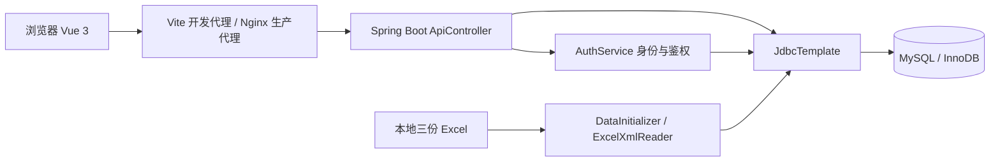
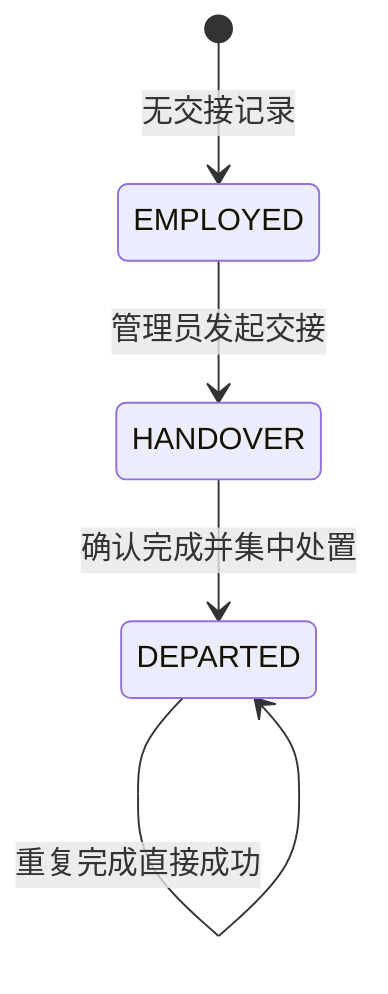
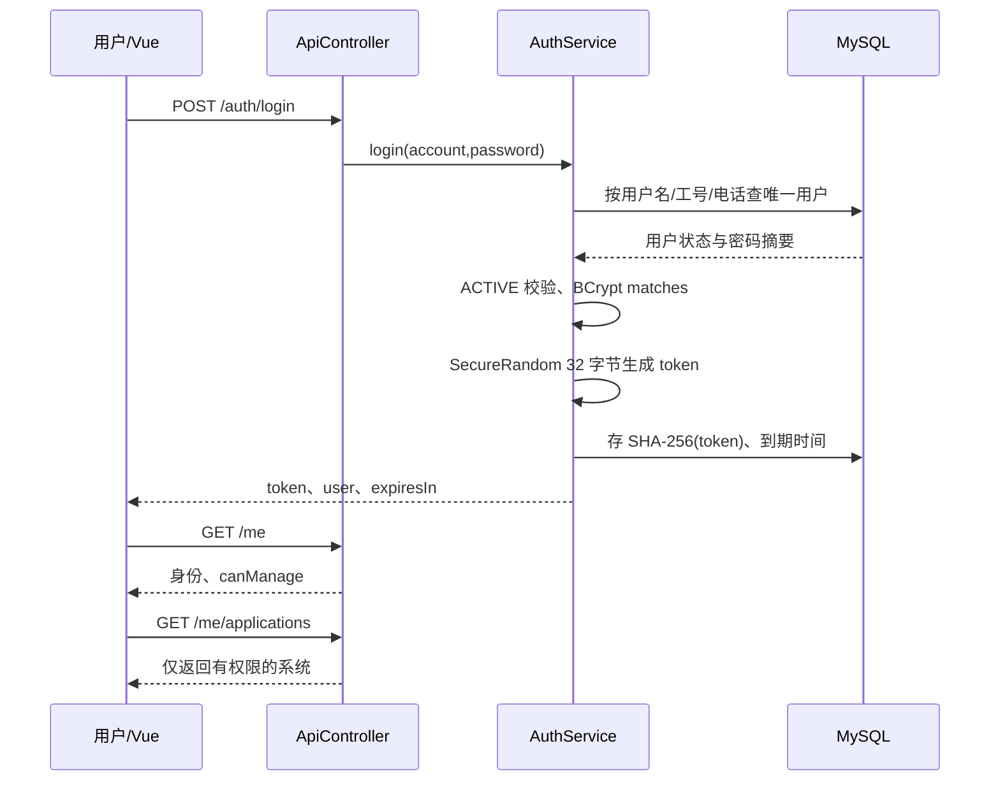

# 市政公司统一权限管理系统——详细设计文档

版本：1.1；日期：2026-10-16；范围：已实现 RBAC0 及 MySQL 迁移；关联[需求](01-需求分析.md)、[界面](02-界面设计文档.md)、[API](03-API设计文档.md)、[数据库](04-数据库设计文档.md)。

## 1. 总体架构

系统采用浏览器/服务器模式，前端与后端独立构建、启动和部署。Vue 负责交互和展示，Spring Boot 接收 REST 请求，JdbcTemplate 参数化访问 MySQL，InnoDB 提供关系约束与事务。



后端不再托管前端静态页面；生产静态站点路由由 Nginx history fallback 处理，/api 转发到后端。开发默认前端 5173、后端 8081、项目本地 MySQL 3307。

代码组织尽量使用命名过程、顺序/分支/循环，Vue 使用 setup 函数与数据容器，没有类式前端业务组件。但 Spring Boot 仍采用框架要求的 Java 类、依赖注入和注解，现有 Java 代码也含 lambda；不能声称整个项目为严格纯结构化编程。若课程继续要求完全不用面向对象，应与老师确认这与指定 Spring Boot 框架的关系。

## 2. 模块划分与源码定位

| 模块 | 文件 | 责任与边界 |
|---|---|---|
| 应用入口 | RbacApplication.java | Spring Boot 启动与组件扫描 |
| API 过程集合 | ApiController.java | 参数接收、管理鉴权、SQL 查询、事务写入、响应组装 |
| 身份权限过程 | AuthService.java | BCrypt、会话签发/检查/撤销、有效权限与管理资格判断 |
| 初始化 | DataInitializer.java | 空库导入、初始角色推导与编码 |
| Excel 读取 | ExcelXmlReader.java | ZIP/XML 解析，兼容现有非标准维度工作簿 |
| 异常转换 | ApiExceptionHandler.java | 已知业务异常按状态响应，未知异常隐藏内部信息 |
| 数据定义 | schema.sql | MySQL 11 张表、外键、索引、状态约束 |
| 前端壳层 | frontend/src/App.vue | 导航、身份栏、管理资格轮询、通知 |
| 路由 | frontend/src/main.js | 页面映射、登录与管理权限守卫 |
| 请求/会话 | frontend/src/api.js | fetch、20 秒超时、令牌存储、401 处理 |
| 页面 | frontend/src/pages/ | 登录、我的应用、用户列表和管理页 |
| 弹窗 | frontend/src/components/ | RoleEditor、Handover |
| 本地数据库工具 | scripts/local_mysql.py | 启动独立 MySQL、建立隔离库与随机本地凭据 |
| 历史迁移工具 | scripts/migrate_sqlite_to_mysql.py | 非破坏导入、备份及全列校验 |

当前没有 MyBatis/JPA、独立 Repository/DAO 层、Redis 或 Spring Security 过滤器链；认证是在控制器过程显式调用 AuthService 完成。类名不等于已采用完整领域对象架构，不在文档中虚构 service/repository/entity 分层。

## 3. 核心数据与状态

### 3.1 RBAC0 关系与有效权限

有效权限集合可表达为：

```text
EffectivePermissions(u) =
  union of enabled permissions from enabled roles assigned to u
  where each permission's application is enabled
```

处理任何受保护请求前还要求用户 ACTIVE、会话未撤销且未过期。系统管理员角色 code 的特殊检查仅用于管理后台准入；普通业务操作仍按具体权限关系判断。

权限模型不包含角色继承、否定权限、互斥约束或数据行条件。同一权限由多个角色授予时只要任一有效授予存在，结果即允许；移除一个角色不保证该权限一定消失。

### 3.2 人员状态机



EMPLOYED 为派生值；handovers 只保存 HANDOVER、DEPARTED。开始交接不改变 users.status；完成将其设为 DISABLED。没有定时完成、交接撤销或再入职路径。账号停用与人员离职不是同一字段。

### 3.3 前端数据状态

共享 session：token、me、notice。用户筛选本地状态：q、company、departmentId、page、items、total、busy、error。授权弹窗：完整 choices、独立 selected IDs、query、loaded、busy。交接弹窗：详情、表单与当前派生状态。

令牌保存于 sessionStorage；数据库不持有前端组件状态。轮询刷新 /me 的 canManage；失去管理权时卸载页面及弹窗并返回 /portal。会话 401 则清空令牌回登录。

## 4. 初始化算法

### 4.1 入口与事务

应用建立缺失表后运行 DataInitializer.run。若 initialize=false 或 users 已有数据则不播种；否则在事务中初始化业务数据。初始化和授权/交接写过程声明 rollbackFor=Exception.class，避免受检异常导致部分数据提交。建表 DDL 自身不能随该业务事务回滚。

不要以“users 非空”判断数据已经完整校验；当前不是可恢复的批量导入作业系统。若外部人工导入留下部分数据，应先核对，不直接再次播种。

### 4.2 Excel 解析

使用 ZipFile 读取 XLSX 内 XML，优先 sheet2.xml，否则 sheet1.xml；共享字符串从 sharedStrings.xml 读取。按实际单元格引用计算列号，不信任工作簿 dimension=A1 的异常范围。XML 工厂禁用 DTD 和外部实体。

该读取器针对课程提供的文件格式，不是任意 Excel 兼容库；缺失 sharedStrings、复杂公式、inlineStr 或不同 sheet 结构需要后续扩展。读取失败应终止初始化，不能将空结果当成功。

### 4.3 映射过程

1. 部门采用最多三轮父先子后的导入策略；只在父名称已识别时插入，现有资料全部导入 111 条。深层组织或未知父节点不能保证覆盖，未来需改为拓扑校验并报告遗漏。
2. 创建五个预设角色，创建初始化管理员并授予系统管理员。
3. 员工工号同时作为初始 username，保留公司、岗位、电话。部门依次尝试“公司-部门”、部门名称、公司名称。
4. 每名员工默认授予普通员工；领导岗位、部门负责人姓名、项目经理岗位按现有规则追加角色。
5. 权限清单继承空白行的系统/模块标题；拆分各角色单元格动作集合。“全部”展开为查看、新增、编辑、删除、审批、导出、配置。
6. 创建操作权限与角色权限关系，重复关系按唯一键合并。权限 code 规范化规则见数据库文档。

当前初始员工演示密码共用一次生成的 BCrypt 摘要，不能作为生产账户发放方案；迁移保留原摘要，不重置已有密码。

## 5. 登录与会话处理

### 5.1 登录流程



若别名匹配 0 条或多条、账号不启用、密码校验失败，统一返回 401。有效 token 使用 Base64URL 无填充编码；仅在登录响应交给前端，服务端保存十六进制 SHA-256。

### 5.2 require 过程

```text
输入 Authorization
若不是 Bearer 前缀：拒绝
计算 token 的 SHA-256
查询 sessions JOIN users：
  token_hash 匹配 AND revoked=0 AND expires_at>当前UTC时间
  AND users.status='ACTIVE'
无记录：401；有记录：返回 id、username、name
```

不在 token 中固化角色或权限；因此权限关系改变无需重新签发 token。退出只将当前 token 标记 revoked=1。浏览器标签页关闭不等于服务端会话立即撤销；会话仍按有效期/退出/离职处理。

### 5.3 MySQL 时间适配

会话时间写入与比较使用 java.sql.Timestamp.from(Instant)，JDBC 固定 UTC；表使用 DATETIME(3)。查询结果组装过程将 JDBC Timestamp/LocalDateTime/Date 转换为约定的字符串，避免驱动返回类型差异影响 Vue。

迁移旧 ISO-8601 过期时间时按 UTC 规范化到毫秒；该转换会丢弃亚毫秒精度，但不改变本系统秒级有效期语义。

## 6. 鉴权与准入算法

### 6.1 功能鉴权

AuthService.has 使用 EXISTS 查询：

```text
user_roles
  JOIN roles(enabled=1)
  JOIN role_permissions
  JOIN permissions(enabled=1)
  JOIN applications(enabled=1)
WHERE user_id=当前用户 AND permissions.code=请求权限码
```

控制器进一步验证权限码所属应用与 appCode 一致。只有两个条件均满足才允许。日志记录用户、用户名、应用码、权限码、requestId、结果和原因，然后返回 allowed。

同一账号持有多个角色时 EXISTS 自然表达并集规则；菜单查询则用 DISTINCT 去重。MySQL 不允许某些 DISTINCT 结果按未选出的 ID 排序，现实现按选出的 appCode、code 排序。

### 6.2 系统准入

本人系统列表基于权限→功能点→模块→系统计算 count(DISTINCT p.id)，仅返回有效授权数量大于零的系统。入口 POST 再次检查权限，否则 403；成功返回 application 和 next=modules。目录查询独立检查准入，功能操作每次调用 /authorize。

“系统管理后台”业务目录项与权限平台管理导航不是同一判断机制；不能通过这个功能鉴权演示目录项推导平台全局管理权。

### 6.3 即时撤权边界

权限判断直接读库，未引入本地或 Redis 权限缓存。READ COMMITTED 下撤权提交后新语句读取新已提交关系。界面每 3 秒更新只是体验上的最终刷新，不能说页面在事务提交瞬间推送更新。

已完成鉴权但尚未提交外部业务的请求不由本平台强制中断；真实业务需要在敏感提交点重新鉴权或设计一致性协议。单次远程鉴权不能解决所有跨服务竞态。

## 7. 用户列表及授权过程

### 7.1 组合查询

userWhere 使用占位符组装：

```text
(name LIKE q OR username LIKE q OR phone LIKE q OR employee_no LIKE q)
AND [company = companyParam]
AND [department_id = departmentParam]
```

q 两端 trim 后包裹 %；公司/部门仅在实际指定时添加。所有值绑定为 SQL 参数，用户输入不成为 SQL 结构。

userPage 与 userRows 共用条件构造，分别计算总数与当前页，page>=0、size∈[1,100]。分页 offset 以 long 计算。角色名称由相关子查询 GROUP_CONCAT 聚合，避免外层按用户 id 分组时产生 MySQL 严格模式不兼容。总数与列表是两次查询，未声明一致性快照；未来并发人员 CRUD 下需接受短暂偏差或统一快照策略。

### 7.2 公司部门联动

公司列表从 users.company 去重，部门通过 users.department_id 与 departments JOIN 得出。前端公司变化时重置部门与页码，同时请求列表和选项。两组请求各有递增序号，响应只有与最新序号一致才更新界面。

### 7.3 替换用户角色

```text
开始事务
检查当前会话与管理权限
检查 ids 非 null
SELECT 目标用户 FOR UPDATE；不存在则 404
检查目标未 DEPARTED
DELETE 原 user_roles
对去重 ids：
  INSERT ... SELECT 有效存在的角色 ID
INSERT authorization_changes(SET_ROLES)
提交事务
```

空集合明确清空，非法角色 ID 当前被 SELECT 过滤而忽略；未提供授予范围和最后管理员保护。用户行锁与交接处置共用，防止同一目标离职完成与重新分配同时交错导致离职后仍出现角色。

### 7.4 替换角色权限

检查管理权及 ids 非 null，删除原关系、插入去重后的存在权限 ID、记录提交数量，事务提交。角色权限编辑器本地筛选不删除隐藏选择。当前无版本号与并发覆盖提示，不宣称已经实现多人协同编辑冲突解决。

## 8. 离职交接详细流程

### 8.1 开始

按固定顺序验证操作者、目标用户（FOR UPDATE）、用户 ACTIVE、无交接记录、必填字段及日期、接收人/负责人。后两者必须启用且无交接记录，不能是离职目标。插入 handovers.state=HANDOVER，写 BEGIN_HANDOVER。

原 user_roles、users.status、sessions 均不变；交接人关系与授权关系无自动复制。OA 单号仅为关联文本，不代表已通过可信审批。

### 8.2 完成

在同一事务内：

1. 检查管理权、禁止自办离职。
2. 锁 users 目标行，再锁 handovers，统一锁顺序。
3. 无交接记录拒绝；已 DEPARTED 直接成功，避免重复日志。
4. 验证 note 与字符串 confirmed="true"。
5. 读取当前角色快照。
6. 删除目标全部 user_roles。
7. 设置 users.status=DISABLED。
8. 更新目标全部 sessions.revoked=1。
9. 更新交接状态、完成时间、操作者、说明。
10. 记录 COMPLETE_HANDOVER，detail 包含撤回角色、说明与最终账号状态。

出现异常回滚上述业务 DML；不允许出现“已显示离职但仍可登录”的部分提交。多个完成请求串行获取锁，后到请求发现已完成则返回。此设计不保护所有其他并发场景，例如交接接收人自身同时开始交接的资格变化仍需更严格的跨用户锁策略。

### 8.3 状态查询

查询用户、关联交接记录、当前角色、有效系统、最近 50 条用户变更。历史为只读信息；不存在用户 404。已离职行继续可见，原密码摘要保留但 require/login 会拒绝停用账号。

## 9. 前端过程与异常控制

- api.js 统一拼接 /api，附 Bearer 令牌、no-store 与 20 秒 AbortSignal 超时。
- 先读取 response.text，空体成功不强行解析 JSON；非空非 JSON 提示代理配置异常。
- 当前 token 对应的请求遇到 401 才清除 session，减少旧请求影响新登录。
- App.vue 的轮询不允许重叠；管理资格回收时刷新壳层并路由到我的应用。
- Portal.vue 卸载后停止定时器和 focus 监听，返回数据只更新活跃组件。
- RoleEditor 保留完整选择集合；loaded=false 或 busy 时不能保存。
- Handover 用 HTML required/maxlength/date/checkbox 做初步提示，服务端仍重复校验。
- 输出 Vue 文本插值，避免把员工姓名、日志 detail 当作 HTML 执行。

当前网络错误提示不等于操作一定未提交；若完成交接响应丢失，可重试其幂等完成接口。用户授权 PUT 的关系最终状态可重复设置，但每次调用会追加变更日志，并非日志级幂等。

## 10. MySQL 迁移实现与部署

### 10.1 运行配置

| 配置 | 作用 |
|---|---|
| RBAC_DB_URL/USER/PASSWORD | 业务 MySQL 连接 |
| RBAC_TEST_DB_URL/USER/PASSWORD | 独立测试库连接 |
| RBAC_INITIALIZE | 空库是否播种，默认 true |
| RBAC_SOURCE_DIR | 三份 Excel 路径，默认项目根 |
| PORT | 后端端口，默认 8081 |
| API_TARGET | Vite 后端代理目标，默认 127.0.0.1:8081 |

本地脚本生成随机账户密码，放入 .local/mysql/application-local.properties 和 credentials.json，目录 700、文件 600，Git 忽略。不以 root 运行后端。生产应由部署环境提供凭据并拆分 DDL 和运行账号权限。

### 10.2 历史迁移

先停旧应用→启动独立 MySQL→建空表→检查目标全空→备份只读 SQLite→按依赖导入→提交→全列 SHA-256 校验→启动新应用。原 ID 和授权关系保持，日期统一 UTC 毫秒；MySQL 自增值随显式导入 ID 向后推进，后续插入不覆盖历史。

脚本不删除源库、不清空非空目标，不关闭外键绕过约束。源模式/外键或长度不兼容导致失败时先修正数据方案，不静默截断。

### 10.3 构建与启动

```bash
# 项目根目录；mysql、mysqld 在 PATH 中
python3 scripts/local_mysql.py
# 仅旧 SQLite 到空目标首次迁移时，且必须在新应用启动前：
# python3 scripts/migrate_sqlite_to_mysql.py
mvn test
mvn spring-boot:run
```

另一终端：

```bash
cd frontend
npm ci
npm run dev
```

部署产物用 mvn package 与 npm run build 生成，分别位于 target/ 与 frontend/dist/。Nginx 示例见 frontend/nginx.conf.example，生产需 HTTPS 与独立数据库网络策略。

## 11. 验证设计与结果

本次迁移回归使用真实 MySQL 8.4，而非 H2 的 MySQL 模拟模式。测试库与应用库隔离，业务用例修改通过 Spring 测试事务回滚。当前共 10 个自动测试：

| 测试 | 检查 |
|---|---|
| readsNonStandardWorkbookDimensions | 三份工作簿实际数据读取 |
| employeeCannotReadOrWriteManagementEndpoints | 管理读写与筛选接口拒绝普通员工 |
| handoverPreservesAccessThenRevokesSessionsAndKeepsHistory | 发起不撤权，完成全部撤销，重复完成无重复日志 |
| handoverRejectsInvalidPeopleDatesAndSelf | 交接输入、日期、自办离职及未发起即完成 |
| sameSessionSeesRevokeAndRegrantImmediately | 同一会话角色撤回/恢复与角色停用 |
| rolePermissionAndAdminRevocationApplyToExistingSessions | 角色权限变更和管理资格回收 |
| userFiltersCombineCompanyDepartmentAndPhoneWithAccuratePagination | 组合筛选、计数、分页边界和选项联动 |
| runsOnRealMysqlWithUtcSessionsAndForeignKeys | 实际数据库产品、12 小时 UTC 会话与外键拒绝孤儿关系 |
| disabledApplicationIsExcludedFromEffectivePermissions | 停用系统不出现在本人有效权限集合 |
| mysqlSupportsEveryManagementReadAndPermissionCatalog | MySQL 统计/角色/系统/日志/权限查询 SQL 兼容性 |

2026-10-08 执行结果：上述测试通过；Vue 生产构建通过；历史迁移 11 张表的规范化全列内容校验一致。结果仅说明已覆盖功能，不代表已完成并发、容量、灾备、渗透或所有浏览器自动化测试。

后续补测建议：两管理员并发角色编辑、撤权在途请求、数据库断连、日志写失败回滚、最后管理员保护、别名跨字段冲突、超长输入、连接池耗尽、备份恢复和正式业务接入。

## 12. 已知限制及改进方向

1. 管理授权为全局角色级，未实现按部门/公司管理范围和管理操作级授权。
2. 接口参数异常归类、目标角色存在性、非法 ID 数组和长度校验不完整；详见 API 文档。
3. /me 的角色与权限数量为关系概览，不可替代有效权限判定。
4. 用户 CRUD、角色/系统 CRUD、HR 增量同步、OA 自动审批、SSO 与真实业务应用未实现。
5. 默认演示密码、无重置/MFA/登录限流、电话明文等不满足生产安全要求。
6. 日志永久保存仅有业务目标和不自动删除的当前实现，归档、监控与备份恢复待完善。
7. 数据库模式更新目前不是版本化迁移，后续建议使用明确版本脚本或迁移工具。
8. 当前测试并不证明 20ms 或万人并发性能；需明确负载和百分位指标后压测。

本阶段交付重点是 MySQL 上可运行、可验收的 RBAC0 核心和五份与代码一致的文档，不将未实现的生产级能力当作现有功能。

## V2 实施补充

数据库已按数据库设计文档第 10 节升级为 15 表；前文旧 SQL/字段示例若涉及 users.company、permissions.app_id/module_name/feature_name/action，应以现行 schema.sql 和 AuthService.CATALOG 为准，不再直接读写这些旧字段。

AuthService 统一目录关联、全链启用条件及有效角色授权 EXISTS 条件，供准入、目录、授权、统计及离职系统查询复用。模块接口验证系统权限，功能接口进一步验证模块归属；返回每项操作的真实布尔 allowed。目录轮询不写操作日志，系统进入与操作鉴权写日志。

SchemaGuard 检测旧结构并阻止直接启动，补齐部门负责人循环外键。DataInitializer 按公司、部门、用户及目录分层初始化，空电话保存 NULL。已有库通过 scripts/normalize_mysql.py 显式备份迁移并比较授权集合，不删除重建业务库。

前端 System.vue 通过 selectionVersion 丢弃过期请求，busy 阻止重复操作；网络错误清空目录，401 退出登录，403/404 返回应用列表。完整验证记录及尚未实现范围见 [实施与测试报告](08-实施与测试报告.md)。
