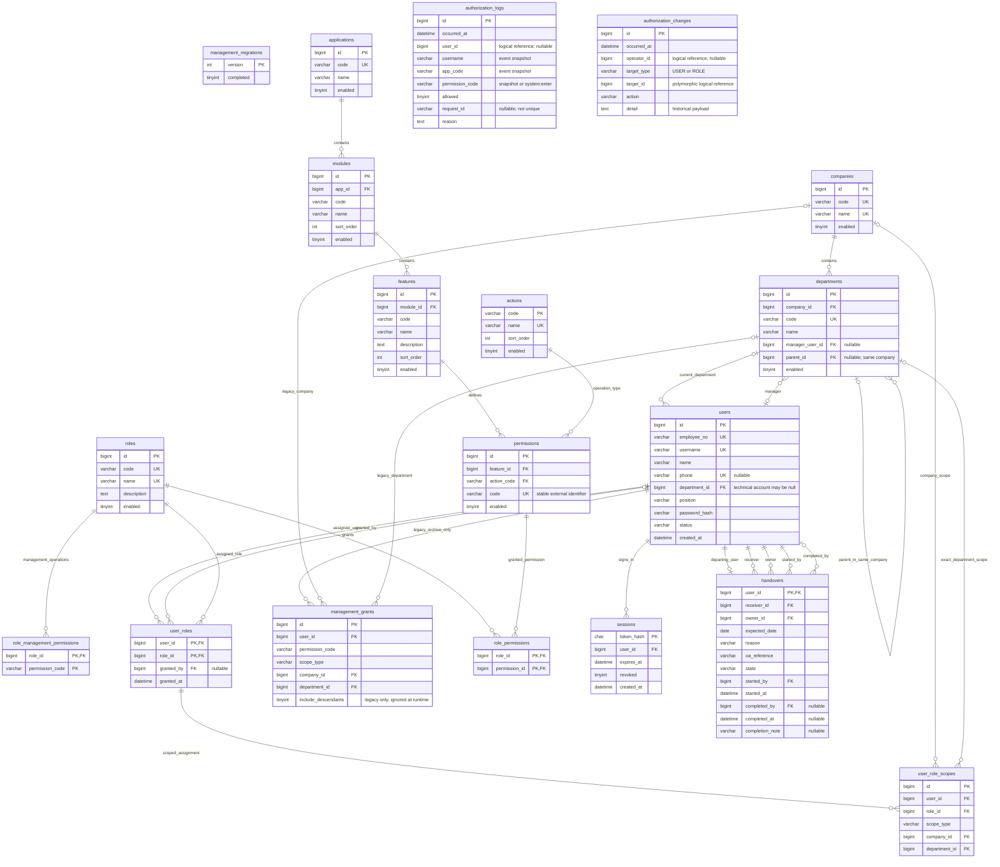
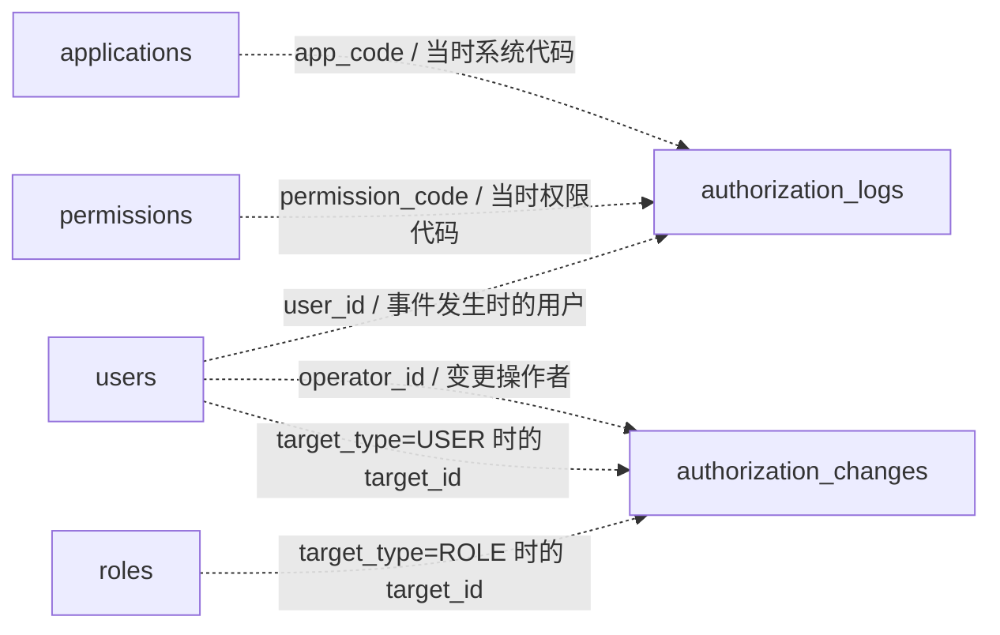

# 市政公司统一权限管理系统——数据库 ER 图

版本：4.0；核对日期：2026-10-25。展示 V4 结构，配套[正式数据库设计文档](../04-数据库设计文档.adoc)，共 19 张表（18 张现用表及 1 张旧授权存档表）。实体和字段已与 schema.sql、SchemaGuard 核对；约束细节与迁移说明见数据库设计文档。使用支持 Mermaid 的 Markdown 预览器可直接查看图形。

## 1. 完整实体关系图

图片版：[PNG 高清图片](07-数据库ER图.png) · [SVG 矢量图片](07-数据库ER图.svg)。图片展示主要物理关系，其余用户外键与审计逻辑引用在图下注明；下方 Mermaid 图保留逐条关系定义。

图中展示主键、外键及主要业务属性，完整类型和约束以数据库设计文档为准。PK 为主键，FK 为物理外键，UK 为单列唯一键；复合唯一约束见下方说明。实体框没有保存角色或权限的逗号分隔集合。

两张审计表在主图中不画物理外键线，避免误认为删除主体会级联删除日志。它们与当前主体的逻辑联系如下，不属于数据库强制外键：

system:enter 是系统准入审计动作，不要求存在同名 permissions 记录。拒绝请求可能引用不存在的权限代码，日志保留原始请求标识；因此不能把审计代码强制关联到当前权限目录。

## 2. 关系与约束说明

| 关系 | 基数及规则 |
|---|---|
| 公司—部门 | 公司可以有 0 至多个部门，每个部门必须属于一个公司 |
| 部门—上级部门 | 部门至多一个上级，外键保证上级同公司；防环为业务要求，当前 DDL 不保证无环 |
| 部门—用户 | 部门可有多名员工；业务员工一个当前部门，技术管理员可无部门 |
| 用户—部门负责人 | 部门至多一名负责人，初始化时在本部门按姓名匹配负责人；DDL 只检查用户存在，后续任职资格维护尚无接口 |
| 用户—角色 | 多对多，经 user_roles；授予人是独立的可空用户引用 |
| 角色—权限 | 多对多，经 role_permissions；不存在角色继承或用户直接授权 |
| 系统—模块—功能点—权限 | 每个下级必须且只属于一个上级，上级允许暂时无下级 |
| 动作类型—权限 | 一种动作可用于多个功能点；一个权限只对应一种动作 |
| 用户—会话 | 一名用户可有多个会话；会话不保存角色或权限快照 |
| 用户—离职交接 | 离职主体至多一条交接记录；接收人、负责人、发起人必填，完成人在完成前可空 |

已定义的复合唯一约束：

- departments(company_id,name)，以及用于复合父部门外键的 (company_id,id)。
- modules(app_id,code) 和 modules(app_id,name)。
- features(module_id,code) 和 features(module_id,name)。
- permissions(feature_id,action_code)。
- user_roles 主键 (user_id,role_id)，role_permissions 主键 (role_id,permission_id)。

负责人及交接人员资格、部门防环、离职后禁止重新授权等跨行业务规则不能仅靠本图表达，需与数据库设计中的事务及应用校验共同实现。

## 3. 原型与数据的对应

“我的应用”来自用户→用户角色→角色→角色权限→权限→功能点→模块→系统的有效关联，不另存用户系统表。“模块”与“功能点”分别读取 modules/features；操作按钮来自 permissions JOIN actions，allowed 按本人有效角色关系计算。只有系统存在至少一项有效权限才可返回其目录。

公司名称只存 companies，功能说明只存 features，动作名称只存 actions；响应需要这些名称时关联查询。管理员可读取鉴权日志，员工只能产生鉴权记录而不能读取；这一读取权限由 API 强制实施，不在表中保存“员工可见日志”的重复标志。

管理操作保存在 role_management_permissions；员工范围保存在 user_role_scopes，并通过 (user_id,role_id) 复合外键绑定 user_roles，撤销角色级联撤范围。必须使用同一角色的操作与范围，不能跨角色组合。GLOBAL 不带组织，COMPANY 仅带公司，DEPARTMENT 同时带公司和部门，不递归扩展。management_migrations 为兼容标记和管理写锁行；management_grants 仅存档，不参与鉴权。parent_id 保留兼容，但当前界面和范围计算不使用子部门。
