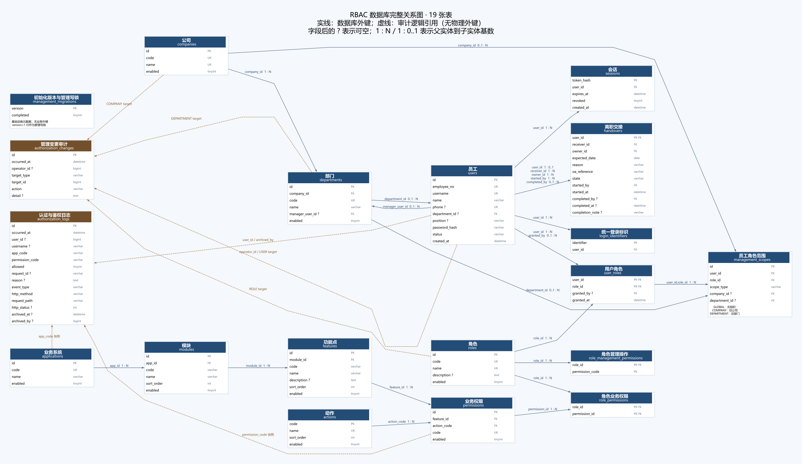
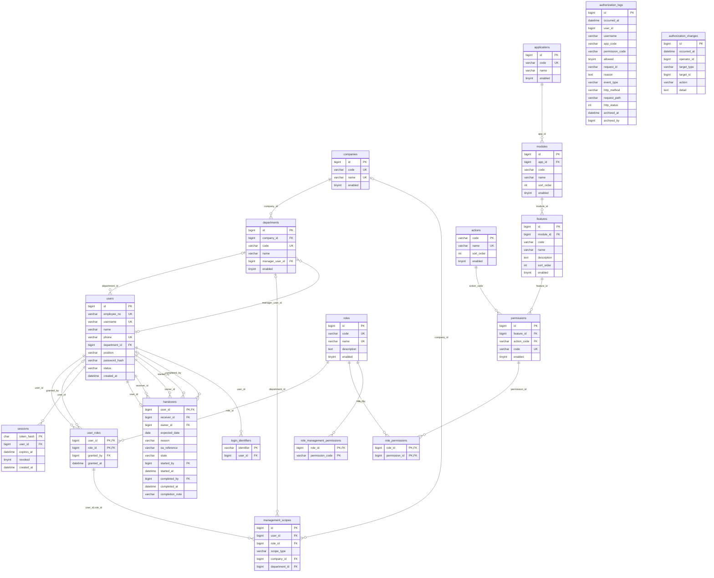

# 数据库实体关系设计

版本 6.0，2026-10-27。模型包含 18 张表，定义组织、人员、权限、会话、交接及审计关系。
配套[数据库设计](../04-数据库设计文档.adoc)。[PNG](07-数据库ER图.png)／[SVG](07-数据库ER图.svg) 与 [Graphviz 源图](07-数据库ER图.dot) 展示全部 23 项物理外键（同两表多外键合并标注）及审计逻辑引用；下方 Mermaid 逐项列出物理外键。

管理范围通过 (user_id,role_id) 复合外键绑定用户角色。GLOBAL 不存组织；COMPANY 只存公司；DEPARTMENT 只存部门，公司通过 departments 推导。没有部门父子关系。
login_identifiers 的 identifier 为跨用户名、工号和手机号的主键，触发器维护；它是唯一性投影，不能独立编辑。
两张审计表的用户、目标、应用及权限标识采用逻辑引用与事件快照，不设物理外键，以容纳未知主体和不存在的目录编码。归档只更新 archived_at/archived_by，仍可查询。
users.department_id、departments.manager_user_id、user_roles.granted_by、handovers.completed_by 可空；handovers.user_id 唯一，因此离职主体至多一条记录。完整 CHECK、候选键、长度及索引以 SQL 字典为准。

## 审计逻辑关系与外键

- authorization_logs：user_id、archived_by 逻辑引用用户，app_code 与 permission_code 保存发生时的系统／权限快照。拒绝请求可能引用不存在的编码，因此不建立物理外键，也不随主体删除而删除历史。
- authorization_changes：operator_id 逻辑引用用户；target_type + target_id 分别表示 USER、ROLE、COMPANY、DEPARTMENT 等变更目标。ARCHIVE_LOGS 的 AUDIT/0 表示一次批处理动作，不对应某条业务实体。
- users 与 handovers 之间一条实线合并标注了五个外键，含离职主体、接收人、负责人、发起人、完成人；users 与 user_roles 合并标注被授予人和授予人。合并连线不代表删除这些关系。

关系模型：18 个实体、23 个外键、18 组实体间实线；7 条审计逻辑虚线。部门负责人外键在 users 建表后建立，完整定义见数据库设计文档。主图按字段列出引用，并保留可编辑 DOT 源文件。
